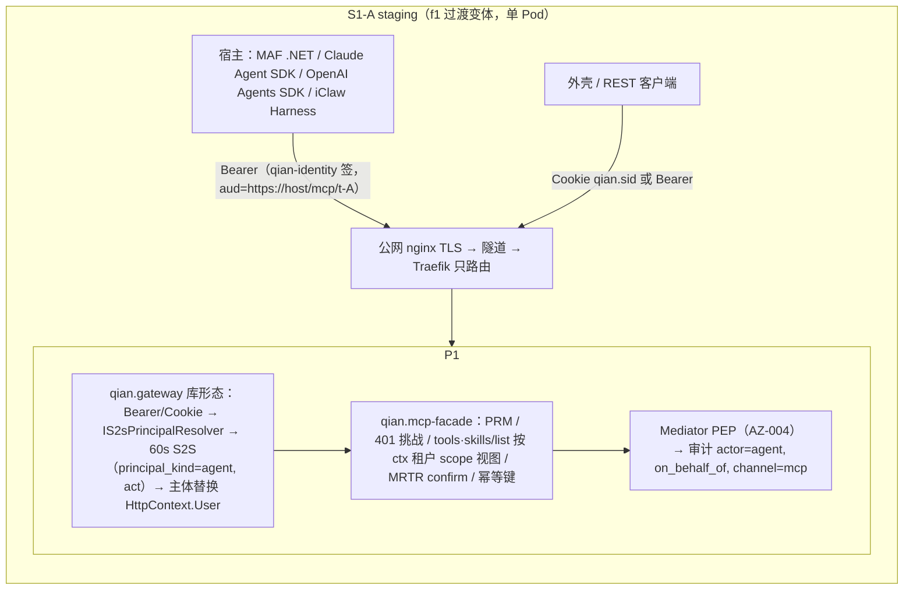
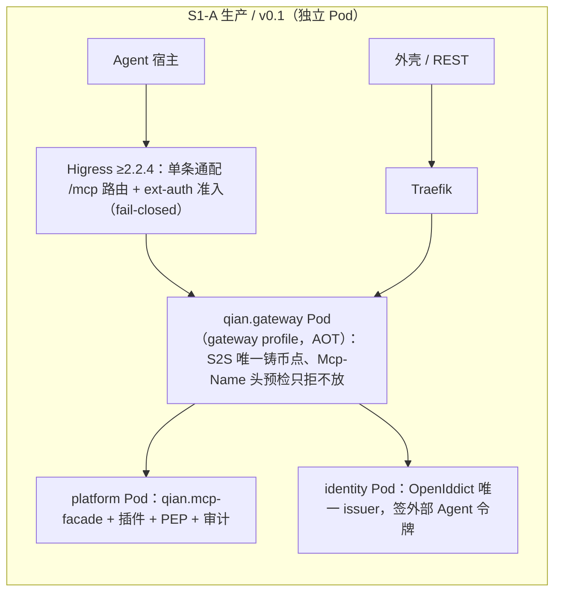

> For AI agents: the complete documentation index is available at /llms.txt, the full documentation bundle is available at /llms-full.txt.

# 框架细化决策备忘录：Agent 框架口径下的 Kun / Qian / 网关 / K3s / Serverless

> 本页由构建脚本镜像自仓库 [`docs/decisions/framework-refinement-2026-10.md`](https://github.com/idadawn/qian/blob/main/docs/decisions/framework-refinement-2026-10.md)，请修改源文件，不要改本页。

| 项      | 值                                                                                                                                                                   |
| ------ | ------------------------------------------------------------------------------------------------------------------------------------------------------------------- |
| 状态     | 草案，待产品负责人拍板                                                                                                                                                         |
| 日期     | 2026-10-20（外部产品能力核实日期 2026-10-21）                                                                                                                                   |
| 对应裁决任务 | S1-DEC-0xx（拍板后新建；编号前先 `git fetch` 并 grep `origin/main` 与全部远端分支，当前最高为 S1-DEC-026）                                                                                    |
| 输入     | 三份方案（极简合并 / 连续演进 / Agent 先行）、九份对抗评审（成本 / 安全 / Agent 时代三视角 × 三）、四份摸底（Kun-Qian / 网关 / K3s-Serverless / Agent 定位）、事实快照；2026-10-21 第二轮：iClaw 既有实现去向（3 摸底 / 3 方案 / 9 评审） |
| 本文不做的事 | 不改任何 ADR / PRD / 看板；所有「要改」的条目都列为待拍板项                                                                                                                                |

> **入库说明（2026-11-15）** 本文写于 2026-10-20 至 10-22，此后一直是工作区里的未提交文件。2026-11-15 按产品负责人的指示删节后入库，仍是待拍板的草案，Q1–Q30 的拍板由 [S1-DEC-035](https://github.com/idadawn/qian/blob/main/pm/tasks/S1-DEC-035.md) 跟踪。读正文前先看下面三点。
>
> **本文有删节。** 本仓库是公开仓库，入库时删去了两类内容：现网基础设施的运维细节；iClaw 私有仓库与部署仓库的内部细节。删节处标「〔已删节〕」，带这个标注的句子或表格单元格是删节后的改写，不是原文。另有少数地方只把名称、版本号、日期、数量、条目序号或文件位置换成概括说法或拿掉，或删掉一个分句，没有逐处标注。原文 625 行，入库时改动了其中 94 行，其余行逐字未改。待拍板项 Q12 的内容整条删节，拍板时要对照完整原文。完整原文不在本仓库，由产品负责人另行保存。
>
> **文中的候选任务号已被别的任务占用。** §8 步 2 与 §12.4、§12.5 给拟新建的任务预取了编号，并注明是候选号、占号前要查重。到入库时，这些编号在看板上都已经是别的任务。正文里出现这些编号的地方（包括不带 `S1-` 的短写），指的仍是下表左边那件拟新建的事，不是看板上的同号任务。这些候选任务都还没有建档，拍板后建档时重新取号。
>
> | 文中的候选号                | 文中所指（拟新建）                                   | 看板上的同号任务（另一件事）                         |
> | --------------------- | ------------------------------------------- | -------------------------------------- |
> | S1-AGT-004            | 门面 PoC                                      | 租户字段 lint 补漏                           |
> | S1-AGT-005            | 门面实现                                        | contracts/v0 冻结                        |
> | S1-IDP-012            | agent 客户端与 token exchange，Q22 采纳时并入 CLI 取令牌 | 拆分部署下授权变更到身份修订递增                       |
> | S1-RT-036             | Operation 最小实现与主体替换                         | 代码包原生真实性校验                             |
> | S1-QA-014             | 宿主一致性                                       | 测试宿主回环端口竞争                             |
> | S1-DEP-009            | 容量 C                                        | 生产平台表面宿主                               |
> | S1-DEP-010            | 一项集群运维任务〔已删节〕                               | 身份生产宿主                                 |
> | S1-KUN-015、S1-KUN-016 | Kun 发版 A、发版 B 之后 Qian 跟升                    | Kun 包缺 AOT 元数据、Kun Gateway JWKS 端点静态路由 |
> | S1-IDP-013、S1-TEN-012 | iClaw 身份导入与租户主数据迁移（文中的建议是本轮不立项）             | RFC 8707 resource、租户运营页面复核收尾           |
>
> 文首表格「对应裁决任务」一行写的「当前最高为 S1-DEC-026」，以及 §12.5 里「S1-DEC-027、S1-IDP-013、S1-TEN-012 均未占用」的说法，是 2026-10-21 的核实结果，也已经过期：S1-DEC-027 现在是另一项已完成的决策。
>
> **写作之后发生的事，正文没有跟进。**
>
> - 2026-11-11 产品负责人定了「初步可用」里程碑的顺序：多租户、管理后台、模型服务（[S1-DEC-033](https://github.com/idadawn/qian/blob/main/pm/tasks/S1-DEC-033.md) D1）。S1-DEC-033 D7 的推荐口径是这个里程碑先行、本文的待拍板项另行处理，D7 本身仍待确认。本文 §7、§8 的排期按「Agent 框架 v0」写，没有反映这个里程碑。
> - staging 首次部署的形状已定为平台与身份同进程、网关独立（R143，[ADR-017](/design/adr/adr-017-deployment.md) §10）。本文 §4 提的 f1 过渡变体是网关以库形态嵌进 platform 单 Pod，两者不同。
> - 2026-11-17 产品负责人裁定 Qian 并入 Kun（[ADR-023](/design/adr/adr-023-kun-qian-merge-blueprint.md)，Accepted）。本文 §3.3 (d) 对合仓的否决与 §9 Q4 的 Kun 路线（不合仓）由它取代；Q4 里的发版 B 与 e1 两项不在 ADR-023 的范围内，连同其余待拍板项仍由 S1-DEC-035 跟踪。
> - §7.2 与 §8 里的任务状态是 2026-10-20 的看板。§8 步 6 列的 S1-IDP-003、S1-IDP-004、S1-IDP-005、S1-AZ-004、S1-CFG-003、S1-EVT-002、S1-GW-001 此后都已完成。现状以 `pm/tasks/` 为准。

***

## 1 一页结论

**Q-A 网关采用什么？**
维持 ADR-010 三层：Traefik（入口，不鉴权）→ `qian.gateway`（Kun.Gateway/YARP 宿主，S2S 唯一铸币点）→ Higress（只管模型与 MCP，对租户无感）。S1 staging 允许 `qian.gateway` 以库形态嵌入 platform 宿主单 Pod（f1 过渡变体，附硬条件），生产按 `profiles/gateway/qian.profile.yml` 拆独立 Pod。不采用「取消网关、单进程」，不采用 Higress / Traefik ForwardAuth 承担北向鉴权，不引入第四套网关栈。
依据：Kun 2026.10.14 已完成 ADR-010 D10.3 的全部加固并过 Native AOT 门禁（`/Users/dawn/project/kun/src/Kun.Gateway/GATEWAY.md` 第 5–19 行，`pm/tasks/S1-KUN-003.md`、`S1-KUN-004.md` done），GW-001 剩余工作只剩 Qian 会话 resolver、audience 映射与密钥接线；单进程方案被 ADR-003 §4 明文放弃，且安全评审指出它会把 IdP 私钥、S2S 签发与业务代码同驻并压扁 MCP 的受众绑定。

**Q-B K3s 基础组件是否完善、缺什么？**
L0 底座完善（Traefik、MetalLB、Harbor、Argo CD、Authentik、Infisical、LGTM、Higress、CubeSandbox、local-path），Qian 基线治理已验收（S1-DEP-001 done）。不完善的是 L1「有、但不是 PRD 要的那种」：RabbitMQ 单副本〔已删节〕、Apollo / MySQL 共享且三者都不在 GitOps 与 BOM；缺 Alertmanager；真正的硬约束是容量，不是组件（2026-10-20 采样：qd CPU 请求 99%、worker01 内存 99%、qian-prod01 仅 1.8 核可分配，连基线 ResourceQuota 都放不下）。2026-10-22 更新：pve01 扩到 156 GiB 后已按 §5.2 方案 B 执行，worker01 32 GiB / 6 vCPU、worker02 32 GiB、qian-prod01 16 GiB，worker01 CPU 请求降到 60%，staging D 档已放得下；qd CPU 请求 98%、单一宿主故障域、机械阵列 I/O 三条不变。另有一项集群级运维事项〔已删节〕。
依据：事实快照 §5；`deploy/baseline/README.md`「staging 调度容量复核」；`pm/tasks/S1-DEP-007.md` 2026-10-14 采样（qd idle 约 70%，请求虚高）；〔已删节〕。

**Q-C Kun 和 Qian 是否都需要？**
都需要，但 Kun 的「需要」改一个含义：Kun 不是「面向任何 .NET 微服务的通用框架」，而是 Qian 与 iClaw 共用的产品族内核包族；Qian 是唯一面向第三方的 API 面与 Agent 框架本体。推荐路径：第一步瘦身归档（Saga / Sandbox / Dapper / Testing(.EFC) / 旧线 Storage，约 4.5k 行）并修订定位文案；第二步在 S1 收口后做 e1（`Qian.*.Abstractions` 不再暴露 Kun 类型，Kun 退为传递依赖，Kun.Authorization 端口按 ADR-019 §7 例外再导出）。不合仓、不把 Kun 模块搬进 Qian、不「冻结 + 吸收即归档」。
依据：Qian `packages/` 15 个 csproj 引用 13 个 Kun 包，`ITenantContext` 207 处、`AsyncLocalTenantContext` 144、`IPermissionChecker` 32、`IRequestHandler<` 29、`IOutboxWriter` 21（摸底 kun-qian 事实 1–2）；iClaw 以 ProjectReference 共用 Core / Security / EFCore / EventBus / Caching / Identity / Storage / Audit；「冻结 + 吸收即归档」在 Agent v0 的第一个 Kun 改动（Kun.Security / Kun.Gateway 的 agent 主体与 act 链）上就与「禁止两份并存」自相矛盾（Agent 时代评审对极简方案的第二条致命反对）。

**Q-D Serverless 与「Agent 框架」定位怎么落？**
「Agent 框架」= Qian 平台层 + 可替换宿主，不是新组件，也不往 Kun 加任何 AI / MCP 语义。用户的「Qian 提供租户、用户等基础服务」成立且不变：租户（TEN 9/11 done）、身份、鉴权、能力目录、审计、配置、事件就是 Agent 框架 v0 的主干（§7.1 基础服务最小集），Agent 只是这些服务的又一种调用主体（principal_kind=agent）与又一个入口（每租户 MCP 门面）。下一个对外里程碑改为「Agent 框架 v0」：S1 退出标准主干 + 每租户 MCP 门面（MCP 2026-07-28，C# SDK v2.2.0，落在 platform profile / JIT）+ Agent 主体与 act 链 + Operation 最小实现 + RFC 9728 受保护资源元数据；iClaw 从 S4 前置降为四个参考宿主之一；原 S1 中约 100 人日平台补全任务后移为「S1-B」，S2 低代码其后。「Serverless」在本项目拆成三件已有事物：(i) 队列 worker 按事件伸缩 = KEDA 核心（S2、容量 C 之后）；(ii) 函数即插件 = 进程内 Wasm `runtime.form: function`（维持 ADR-002 D2.11，S2 可选）；(iii) Agent 工具按需沙箱 = CubeSandbox 经 E2B 兼容 API（S4 对接）。S1 / S2 不装 Knative / OpenFaaS / Fission / KEDA HTTP add-on。
依据：能力目录与五种 Agent 表面在 S1 已是一等公民（`packages/Qian.Runtime/SurfaceKeys.cs`、`packages/Qian.Surfaces/SchemaLibrary.cs`、`packages/Qian.Capabilities`），ADR-018 §4「Agent 无物可发现」的前提已不成立；Qian 文档全文无 Serverless / KEDA / Knative（事实快照 §6）；KEDA v2.21.0（2026-09-23，[https://github.com/kedacore/keda/releases；测试矩阵](https://github.com/kedacore/keda/releases；测试矩阵) K8s 1.34–1.36（现网版本在内〔已删节〕）、operator / metrics-server / webhooks 三组件各请求 100m / 100Mi、合计 300m / 300Mi，[https://keda.sh/docs/2.21/operate/cluster/）。](https://keda.sh/docs/2.21/operate/cluster/）。)

***

## 2 定位：Agent 框架口径下的五层

| 层                      | 拥有什么                                                                                                                                                                                                                                                                                                                                                                                                            | 不做什么                                                                                                                                                                                                                                           | 对外口径                                                                              |
| ---------------------- | --------------------------------------------------------------------------------------------------------------------------------------------------------------------------------------------------------------------------------------------------------------------------------------------------------------------------------------------------------------------------------------------------------------- | ---------------------------------------------------------------------------------------------------------------------------------------------------------------------------------------------------------------------------------------------- | --------------------------------------------------------------------------------- |
| 运行环境（K3s + 网关）         | Traefik 入口；`qian.gateway` 业务 API 边界（S2S 换签、per-cluster audience、R32 未挂载 404、identity_revision 转发）；Higress 模型与 MCP 数据面；L0 全部复用；Qian 专属 PG 16 / Redis 7                                                                                                                                                                                                                                                           | 不引入 Knative / OpenFaaS / Fission / KEDA HTTP add-on / Envoy Gateway / Kong / APISIX / Dapr / Istio；Higress 不感知租户、不签发 S2S；Traefik 不做 ForwardAuth 鉴权                                                                                             | 「沿用 iclaw-deploy 的 L0/L1/L2」                                                      |
| Kun（框架层）               | 无产品观点的 .NET 原语：租户上下文、Result/Error、Mediator + 行为链、EventBus/Outbox/RabbitMQ、EF Core + RLS、Caching、Apollo Provider、Security（S2S 校验、principal_kind）、Gateway（YARP 宿主、S2sTokenIssuer、JWKS 双钥重叠）、Authorization 端口、Validation、AspNetCore、Identity(.AspNetCore)、Storage.Abstractions + 新线、Observability、Grpc（S3）、Audit\*（iClaw 在用，去留随 AUD 裁决）                                                                            | 零 AI / MCP 语义，也不加（`/Users/dawn/project/kun/src` 35 个模块 grep `mcp` / `ModelContext` / `IChatClient` 零命中）；归档 Saga / Sandbox / Dapper / Testing(.EFC) / 旧线 Storage；RateLimit 并入 Gateway；唯一要扩的功能：S2S 签发端放开 `principal_kind=agent` 与结构化 `act` claim | 「Qian / iClaw 产品族内核包族，当前下游 = Qian + iClaw」（修订 ADR-001 D1.1 / ADR-021 D21.1 框架层一格） |
| Qian（平台层 = Agent 框架本体） | tenancy / identity（OpenIddict 唯一 issuer、Person / Membership、client_credentials、新增 agent 客户端类型 + 自定义 token-exchange + act + RFC 8707 resource + RFC 9728 PRM）/ authz（PEP、Explain）/ capabilities（目录 + Agent 字段 + Operation 契约）/ surfaces（六个目录键）/ registry 租户 scope patch / audit（actor_type=agent、on_behalf_of、channel=mcp）/ events / config / gateway 宿主 / 新增 `qian.mcp-facade` / Operation-Task 最小实现 / CLI / 市场 | 不写 LLM 推理循环、记忆、沙箱、技能引擎（ADR-016 D16.2 前半句保留）；不合并 Kun；S1 不做 qian.realtime 自建 WebSocket 背板                                                                                                                                                        | 「为 Agent 时代构建的多租户平台层 / Agent 框架，基于 Kun 构建，前端 yue」                                 |
| yue（前端层）               | 令牌层、基础组件、视觉门禁（已 done 7/11）；MF2 外壳与插槽；S1-B 起 Agent 工作台与审批 UI（policyHint=confirm 的人机确认视图、MCP Apps 视图）                                                                                                                                                                                                                                                                                                             | v0 不含外壳与 Agent 专属组件；v0 的人机确认经 MCP MRTR 在门面侧完成，宿主 UI 承担交互                                                                                                                                                                                       | 不改 ADR-013 分发口径                                                                   |
| iClaw（参考宿主之一，不是层也不是前置） | Agent loop、四层记忆、Skills 引擎、ToolPolicy / RiskGate、CubeSandbox 对接；作为第四个一致性测试宿主，前提是其 Harness 补 Streamable HTTP 客户端（其 MCP 客户端仍钉 2025-03-26，只有 stdio〔已删节〕）                                                                                                                                                                                                                                                            | 不再是 S4 前置；不共用网关 Pod、不共用签发器（各签各的、claim 同形，`contracts/v0/iclaw-alignment.md` §2）；Edge 的 YARP 部分与 `qian.gateway` 去重位置在框架层（Kun.Gateway 共享代码），时点由 iClaw 定                                                                                           | 「两产品共用 Kun 基座与 Higress 数据面，租户主数据权威归 Qian」                                         |

### 2.1 ADR-016 / ADR-018 条目处置

| 条目                                                     | 处置   | 新表述要点                                                                                                                                                                                                                      |
| ------------------------------------------------------ | ---- | -------------------------------------------------------------------------------------------------------------------------------------------------------------------------------------------------------------------------- |
| ADR-016 D16.2 前半句「Qian 不写 Agent loop / 沙箱 / 记忆 / 技能引擎」 | 保持   | 补一句「MCP 服务端门面、Operation/Task、Agent 主体与委托链属于平台接口，不是 Agent loop」                                                                                                                                                             |
| ADR-016 D16.2 后半句「S4 经 MCP 对接 iClaw」                   | 修订   | 「经 MCP 2026-07-28 对接任意宿主；iClaw Harness 为参考宿主之一而非前置」                                                                                                                                                                        |
| ADR-016 D16.3(c)「运行时权威仍是 iClaw ToolPolicy / RiskGate」  | 修订   | 「Qian 元数据（sideEffect / policyHint / requiredScopes）给默认值并经 MRTR 强制 confirm，审计以门面记录为准；宿主策略只能更严，不计入 Qian 授权判定」                                                                                                                |
| ADR-016 D16.4「Tasks / Apps / Skills 官方扩展」              | 保持   | 官方扩展目录确有 `io.modelcontextprotocol/skills`（SEP-2640 Final，[https://modelcontextprotocol.io/extensions/skills/overview）；两份方案要求删除此句是错的，见](https://modelcontextprotocol.io/extensions/skills/overview）；两份方案要求删除此句是错的，见) §11 #8 |
| ADR-016 D16.9「不直连裸 URL、一律经 Higress MCP 路由」             | 修订   | 「staging / 开发可经 Traefik → qian.gateway 直达门面；生产一律经 Higress（v0.1）」                                                                                                                                                           |
| ADR-016 D16.10「门面托管在 Higress」                          | 修订   | 「门面逻辑在 `qian.mcp-facade`（platform profile，JIT）；Higress 只做路由与 ext-auth 准入」                                                                                                                                                  |
| ADR-016 D16.12「以 iClaw 冻结契约为准」                         | 修订   | 「以 MCP 2026-07-28 / A2A 1.0（v1.0.0 2026-03-12、v1.0.1 2026-05-26，[https://github.com/a2aproject/A2A/releases）/](https://github.com/a2aproject/A2A/releases）/) agentskills.io 公开标准为准，iClaw 契约只做对齐检查」                         |
| ADR-016 §5                                             | 补注   | 「两产品各自宿主 Kun.Gateway，不共用网关 Pod；NeuroAgent.Edge 并非建于 Kun.Gateway」                                                                                                                                                           |
| ADR-018 D18.1 四段顺序                                     | 修订   | 「S1-A Agent 框架 v0 → S1-B 平台补全 → S2 低代码 → S3 市场 → S4 Agent 高阶」                                                                                                                                                              |
| ADR-018 D18.2 退出标准                                     | 修订   | 见 §8.3                                                                                                                                                                                                                     |
| ADR-018 D18.5「每租户 MCP 门面、Agent 主体与委托链」                 | 前移   | 从 S4 移到 S1-A；S4 保留 extensions、Agent 生成组件、A2A Agent Card、CubeSandbox 对接                                                                                                                                                     |
| ADR-018 D18.7「企业微信 / 短信 OTP S1 必做」                     | 修订   | 改 S1-B（需显式裁决，见 Q6）                                                                                                                                                                                                         |
| ADR-018 §4「先做 Agent 再做低代码：放弃」                          | 修订理由 | 「v2 组件模型下能力目录与五种表面已在 S1，Agent 有物可发现；只有『生成 package』仍依赖 S2 元数据注册表」                                                                                                                                                           |

***

## 3 Kun 与 Qian

### 3.1 实测依赖（事实快照 §4 + 摸底 kun-qian）

| 指标                         | 数值                                                                                                                                                                                                                                                                                                                       | 来源                                                                                    |
| -------------------------- | ------------------------------------------------------------------------------------------------------------------------------------------------------------------------------------------------------------------------------------------------------------------------------------------------------------------------ | ------------------------------------------------------------------------------------- |
| Qian `packages/` 规模        | 291 个 .cs、28,701 行；83 个文件 `using Kun.*`                                                                                                                                                                                                                                                                                  | 摸底 kun-qian 事实 1                                                                      |
| Qian 引用的 Kun 包             | 15 个 csproj → 13 个包（Core、Mediator、Validation、EventBus(+Abstractions)、Security、MultiTenancy(+EFC)、EntityFrameworkCore、Configuration.Apollo、Caching、Authorization、AspNetCore）                                                                                                                                              | `Directory.Packages.props` 第 14 行 KunVersion=2026.10.14                               |
| 预钉但 `packages/` 无引用        | Kun.Gateway、Kun.Identity、Kun.Infrastructure、Kun.Storage(.Abstractions)；其中 Gateway / Identity 被 `tests/Qian.Identity.Server.Tests/ProtocolTests.cs`、`tests/Qian.Sample.Crm.Tests/IdentityServerInteropTests.cs`、`tests/Shared/IdentityProtocolHost.cs` 与 `tests/gates/bannedapi` 引用                                       | 成本评审（极简）                                                                              |
| 高频符号                       | `ITenantContext` 207、`AsyncLocalTenantContext` 144、`Error.Code` 130、`ICurrentUser` 82、`IPermissionChecker` 32、`IRequestHandler<` 29、`IOutboxWriter` 21、`ICapabilityRegistry` 1                                                                                                                                           | 摸底 kun-qian 事实 2                                                                      |
| Kun 类型泄漏进 Qian 公共 API      | `PublicAPI.*.txt` 中 Kun 类型 76 处；`*.Abstractions` 泄漏 12 类（IEventTypeRegistrar 10、AuthorizationSubject 5、KunMediatorBuilder 4、PermissionDecision 4、ITenantContext 3 …）                                                                                                                                                     | 摸底 kun-qian 事实 4                                                                      |
| `Qian.Runtime` 对 Kun 的真实耦合 | csproj 第 7–8 行引用 Kun.Core + Kun.Mediator；源码只有 `KunErrorBridge.cs` 两处 `using Kun.Core.*`，Kun.Mediator 零使用                                                                                                                                                                                                                 | `packages/Qian.Runtime/Qian.Runtime.csproj`、`packages/Qian.Runtime/KunErrorBridge.cs` |
| Kun 规模                     | 35 个模块约 25k 行；A 组（Qian 在用）≈ 9.0k；B 组（已规划未引用）≈ 6.8k；C 组（Qian 与 iClaw 均不用）≈ 3.4k（Saga 1,585 / Sandbox 1,248 / Dapper 229 / Testing 364）；旧线 Storage 1,145 行已标 KUNLEGACY001                                                                                                                                                  | 摸底 kun-qian 事实 5–7；`ls /Users/dawn/project/kun/src/Kun.*`                             |
| iClaw 消费方式                 | 7 个 csproj 以 ProjectReference 引 Kun（ProjectReference 行约 20 条）：Core / Security / AspNetCore / EFCore / Identity(.AspNetCore) / EventBus(.RabbitMQ) / Caching / Audit(.EFC) / Gateway / Storage.Abstractions+Local+S3+Oss；其 12 处 `using Kun.Storage;` 是新线 `Kun.Storage.Abstractions` 的命名空间，不依赖旧线                           | 成本评审（Agent 先行）核实〔已删节〕                                                                 |
| Kun 发版节奏                   | 10 月 9 个 tag（10.8、10.9、10.11、10.12、10.12-2、10.12-hotfix.2、10.12-hotfix.3、10.13、10.14）全由 S1-KUN-001～014 驱动；nuget.org Kun.Core 总下载 5.0K（最新 2026.10.14，[https://www.nuget.org/packages/Kun.Core），无外部消费者证据](https://www.nuget.org/packages/Kun.Core），无外部消费者证据)                                                               | 摸底 kun-qian 事实 10–11；`git -C /Users/dawn/project/kun tag` 复核                          |
| Agent 相关现状                 | Kun.Security 读 `principal_kind`（user/service/agent）；`S2sTokenIssuer.cs:136–137` 显式拒绝非 user/service 与任何 `act` claim，`:201–202` 闭合 claim 集不含 `act`，`:50–55` 拒绝非 canonical 转发 claim；Qian `packages/Qian.Identity.Abstractions/Principal.cs:14–15` 把 Agent 标「S4 启用」；`packages/Qian.Audit/README.md:55`「S1 不签发的 act 委托入口明确拒绝」 | Agent 时代评审（Agent 先行）、安全评审（Agent 先行）                                                   |

### 3.2 推荐结构

| 步骤                           | 内容                                                                                                                                                                                                                                                                                                                                                                                                                      | 时点                      | Kun 带宽                    |
| ---------------------------- | ----------------------------------------------------------------------------------------------------------------------------------------------------------------------------------------------------------------------------------------------------------------------------------------------------------------------------------------------------------------------------------------------------------------------- | ----------------------- | ------------------------- |
| 第一步：定位修订 + 瘦身归档（摸底选项 b）      | 归档 Saga / Sandbox / Dapper / Testing(.EFC) / 旧线 Storage（冻结留 tag 与已发 nuget 版本、移出 CI/AOT 矩阵与文档镜像白名单，不删源码）；RateLimit 并入 Gateway；README 第 23–26 行「向 NeuroAgent 提供 Phase 1 能力集 / 面向任何 .NET 微服务」改为「产品族内核包族」；`ci.yml:95–110` 与 `release.yml` 的 AOT 矩阵同步                                                                                                                                                                        | Kun 发版 A（S1-A 内，低风险，先发） | ≈ 2.5 人日 + 一次约 25 分钟串行 CI |
| 第二步：Agent 主体签发（Agent v0 硬前置） | `S2sTokenIssuer` 放开 `principal_kind=agent`、`act` 结构化 claim（嵌套对象、白名单、深度上限）、`CanonicalClaimTypes` 加 `act`；`GATEWAY.md` 闭合 claim 集同步；YARP 2.2.0 → 2.3.0（2026-02-27，仓库迁至 dotnet 组织，发布说明只声明 net8.0 目标恢复 NativeAOT 发布，[https://github.com/dotnet/yarp/releases）仅在](https://github.com/dotnet/yarp/releases）仅在) Qian 侧 gateway profile 的 net10 `PublishAot` spike 通过后并入；PartitionedRateLimiter 的 Redis 集成（支撑 GW-002）可同版或推 S1-B | Kun 发版 B（S1-A wave 1 末） | ≈ 4–5 人日 + 一次 CI          |
| 第三步：e1 收口第三方 API 面           | `Qian.Runtime` 删 Kun.Mediator 引用、`KunErrorBridge.cs` 处置；`Qian.*.Abstractions` 的 24 处 Kun 类型改为 Qian 别名或适配器，Kun 退为 Provider 包传递依赖；唯一例外按 ADR-019 §7 维持 Qian.Authz.Abstractions 再导出 Kun.Authorization 端口                                                                                                                                                                                                                    | S1-A 收口后 / S2 初         | 0（Qian 侧 5–8 人日）          |

Qian.Runtime 去 Kun.Mediator（0.5 人日）零争议，可独立成一条 RT 任务立即做；`KunErrorBridge.cs` 是公开 API（`PublicAPI.Unshipped.txt` 第 162–164 行），搬到 Qian.Plugin.Sdk 与否另议。

e1 的安全约束（安全评审对连续方案第四条）：`/Users/dawn/project/kun/src/Kun.EntityFrameworkCore/Interceptors/TenantRlsTransactionInterceptor.cs` 第 29–32、60–63 行在 `ITenantContext.TenantId` 为空时静默 no-op、不设 `app.current_tenant_id` GUC，而 `packages/Qian.Audit/AuditPlatformAccess.cs:15` 把 GUC 为 NULL 解释为平台模式。适配器必须保证 Kun 上下文与 Qian 上下文是同一个单例（零拷贝），并把拦截器的 no-op 改为「principal 有租户但上下文为空 ⇒ 抛错」（Kun 上游改动，随发版 B），TCK 加反例。

### 3.3 被否决的 Kun 选项

| 选项                                            | 否决原因                                                                                                                                                                                                                                                                           |
| --------------------------------------------- | ------------------------------------------------------------------------------------------------------------------------------------------------------------------------------------------------------------------------------------------------------------------------------ |
| (c) 把 Qian 需要的 Kun 模块并入 Qian.\*、Kun 只服务 iClaw | 搬迁约 14k 行源码 + 13–15k 行测试 + 83 个 packages 文件与 104 个 tests/samples 文件改命名空间，3–4 周 S1 停摆；S2S / Outbox / 租户上下文从此两份实现，ADR-016 D16.3 同形承诺只能靠人工对齐；收益到 S3 才兑现                                                                                                                           |
| (d) Kun 与 Qian 合并为单一包族 / 单仓                   | ADR-001 §4 与 ADR-021 D21.2 两次否决，理由未变：iClaw 以 ProjectReference 指向 `../kun/src`；CalVer/MIT 与 SemVer/Apache-2.0 二选一会破坏 iClaw 还原。（2026-11-17 补注：产品负责人已裁定 Qian 并入 Kun，本条否决由 ADR-023 取代）                                                                                             |
| 「冻结 + 吸收即归档」（极简方案）                            | Agent v0 第一个 Kun 改动就落在 Kun.Security / Kun.Gateway——恰是 iClaw 以 ProjectReference 在用的模块；按规则整模块迁入 Qian 并归档，iClaw 仍从冻结树编译，即修订后 D1.2 要禁止的「两份并存」；同时删除 `Directory.Packages.props` 第 40–45 行会误删在用的 Kun.Caching（第 45 行）并打断 Kun.Identity 作 RP 的联调夹具                                       |
| (e2) Wolverine 替换 Mediator / EventBus / Saga  | Qian.Authz.Abstractions 的权限行为（S1-KUN-014）、Validation 行为与 PublicAPI 全部重做；iClaw 仍在 Kun.EventBus 上，事件信封同形变两套；只在 EVT-002/003 被可靠性缺口阻塞时以时间盒 spike 评估（Wolverine 6.51.1，2026-10-19，[https://github.com/JasperFx/wolverine/releases）](https://github.com/JasperFx/wolverine/releases）) |

### 3.4 对 iClaw 的影响

| 项                       | 影响                                                                                                                                                                        |
| ----------------------- | ------------------------------------------------------------------------------------------------------------------------------------------------------------------------- |
| Kun 归档 C 组 + 旧线 Storage | 零影响（iClaw 无任何 csproj 引用旧线 `src/Kun.Storage/Kun.Storage.csproj`）                                                                                                           |
| Kun 放开 agent / act 签发   | 按 allow-list 扩展实现，iClaw 的 user/service 路径不变；iClaw Edge 用的是已废弃的 `Kun.Security.S2SJwt`（ES256 自签），不经 `S2sTokenIssuer`                                                        |
| 两产品 S2S                 | 各签各的、不互信、只同形（iss 不同、RS256 vs ES256、Qian 不签 email、允许 tenant_id=null）；`contracts/v0/s2s-claims.schema.json` 需补 agent ⇒ tenant_id 非 null、act 必填、act 链每层同租户、scope ⊆ 委托人 scope |
| 事件信封                    | subject 白名单与 tenant_id=null 两处不兼容在 S1-A hooks 桥接（RT-032）时裁决；`schemaSha256` 算法改为 Qian 单方定义、iClaw 对齐检查可选                                                                    |
| 网关去重                    | 不合并 NeuroAgent.Edge（12 万行单体，YARP 直引〔已删节〕）；Qian.Gateway 宿主可作为替换其休眠 NeuroAgent.Gateway（74 行、无 Dockerfile）的现成载体，时点由 iClaw 定                                                  |

### 3.5 包族与版本线（维持 ADR-021 D21.3 / ADR-019 D19.7）

| 包族              | 许可证        | 版本线                                                          | 发布地             | 变化                                                                                                                                                                                 |
| --------------- | ---------- | ------------------------------------------------------------ | --------------- | ---------------------------------------------------------------------------------------------------------------------------------------------------------------------------------- |
| Kun.\*          | MIT        | CalVer `2026.MM.DD(-hotfix.N)`，Qian 以 `[$(KunVersion)]` 精确钉版 | nuget.org       | 瘦身后 28 个包（现 35 个模块全部 IsPackable，归档 Saga / Sandbox / Dapper / Testing / Testing.EFC / 旧线 Storage 6 个、RateLimit 并入 Gateway 1 个）；S1-A 内两次发版（A 归档、B agent/act + YARP）；文档站镜像白名单同步去掉归档模块 |
| Qian.\*         | Apache-2.0 | SemVer 锁步                                                    | GitHub Packages | 新增 Qian.Mcp.Abstractions / Qian.Mcp（依赖 ModelContextProtocol.AspNetCore 2.2.0，只进 platform profile）；Operation 契约进 Qian.Capabilities.Abstractions                                     |
| @idadawn/yue-\* | —          | Changesets                                                   | npm             | 不变                                                                                                                                                                                 |

***

## 4 网关

### 4.1 推荐方案与数据流

要点：

- S2S 唯一铸币点仍是 `qian.gateway` 的 `S2sTokenIssuer`（ADR-010 D10.4 不变）；`qian.identity`（OpenIddict）签发**外部** Agent 令牌（client_credentials 或 token-exchange 后的委托令牌），不签 S2S。
- Higress 在 v0.1 只做单条通配路由 + ext-auth 准入（`failure_mode_allow` 默认 false、`status_on_error` 默认 403、timeout 默认 1000ms，[https://higress.cn/en/docs/latest/plugins/authentication/ext-auth/），不做换签、不按租户配置（mcp-server](https://higress.cn/en/docs/latest/plugins/authentication/ext-auth/），不做换签、不按租户配置（mcp-server) 插件的 `mcp-proxy` 上游是静态单值，每租户一条配置会让 Higress 感知租户，违反 D10.10）。工具裁剪只有门面内这一道，不依赖 `x-envoy-allow-mcp-tools`。
- v0 staging 不经 Higress：现网版本还不实现 2026-07-28〔已删节〕，升级是共享集群变更，v0 不能被它阻塞。

### 4.2 f1 过渡变体的硬条件（否则不允许）

| 条件                                                                                                               | 理由                                                                                                                                                         | 守门方式                                                          |
| ---------------------------------------------------------------------------------------------------------------- | ---------------------------------------------------------------------------------------------------------------------------------------------------------- | ------------------------------------------------------------- |
| platform 内所有业务端点只接受 S2S 认证方案（显式 scheme 名 + RequireAuthenticatedUser），外部 Bearer / Cookie 只在 `qian.gateway` 中间件层终结 | 同一 Kestrel 上并存两套认证方案，默认 scheme 配错即外部令牌直达 platform（`docs/prd/13-*.md` 第 198 行列出的已知风险）                                                                       | TCK 反例「外部令牌直打 platform 端点 → 401」                              |
| 进程内 MCP 路径必须经「主体替换」：外部 Bearer → `IS2sPrincipalResolver` → 规范化主体替换 `HttpContext.User`，原 Bearer 对门面以下不可见           | Kun.Gateway 的换签只发生在 YARP 出站 `S2sAuthTransform`（`src/Kun.Gateway/Transforms/S2sAuthTransform.cs:6–35`），进程内不经 YARP，不写这一步 S2S 换签就是空操作，PRD §13.3.1「下游每跳重新验签」失效 | 写进 `contracts/v0/mcp-facade.md`，进 TCK                         |
| 仅 staging；生产 DEP-005 把「独立 gateway Pod + AOT 镜像」写成硬验收                                                             | S2S 签名私钥（`KunGatewayOptions.cs:46–48` PEM 文件）进入承载全部 system/official 插件的共享进程；ADR-002 D2.4 只禁第三方代码进共享进程，不覆盖此风险                                               | ADR-010 新 D10.13 写明「f1 不满足 D10.3 私钥只在网关的要求，staging 显式接受、生产禁止」 |
| S1 内 platform 进程只含 system-tier 代码                                                                                | S2 Wasm `function` 落地前必须拆回独立 Pod                                                                                                                           | depgraph 门禁：profile 内出现 tier ≠ system 的可执行代码即拒绝 f1            |

### 4.3 MCP / SSE 流式与头预检的鉴权保证

| 问题                                               | 规范事实                                                                                                                                                                                                                                                                                                                                                                                    | Qian 的做法                                                                                                                                                                                                                               |
| ------------------------------------------------ | --------------------------------------------------------------------------------------------------------------------------------------------------------------------------------------------------------------------------------------------------------------------------------------------------------------------------------------------------------------------------------------- | -------------------------------------------------------------------------------------------------------------------------------------------------------------------------------------------------------------------------------------- |
| 受众绑定                                             | MCP 服务器 MUST 校验令牌专为自己签发，resource 为服务器规范 URI；MUST NOT 接受或透传其他令牌（[https://modelcontextprotocol.io/specification/2026-07-28/basic/authorization）](https://modelcontextprotocol.io/specification/2026-07-28/basic/authorization）)                                                                                                                                                           | `/mcp/<tenant>` 为独立 resource（`aud = https://<host>/mcp/<tenant>`），JwtBearer 策略 ValidAudiences 不含 REST 受众；路径租户段只做路由键，租户上下文只取令牌 tenant_id，路径 / aud / tenant_id 三者不一致即 404                                                                |
| 发现与挑战                                            | MCP 服务器 MUST 实现 RFC 9728 PRM；客户端 MUST 用 PRM 发现 AS；AS MUST 提供 RFC 8414 或 OIDC Discovery；客户端 MUST 带 RFC 8707 resource；DCR 已弃用、SHOULD 支持 CIMD                                                                                                                                                                                                                                              | 门面提供 `/.well-known/oauth-protected-resource`，401/403 带 `WWW-Authenticate` resource_metadata + scope；AS 侧复用 OpenIddict 的 OIDC Discovery；客户端注册 = 预注册 + CIMD，不做 DCR                                                                       |
| Cookie 与 CSRF                                    | MCP 要求 Authorization: Bearer                                                                                                                                                                                                                                                                                                                                                            | `/mcp` 路径 Bearer-only，拒绝 Cookie；IdP 登录 Cookie 与外壳会话 Cookie 名称 / Path / SameSite 分开（`packages/` 与 PRD 07 目前无 SameSite 设定，S1-A 补）                                                                                                        |
| `Mcp-Method` / `Mcp-Name` 头                      | 服务器 MUST 校验头体一致（-32020）；中间件只应对 `MCP-Protocol-Version ≥ 2026-07-28` 的请求按头做策略，旧版本应拒绝（[https://modelcontextprotocol.io/specification/2026-07-28/basic/transports/streamable-http）](https://modelcontextprotocol.io/specification/2026-07-28/basic/transports/streamable-http）)                                                                                                             | 网关头预检只产生拒绝（403 insufficient_scope / 429）、不产生放行；旧协议版本或缺失头的请求跳过预检或拒绝；体内 Mediator PEP 是唯一放行点                                                                                                                                              |
| 长流（`subscriptions/listen` 长 POST、tools/call 响应流） | 2026-07-28 删除 GET 流与断点续传；令牌只在建流时校验                                                                                                                                                                                                                                                                                                                                                      | 流最长存活 ≤ 令牌 exp；IDP-004 吊销事件主动关闭该主体的流；`notifications/tools/list_changed` 按主体 / 租户过滤；prod 2 副本需跨副本扇出（Redis pub/sub）且结果标 `cacheScope=private`；公网 nginx 为 Qian 站点配 `proxy_read_timeout` / `proxy_buffering off`（部署仓库里现为逐站点配置，Qian 尚无〔已删节〕） |
| 人机确认                                             | MRTR：`tools/call` 返回 `resultType=input_required` + `elicitation/create`，`requestState` 若影响授权 MUST 以 HMAC/AEAD 保护完整性、SHOULD 在受保护载荷内绑定主体、TTL、请求摘要（单次消费须服务端另行保证）；服务器 MUST NOT 向未声明 elicitation 能力的客户端发 `elicitation/create`（[https://modelcontextprotocol.io/specification/2026-07-28/basic/patterns/mrtr）](https://modelcontextprotocol.io/specification/2026-07-28/basic/patterns/mrtr）) | `policyHint=confirm` 的工具由门面返回 MRTR 确认请求，accept/decline 落 Qian 审计；客户端未声明 elicitation 能力时对 confirm 工具 fail-closed（不列出或 403）                                                                                                              |
| 后台 Operation 主体                                  | —                                                                                                                                                                                                                                                                                                                                                                                       | 任务持久化主体快照（sub / tenant_id / membership_id / act / identity_revision），不持久化 Bearer；恢复执行前复核 identity_revision 与吊销                                                                                                                         |
| 〔已删节〕                                            | 〔已删节〕                                                                                                                                                                                                                                                                                                                                                                                   | 〔已删节〕                                                                                                                                                                                                                                  |

### 4.4 要改的 ADR-010 条目

| 条目          | 改动                                                                                                                        |
| ----------- | ------------------------------------------------------------------------------------------------------------------------- |
| §1 与 §5 过渡态 | 改为 Kun 2026.10.14 现状（回退策略、可信代理、私钥原子替换 + 5 分钟 JWKS 重叠、闭合 claim 集、/healthz /readyz、IssueForAudienceAsync、standalone 宿主 AOT） |
| D10.4       | 补「qian.identity 签外部 Agent 令牌，网关签 S2S（含 principal_kind=agent + act）」                                                       |
| D10.6       | 「Kun 上游提供 PartitionedRateLimiter 的 Redis 集成、GW-002 装配；prod 2 副本前必做」                                                       |
| D10.11      | 补「Mcp-Method / Mcp-Name 头预检在 qian.gateway，只拒不放，仅对 ≥2026-07-28 请求生效」                                                       |
| 新 D10.12    | 「S4 / v0.1 Agent 入口：Higress 单条通配路由 + ext-auth 准入（fail-closed）→ qian.gateway；Higress 不签发、不感知租户」                            |
| 新 D10.13    | 「f1 过渡变体：staging 可库形态嵌入 platform 单 Pod，附 §4.2 四条硬条件；生产独立 Pod」                                                             |
| §7          | 补 YARP 2.3.0 升级前置（Qian 侧 PublishAot spike）                                                                                |

### 4.5 S1-GW-001～003 调整

| 任务        | 原估算 | 调整                                                                                                                                               |
| --------- | --- | ------------------------------------------------------------------------------------------------------------------------------------------------ |
| S1-GW-001 | 5d  | 3d：Qian 会话 `IS2sPrincipalResolver`、cluster → audience 映射、密钥运维接线、资源预算验收、进程内主体替换步骤；去掉 Kun 已完成的加固项                                                  |
| S1-GW-002 | 2d  | 维持 2d，但写明「Kun 只有 Redis 原语（`RedisFixedWindowRateLimitStore.cs:18–21` 自述 PartitionedRateLimiter 集成为 future work）」，集成随 Kun 发版 B 或 S1-B；prod 2 副本前必做 |
| S1-GW-003 | 5d  | 3d：MCP 路由片段 + PluginEnabledTransform 404 + /readyz；OpenAPI 聚合与 gRPC-Web 移 S1-B；**开工前置 = 门面 PoC 结论**（否则路由片段返工）                                    |

***

## 5 K3s 基础组件

### 5.1 要求 × 现网对照

| 要求（ADR-017 / PRD 7.17）                                       | 现网（事实快照 §5）                                                                              | 判定                                                      |
| ------------------------------------------------------------ | ---------------------------------------------------------------------------------------- | ------------------------------------------------------- |
| Traefik 北向、trustedIPs                                        | 已部署，trustedIPs 已配                                                                        | 已有可复用                                                   |
| Higress 只管模型 / MCP                                           | 已部署〔已删节〕；配置未入 git                                                                        | 已有不达标：版本不满足 MCP 2026-07-28；无 GitOps 基线（S1-MGW-002 todo） |
| Harbor、Argo app-of-apps、Kustomize                            | 已部署并在用〔已删节〕                                                                              | 已有可复用                                                   |
| `qian-<env>` ns + 专属 PG 16 / Redis 7                         | staging / prod 均 Ready                                                                   | 已有（DEP-001 done）                                        |
| default-deny / Quota / LimitRange / PDB / secrets-encryption | 已验收                                                                                      | 已有                                                      |
| 生产独立节点池（D17.7）                                               | qian-prod01 1.8 核 / 14.3 GiB（2026-10-22 扩容后 allocatable 14,653 MiB），与两台 worker 同宿主 pve01 | 已有不达标：CPU 仅 1.8 核、非独立物理故障域；内存已不是瓶颈                      |
| RabbitMQ quorum，prod 3 副本（D17.3）                             | ns rabbitmq 单副本，共享、不在 GitOps / BOM〔已删节〕                                                  | 已有不达标                                                   |
| Apollo ≥2.5.2，Qian 专属                                        | 已部署，共享，不在本项目的 GitOps〔已删节〕                                                                | 已有不达标（专属性、GitOps 归属）                                    |
| MySQL staging 集群内 / prod 托管、不与 iClaw 共用（Q8）                  | ns mysql 共享〔已删节〕                                                                         | 已有不达标                                                   |
| Alertmanager（D17.5）                                          | 无                                                                                        | 缺失（S1-DEP-006 todo）                                     |
| cert-manager（D17.14 按需）                                      | 无，公网 nginx 终结 TLS                                                                        | 按设计缺失                                                   |
| HPA / KEDA / Knative / Dapr / Istio                          | 全无                                                                                       | 按设计缺失                                                   |
| profile 镜像、Kustomize 生成器、发布链                                 | DEP-003 done；DEP-004 / 005 / 008 todo                                                    | Qian 侧未完成                                               |

### 5.2 容量方案

| 方案                  | 内容                                                                                                                                                                                                                                                                                                                                                                      | 推荐                                                                                                                                                                                         |
| ------------------- | ----------------------------------------------------------------------------------------------------------------------------------------------------------------------------------------------------------------------------------------------------------------------------------------------------------------------------------------------------------------------- | ------------------------------------------------------------------------------------------------------------------------------------------------------------------------------------------ |
| C：不加硬件              | 按实际利用率右调 qd 上 llm / 观测 / Harbor / gitlab 等 Pod 的 requests；清退确认不用的工作负载（参考平台试用实例、lab、mock、joyai-vl-test、ota、safe-ai、pdm 需各负责人确认）；两个 GitHub runner（4 核 / 48 GiB slice）与 cubemaster 迁出 qd                                                                                                                                                                                   | 2026-10-22 前是 staging 放下 v0 的唯一途径（当时 worker01 余约 400m / 600 MiB）；方案 B 执行后 worker01 余 2,370m / 约 21.5 GiB，staging 不再依赖 C。C 降为**按需做**：qd CPU 请求仍 98%，凡要落 qd 的新增负载仍受它约束；不在 Qian 控制范围，需集群所有者排期 |
| D：S1 收缩拓扑（非 HA 过渡档） | staging：platform（含 gateway 库 + 门面）1 副本约 750m / 1.5 GiB + identity 250m / 512Mi + RabbitMQ 1 副本 500m / 1 GiB + 已有 PG/Redis 600m / 768Mi ≈ 2.1 CPU / 3.8 GiB；Apollo / MySQL 复用现网（Qian 专属 AppId + AccessKey + per-env OIDC client，NetworkPolicy 精确放行）                                                                                                                      | **S1-A staging 按此跑**；写进 ADR-017 新 D17.15，附退出条件                                                                                                                                             |
| A：新物理宿主             | 一台不在 pve01 上的 ≥4 核 / 16 GiB 宿主承接 `qian.io/node-pool=prod`                                                                                                                                                                                                                                                                                                               | **S1 生产门（DEP-005）前置**；到位前 qian-prod01 只承载 PG/Redis，v0 对外演示在 staging + 公网 nginx 完成                                                                                                          |
| B：pve01 加内存扩 VM     | **已执行（2026-10-22）**：pve01 加到 156 GiB 后 worker01 32 GiB / 6 vCPU + 整机 cpulimit 4、worker02 32 GiB / 4 vCPU + 根盘 100 GiB、qian-prod01 16 GiB、gpustack-cp 8 GiB；两台 worker 补 kubelet 预留（memory 1Gi + 1Gi、eviction-hard 512Mi）；运行 vCPU 16 / 8 物理核；方案与执行记录在运维工作区 `/Users/dawn/work/qd/k3s/pve01-worker-memory-replan-20261021.md` 与 `pve01-worker-memory-execution-20261022.md` | 仍只作 A 到位前过渡：单一宿主故障域、机械阵列 I/O（iowait 周均 16%）、8 物理核三条不变；不改 DEP-005 生产门；staging 部署前 `env-ds/qian-staging` 要给 Deployment 补 worker01 nodeSelector、platform 用 Recreate                           |
| ResourceQuota       | 初值请求 4 CPU / 8 GiB，2026-10-22 前超过节点                                                                                                                                                                                                                                                                                                                                     | 维持请求 4 / 8 GiB、上限 8 / 16 GiB，不下调；DEP-004 清单须显式 limits ≥ requests，staging 内 limits 合计 ≤ 5 CPU / 13.5 GiB（PG / Redis 已占 3 / 2.5 GiB）                                                         |

估值说明：仓库 `KustomizeFragment.cs` 与 `profiles/` 未声明 requests，以上为 .NET 10 JIT 经验值，DEP-004 落地前只作量级；GW-001 / DEP-004 验收须含一次容量实测。

### 5.3 RabbitMQ / Apollo 等组件的具体取舍

| 项              | 推荐                                                                                                                                                                                                                                                                                                                                                                                                                                                                                                         | 否决项与原因                                 |
| -------------- | ---------------------------------------------------------------------------------------------------------------------------------------------------------------------------------------------------------------------------------------------------------------------------------------------------------------------------------------------------------------------------------------------------------------------------------------------------------------------------------------------------------- | -------------------------------------- |
| RabbitMQ       | Qian 用 Cluster Operator v2.23.1（2026-10-13，[https://github.com/rabbitmq/cluster-operator/releases）自建](https://github.com/rabbitmq/cluster-operator/releases）自建) staging 1 副本并入 Argo L1，直接上 4.4 线（4.4.0 2026-10-20，社区支持至 2027-07-31；4.3 线 2027-01-31 止，[https://www.rabbitmq.com/release-information）；prod](https://www.rabbitmq.com/release-information）；prod) 3 副本等容量 A（quorum queue 默认组大小 3 为「实际可用的 HA 最小值」，[https://www.rabbitmq.com/docs/quorum-queues）](https://www.rabbitmq.com/docs/quorum-queues）) | 不接管现网实例：无主、不在 GitOps〔已删节〕，会触碰 iClaw 生产 |
| Apollo / MySQL | S1 staging 复用现网〔已删节〕；prod 专属实例随容量 A 再建；3.0.0（2026-10-03，服务端 Java 基线升到 17、发布说明含数据库迁移段，[https://github.com/apolloconfig/apollo/releases）按](https://github.com/apolloconfig/apollo/releases）按) PRD 7.19 第 8 条择机                                                                                                                                                                                                                                                                                               | 不建第二套 L1 到 pve01                       |
| 〔已删节〕          | 〔已删节〕                                                                                                                                                                                                                                                                                                                                                                                                                                                                                                      | 〔已删节〕                                  |
| Alertmanager   | S1-DEP-006 从 wave 4 提前到 DEP-005 之前（2d）                                                                                                                                                                                                                                                                                                                                                                                                                                                                     | —                                      |
| Higress ≥2.2.4 | v0.1；先完成 S1-MGW-002 配置入 git 作为回滚基线；窗口由 MaaS 所有者拍                                                                                                                                                                                                                                                                                                                                                                                                                                                           | 不在 v0 前升级                              |

### 5.4 S1-DEP-002 需修正的地方

`pm/tasks/S1-DEP-002.md`（5d）与 `docs/adr/ADR-017-deployment.md` §5、`docs/prd/07-s1-foundation.md` 7.17 过渡态（第 740 行附近）都写「K3s 上无 RabbitMQ / Apollo / MySQL」「prod 托管 MySQL」，与现网相反。改写为「接管 / 重建决策 + 执行」：核出 Apollo 的责任人〔已删节〕；RabbitMQ 自建 1 副本入 GitOps 并建 vhost `qian`；Apollo / MySQL 复用并建 Qian 专属 AppId + AccessKey + per-env OIDC client；三者补进部署仓库的 Argo L1 Application 与 BOM；两条宕机 E2E 改为「容量 A 到位后的条件验收」。估算 5d → 3d（成本评审指出 1d 不够）。

***

## 6 Serverless

| 解释                         | 技术落点（已核实版本）                                                                                                                                                                                                                                                                                                                                                                                                                                                            | 资源代价                                                                            | S1-A | S1-B / S2                                                                        | 之后                                                   |
| -------------------------- | ---------------------------------------------------------------------------------------------------------------------------------------------------------------------------------------------------------------------------------------------------------------------------------------------------------------------------------------------------------------------------------------------------------------------------------------------------------------------- | ------------------------------------------------------------------------------- | ---- | -------------------------------------------------------------------------------- | ---------------------------------------------------- |
| (i) 按需伸缩的无状态进程 / 队列 worker | 门面本身无状态（C# SDK v2.0.0 起 `Stateless` 默认 true，v2.2.0 加 `HttpServerSessionMode` 混合模式，[https://github.com/modelcontextprotocol/csharp-sdk/releases）；KEDA](https://github.com/modelcontextprotocol/csharp-sdk/releases）；KEDA) v2.21.0 核心（RabbitMQ / PostgreSQL / cron scaler、ScaledJob）                                                                                                                                                                                     | KEDA 核心 300m / 300Mi；HTTP add-on 默认 interceptor 3 + scaler 3 副本约 1.75 核且请求路径多一跳 | 不装   | S2、容量 C 之后只装核心，用于 Outbox 消费者、计量 / 通知 / 文件 worker、逐租户迁移 ScaledJob；永不装 HTTP add-on | HTTP scale-to-zero 留 S3/S4 的 `runtime.form: service` |
| (ii) 函数即插件                 | 进程内 Wasm：Extism .NET SDK 1.10.0（2025-12-01，NuGet 显式目标 net8.0 / net9.0 / netstandard2.1，net10 仅为计算兼容，[https://www.nuget.org/packages/Extism.Sdk；Qian](https://www.nuget.org/packages/Extism.Sdk；Qian) 为 net10，`Directory.Build.props:9`）；不用 Knative Serving 1.23.0（2026-07-29，[https://github.com/knative/serving/releases；需](https://github.com/knative/serving/releases；需) Kourier 等第二网络层加每服务 queue-proxy，资源量级未从官方文档核出，只作定性否决）、OpenFaaS CE（不可商用、无缩零）、Fission（依赖 KEDA） | 零集群组件                                                                           | 不做   | 维持 ADR-002 D2.11：S2 可选 P2，ABI S2 中期拍板，先实测 net10                                  | S3 随审核台开放 partner                                    |
| (iii) Agent 工具按需沙箱         | CubeSandbox 经 E2B 兼容 API（现网 DaemonSet〔已删节〕；上游 v0.7.2 2026-09-24 起 K8s 部署的 cube-node 默认 host network，既有集群切换需 drain 计算节点并显式确认；v0.7.3 起 E2B 兼容的 `mcp` 创建参数；[https://github.com/TencentCloud/CubeSandbox/releases）](https://github.com/TencentCloud/CubeSandbox/releases）)                                                                                                                                                                                                 | 已在集群；cubemaster 占 qd 1 核                                                        | 不做   | 不做                                                                               | S4 对接；Kun.Sandbox 归档不影响（E2B 兼容 REST 用 HttpClient 即可） |

写法：ADR-017 新增 D17.16「Serverless 口径」一条，不另起 ADR；S1 / S2 不装 Knative / OpenFaaS / Fission / KEDA HTTP add-on。

***

## 7 基础服务最小集与 S1 剩余任务取舍

### 7.1 基础服务最小集（Agent 框架 v0）

| 服务             | 内容                                                                                                                                                                                                                                                                                                                                                                                                                                                                | 来源任务                                                 |
| -------------- | ----------------------------------------------------------------------------------------------------------------------------------------------------------------------------------------------------------------------------------------------------------------------------------------------------------------------------------------------------------------------------------------------------------------------------------------------------------------- | ---------------------------------------------------- |
| 租户             | 已 done 9/11；scope patch 写入端点（每租户工具可见性机制）；lifecycle 整改                                                                                                                                                                                                                                                                                                                                                                                                             | RT-029、RT-031                                        |
| 身份             | Person / Membership、会话中心、Identity.Client 与 S2S 校验、连接器 SPI + 通用 OIDC（企业 SSO 硬要求）；新增 agent 客户端类型 + token-exchange（OpenIddict 7.0 起内建 RFC 8693 token exchange，服务端 `AllowTokenExchangeFlow()`，Qian 现钉 7.7.2 可直接用，[https://kevinchalet.com/2025/07/07/openiddict-7-0-is-out/](https://kevinchalet.com/2025/07/07/openiddict-7-0-is-out/) ；7.x 无原生后通道登出与动态客户端注册，自研 IdentityBackchannelWorker 与静态注册表仍必需，§12.8 #1）+ act 链 + RFC 8707 resource + RFC 9728 PRM + CIMD / 预注册 | IDP-003 / 004 / 005 / 007；新 IDP                      |
| S2S 与网关        | GW-001（缩）/ GW-002 / GW-003（缩）；f1 库形态                                                                                                                                                                                                                                                                                                                                                                                                                              | GW-001～003                                           |
| 鉴权             | PEP 三处强制执行点、决策审计、identity_revision 失效传播                                                                                                                                                                                                                                                                                                                                                                                                                           | AZ-004                                               |
| 能力目录与 Agent 契约 | Agent 字段落库、主体模型验证、Operation 契约 + 最小实现（working / input_required / completed / failed / cancelled，附 MRTR / Tasks / A2A 映射表）                                                                                                                                                                                                                                                                                                                                         | AGT-002 / 003、RT-007（P1 → P0）                        |
| MCP 门面（新增）     | `qian.mcp-facade`：ModelContextProtocol.AspNetCore 2.2.0、platform profile JIT；合并 `ctx.Tools` 与 Qian.Capabilities 两个注册表并统一 schemaSha256 口径；工具名映射（MCP 工具名 SHOULD 只含 `A-Za-z0-9_-.`，Qian 能力 id 含 `/`）；PRM + 401/403 挑战；tools/list 确定性排序 + ttlMs / cacheScope=private；写工具强制 idempotencyKey；MRTR confirm；`io.modelcontextprotocol/skills` 的 skills/list + skills/get + resources/read（从 `ctx.Skills` 租户 scope 视图派生）；`subscriptions/listen` 跨副本扇出；`_meta` 只取 traceparent | 新 AGT                                                |
| 审计 / 可观测 / 计量  | 实体级审计与链（链校验改 CLI / CronJob，解除对 SCH-001 依赖）、baggage 贯通、计量事件；解除 `packages/Qian.Audit/README.md:55` 对 act 的拒绝                                                                                                                                                                                                                                                                                                                                                        | AUD-002 / 003 / 004                                  |
| 配置             | 热更新校验                                                                                                                                                                                                                                                                                                                                                                                                                                                             | CFG-003                                              |
| 事件             | 消费端至少一次、事件目录与 IOutboxWriter                                                                                                                                                                                                                                                                                                                                                                                                                                       | EVT-002 / 003                                        |
| 文件             | 精简为租户前缀键 + 预签名（保留退出标准 files 最小语义，解 QA-003/005/007 依赖）                                                                                                                                                                                                                                                                                                                                                                                                             | FILE-001（5d → 3d）                                    |
| 运行时 / CLI / 市场 | doctor / dump-config / init、pack / sign / publish、分析器、hooks 桥接 + `.mcp.json` 装进宿主、清单去骨架、CLI 收口、市场缩为「仓库 + marketplace.json」                                                                                                                                                                                                                                                                                                                                        | RT-012 / 013 / 015 / 032 / 033 / 035、RT-017（5d → 2d） |
| QA             | TCK 独立模式、组件一致性、standalone-minimal（命令改 `tenancy identity authz capabilities`）、文档门禁、参考应用改「Agent 驱动的两租户 CRM」、退出演练；新增宿主一致性测试                                                                                                                                                                                                                                                                                                                                          | QA-003～008；新 QA                                      |
| 部署             | DEP-002（改写）、DEP-004、DEP-005（生产门等容量 A）、DEP-006 提前、DEP-008 两镜像复验；新立一项集群运维任务〔已删节〕与容量 C 任务                                                                                                                                                                                                                                                                                                                                                                            | DEP-002 / 004 / 005 / 006 / 008；新 DEP                |
| Kun 侧          | 发版 A（归档 + 文案）、发版 B（agent / act + YARP 2.3.0 + Redis 限流集成）；Qian 跟升 KunVersion 两次                                                                                                                                                                                                                                                                                                                                                                                   | 新 KUN                                                |
| 文档             | Agent v0 开发者手册 + 宿主接入指南                                                                                                                                                                                                                                                                                                                                                                                                                                           | DOCS-002（5d → 3d）                                    |

### 7.2 S1 剩余 todo 的领域级处置

现状：看板 194 项中 124 done（64%，事实快照 §3，本文按 `pm/tasks` front matter 复核一致）；status=todo 共 70 项 239.5 人日，其中 S2-DOCS-001（5d）属 S2；S1 的 69 项 = 234.5 人日。领域缺口与快照一致：GW 0/3、MGW 0/2、FILE 0/3、NTF 0/3、SCH 0/3、ENT 0/2、EVT 1/3、AGT 1/3。

| 领域          | 任务                                            | 原估算    | 处置                          | v0 估算    | 理由                                                                               |
| ----------- | --------------------------------------------- | ------ | --------------------------- | -------- | -------------------------------------------------------------------------------- |
| IDP         | 003 / 004 / 005 / 007                         | 16d    | 必做                          | 16d      | 退出标准主干与企业 SSO 硬要求                                                                |
| IDP         | 006 OTP、008 企微、009 / 010 组织目录                 | 16d    | 延后 S1-B                     | 0        | 不在 Agent v0 路径；改 D18.7 需显式裁决                                                     |
| AZ          | 004                                           | 3d     | 必做                          | 3d       | PEP 是唯一放行点                                                                       |
| AZ          | 005 / 007                                     | 5d     | 延后 S1-B                     | 0        | 依赖组织目录 / YUE-010                                                                 |
| AGT         | 002 / 003                                     | 5d     | 必做（AGT-002 依赖已全 done，可立即开工） | 5d       | Agent 字段与主体模型                                                                    |
| RT          | 007                                           | 3d     | 必做，P1 → P0，加最小实现            | 3d + 5d  | Operation 是 MRTR / Tasks / A2A 的统一落点                                             |
| RT          | 012 / 013 / 015 / 029 / 031 / 032 / 033 / 035 | 32d    | 必做                          | 32d      | 装载、打包、scope 视图、hooks 桥接                                                          |
| RT          | 017                                           | 5d     | 必做（缩）                       | 2d       | 市场缩为仓库 + marketplace.json，本地路径 / git 源够 v0                                       |
| RT          | 027 / 034                                     | 2.5d   | 延后 S1-B                     | 0        | P2                                                                               |
| GW          | 001 / 002 / 003                               | 12d    | 必做（缩）                       | 8d       | 见 §4.5                                                                           |
| AUD         | 002 / 003 / 004                               | 8d     | 必做                          | 8d       | 审计主体链、`_meta` traceparent                                                        |
| AUD         | 007                                           | 2d     | 延后 S1-B                     | 0        | 复核整改                                                                             |
| CFG         | 003                                           | 3d     | 必做                          | 3d       | —                                                                                |
| CFG         | 004                                           | 2d     | 延后 S1-B                     | 0        | ENT-002 依赖项随 ENT 一起延后                                                            |
| EVT         | 002 / 003                                     | 6d     | 必做                          | 6d       | hooks 触发源、写工具副作用                                                                 |
| FILE        | 001                                           | 5d     | 必做（缩）                       | 3d       | 解 QA-003 / 005 / 007 依赖                                                          |
| FILE        | 002 / 003                                     | 6d     | 延后 S1-B                     | 0        | Provider 与分片                                                                     |
| NTF         | 001 / 002 / 003                               | 13d    | 延后 S1-B                     | 0        | 宿主自带通知；IDP-006 随之延后                                                              |
| SCH         | 001 / 002                                     | 8d     | 延后 S1-B                     | 0        | AUD-002 链校验改 CLI / CronJob 解依赖                                                   |
| SCH         | 003 realtime                                  | 5d     | 砍掉改形态                       | 0        | 进度流走请求响应流上的 `notifications/progress` 与 Tasks 轮询，不自建 WebSocket 背板；7.13.2 改「明确不支持」 |
| ENT         | 001 / 002                                     | 5d     | 延后 S1-B                     | 0        | 租户开通先用 scope patch；QA-008 的 depends 去掉 ENT-002                                   |
| MGW         | 001                                           | 5d     | 延后 S1-B                     | 0        | 宿主自己调 Higress                                                                    |
| MGW         | 002                                           | 3d     | 前移到 v0.1                    | 3d（v0.1） | Higress 升级的回滚基线                                                                  |
| TEN         | 005 / 010                                     | 6d     | 延后 S1-B                     | 0        | 运营页面先用运营 CLI                                                                     |
| YUE         | 001 / 002 / 006                               | 13d    | v0.1 可选                     | 0        | 首要用户是终端用户时拉入；DEP-008 的 depends 去掉 YUE-001 并改验收文本                                 |
| YUE         | 010                                           | 3d     | 延后 S1-B                     | 0        | —                                                                                |
| QA          | 003 / 004 / 005 / 006 / 007 / 008             | 20d    | 必做（改写验收）                    | 20d      | QA-003 / 005 / 007 依赖 FILE-001（精简保留）；QA-008 去 ENT-002                            |
| DEP         | 002 / 004 / 005 / 008                         | 13d    | 必做（改写）                      | 11d      | DEP-002 5 → 3；DEP-008 2 镜像                                                       |
| DEP         | 006                                           | 2d     | 必做（提前）                      | 2d       | Alertmanager 在 DEP-005 前                                                         |
| DOCS        | 002                                           | 5d     | 必做（缩）                       | 3d       | —                                                                                |
| DATA        | 006                                           | 1d     | 延后 S1-B                     | 0        | —                                                                                |
| DEC         | 026                                           | 1d     | 维持                          | 1d       | —                                                                                |
| 小计（现有 todo） | —                                             | 234.5d | —                           | ≈ 127d   | 延后约 100d，砍 5d，缩 13d                                                              |

### 7.3 新增工作（v0）

| 项                                                                                      | 估算                          | 说明                                                                                                                                                                                   |
| -------------------------------------------------------------------------------------- | --------------------------- | ------------------------------------------------------------------------------------------------------------------------------------------------------------------------------------ |
| 门面 PoC 时间盒                                                                             | 2d                          | 先于 GW-003 与门面实现；验证 Stateless + PRM + Mcp-Name 头 + ttlMs / cacheScope + Claude Agent SDK（`type: http`）与 MAF .NET 各连一次；结论写回 ADR-016 §7                                                 |
| `qian.mcp-facade`                                                                      | 12d                         | 含 PRM / 挑战、两注册表合并、工具名映射、skills 扩展、MRTR confirm、listen 扇出                                                                                                                             |
| Identity agent 客户端 + token-exchange + act + resource + PRM/CIMD                        | 8d（Q22 / Q23 后净值不变，见 §12.5） | OpenIddict 7.x 内建 `AllowTokenExchangeFlow()`（Q23）；act 链同租户 / scope ⊆ 委托人 / resource 绑定自写；`qian login` 设备码 / loopback PKCE 取令牌路径（Q22）；sub / act / on_behalf_of 方向先在 `contracts/v0` 裁决 |
| Operation 最小实现 + 映射表                                                                   | 5d                          | 并入 RT-007                                                                                                                                                                            |
| 进程内主体替换 + `contracts/v0/mcp-facade.md` + `operation.schema.json` + s2s-claims 加 act 约束 | 3d                          | —                                                                                                                                                                                    |
| 宿主一致性测试工程                                                                              | 5d                          | tools 路径四宿主必过；skills / elicitation / PRM 自举按宿主逐项记「支持 / 不支持 / 未覆盖」                                                                                                                    |
| Kun 发版 A + B 与 Qian 跟升                                                                 | 7–8d                        | 含 YARP PublishAot spike                                                                                                                                                              |
| 容量 C 执行（运维，按需）                                                                         | 2d                          | 需各负责人确认；不在 Qian 控制范围；容量 B 已于 2026-10-22 执行，staging 不再依赖 C                                                                                                                            |
| 一项集群运维任务〔已删节〕                                                                          | 1d                          | 集群所有者                                                                                                                                                                                |
| ADR / PRD / ROADMAP / pm 修订                                                            | 4d                          | 一次 PR                                                                                                                                                                                |
| 渗透与返工预留                                                                                | 8d                          | 新增安全敏感代码（token-exchange、门面）按 15–20% 预留                                                                                                                                               |
| 小计                                                                                     | ≈ 58d                       | —                                                                                                                                                                                    |

**v0 合计约 185 人日**（现有子集 127 + 新增 58）；S1-B 约 100 人日；v0.1（Higress 升级 + MGW-002 + 可选 yue 外壳）约 6–19 人日。对比原 S1 234.5 人日：总量不减（+约 50），只是把 Agent 可见物挪到下一个里程碑、把平台补全后移。

### 7.4 日历与串行点（不承诺周数）

看板 124 个 done 任务估算 263 人日落在 2026-10-06～10-17 的 12 个日历日内，说明「估算人日」是名义值、不是日历约束；但已完成的是文档、决策与库内代码，剩余的 GW / IDP / DEP 是要碰集群与他人工作负载的集成任务。真正的关键路径是五个串行点：

| 串行点                      | 阻塞什么                                         | 谁掌控                         |
| ------------------------ | -------------------------------------------- | --------------------------- |
| Kun 发版 B（agent / act 签发） | IDP 新任务、门面委托调用                               | 单人 + qd 单 runner 约 25 分钟 CI |
| 门面 PoC                   | GW-003、门面实现、QA-008 验收口径                      | Qian                        |
| 容量 B（已于 2026-10-22 执行）   | 曾阻塞 staging 任何部署、DEP-005 staging 门，现已解除；仍为过渡 | 集群所有者（已完成）                  |
| 容量 C（按需）                 | 落 qd 的新增负载（qd CPU 请求 98%）                    | 集群所有者与各负载负责人                |
| Higress ≥2.2.4 升级窗口      | v0.1 生产入口                                    | MaaS 所有者                    |
| 容量 A 硬件                  | DEP-005 生产门、gateway 独立 Pod、RabbitMQ 3 副本     | 采购                          |

2026 年内可信交付：步骤 0–3（裁决、文档对齐、Kun 两次发版）、不依赖集群的主干任务、staging + 公网 nginx 上的 Agent v0 演示。生产发布与 v0.1 依赖容量 A 与 Higress 窗口，不写进 2026 承诺。

***

## 8 迁移步骤

| 步  | 内容                                                                                                                                                                                                                                                                                                                                                                                                                                                                                                                                                                                                                                                                                                                                                               | 前置                              | 产出                                   |
| -- | ---------------------------------------------------------------------------------------------------------------------------------------------------------------------------------------------------------------------------------------------------------------------------------------------------------------------------------------------------------------------------------------------------------------------------------------------------------------------------------------------------------------------------------------------------------------------------------------------------------------------------------------------------------------------------------------------------------------------------------------------------------------- | ------------------------------- | ------------------------------------ |
| 0  | 新建裁决任务 S1-DEC-0xx（编号前 `git fetch` 并 grep `origin/main` 与全部远端分支及本机分支），把 §9 的 Q1～Q16 逐条列为 R 编号；`pm.py set` 一律 `--by claude`                                                                                                                                                                                                                                                                                                                                                                                                                                                                                                                                                                                                                                        | 产品负责人逐条答复                       | 裁决记录；本文状态由草案改为已裁决                    |
| 1  | 文档修订 PR（零代码）：ADR-001 D1.1 / ADR-021 D21.1 Kun 定位；ADR-010 §1 / §5 / D10.4 / D10.6 / D10.11 / 新 D10.12 / D10.13 / §7；ADR-016 D16.2 / D16.3(c) / D16.9 / D16.10 / D16.12 / §5；ADR-017 §5 / D17.2 / D17.3 过渡 / D17.5 / D17.7 / 新 D17.15 / D17.16；ADR-018 D18.1 / D18.2 / D18.5 / D18.7 / §4；ADR-019 §7 补注；ADR-020 D20.9 / D20.10 补注；ADR-009 D9.5 按代码改 PRD；新增 ADR-023「Agent 框架定位与宿主可替换」（ADR-022 已被 rspress 文档占用）；PRD §01 1.1、§07 7.2.2 第 12 条 / 7.9 / 7.11 / 7.13.2 / 7.17 / 7.18 第 12 项 / 7.19、§10 10.1.3 / 10.2；ROADMAP S1-A / S1-B / S2 行；`contracts/v0` 新增 mcp-facade.md 与 operation.schema.json，s2s-claims 加 act 约束，iclaw-alignment.md 改「对齐检查」；`schemas/v2/skill.schema.json` 加 `compatibility`、`allowed-tools` 改字符串、放开 `metadata`；`facts-snapshot` §4 Edge 误述更正 | 步 0                             | 一次合入的 PR                             |
| 2  | 看板重排：S1-B 用 wave 5+ 或标签表达（`scripts/pm.py:34` STAGES 固定四值、id 前缀须等于 stage，不加 S1.5）；改写 QA-003 / 005 / 007 / 008、DEP-005 / 008、AUD-002 的 depends；RT-007 P1 → P0；MGW-002 wave 4 → v0.1；新建（候选号，占号前查重）：S1-AGT-004 门面 PoC、S1-AGT-005 门面实现、S1-IDP-012 agent 客户端 + token-exchange、S1-RT-036 Operation 最小实现与主体替换、S1-QA-014 宿主一致性、S1-DEP-009 容量 C、S1-DEP-010 一项集群运维任务〔已删节〕、S1-KUN-015 / 016 发版 A / B 跟升；注意 S1-IDP-011 与 S1-QA-009 已存在且 done，不可复用                                                                                                                                                                                                                                                                                                                             | 步 1                             | validate 通过的看板                       |
| 3  | Kun 发版 A：归档 C 组 + 旧线 Storage、RateLimit 并入 Gateway、README / 模块地图 / 文档镜像白名单 / CI-AOT 矩阵同步；Qian 升 KunVersion（S1-KUN-015），跑 TCK 两种模式                                                                                                                                                                                                                                                                                                                                                                                                                                                                                                                                                                                                                                 | 步 0                             | Kun 2026.10.x-A                      |
| 4  | 门面 PoC（S1-AGT-004，2d）与 Qian.Runtime 去 Kun.Mediator（0.5d）并行                                                                                                                                                                                                                                                                                                                                                                                                                                                                                                                                                                                                                                                                                                       | 步 1                             | PoC 结论；AGT-005 / GW-003 范围定稿         |
| 5  | Kun 发版 B：agent / act 签发（三处 + 结构化 claim）、YARP 2.3.0（Qian 侧 PublishAot spike 通过后）、RLS 拦截器 no-op 改抛错、PartitionedRateLimiter Redis 集成；Qian 升 KunVersion（S1-KUN-016）                                                                                                                                                                                                                                                                                                                                                                                                                                                                                                                                                                                                  | 步 3、`contracts/v0` sub/act 方向裁决 | Kun 2026.10.x-B                      |
| 6  | wave 1：IDP-003 → 004 → 005；AZ-004；CFG-003；EVT-002；GW-001（缩、f1）；DEP-009 容量 C；DEP-010〔已删节〕                                                                                                                                                                                                                                                                                                                                                                                                                                                                                                                                                                                                                                                                         | 步 2                             | 身份 / 鉴权 / 事件骨架                       |
| 7  | wave 2：AGT-002 / 003、RT-007（+实现）、RT-029 → 033 → 032 → 031、AUD-002 / 003 / 004、EVT-003、AGT-005 门面、IDP-012、GW-002                                                                                                                                                                                                                                                                                                                                                                                                                                                                                                                                                                                                                                                  | 步 4、5                           | 门面可列出租户 A 工具并以委托身份调用                 |
| 8  | wave 3：RT-012 / 013 / 015 / 017（缩）/ 035、QA-003～007、FILE-001（缩）、GW-003（缩）、DEP-002（改）→ DEP-004 → DEP-006 → DEP-005 staging → DEP-008（两镜像）                                                                                                                                                                                                                                                                                                                                                                                                                                                                                                                                                                                                                          | 容量 C 完成                         | staging 发布链                          |
| 9  | 退出演练 QA-008 + QA-014：四宿主 tools 路径、渗透（头体不一致、旧协议绕预检、resource 指向未授权租户、act 伪造与深度、平台进程私钥可达性、listen 流跨租户通知）、断流重发幂等、多副本无会话亲和                                                                                                                                                                                                                                                                                                                                                                                                                                                                                                                                                                                                                                            | 步 8                             | 对外发布 Agent 框架 v0（staging + 公网 nginx） |
| 10 | v0.1：MGW-002 入 git → Higress 升级〔已删节〕 → 单条通配路由 + ext-auth 准入；可选 yue 外壳与 @yue/agent                                                                                                                                                                                                                                                                                                                                                                                                                                                                                                                                                                                                                                                                                | MaaS 窗口                         | 生产 Agent 入口                          |
| 11 | 容量 A 到位：gateway 拆独立 Pod（AOT）、RabbitMQ 3 副本、DEP-005 生产门；随后 S1-B 平台补全，再 S2 低代码（元数据注册表先行）                                                                                                                                                                                                                                                                                                                                                                                                                                                                                                                                                                                                                                                                           | 硬件                              | S1 生产收口                              |

***

## 9 待产品负责人拍板

| 编号  | 问题                                                                                                                                                                                                                                                                                                                                                                                                                                                                                                                                                                                                                                                                                | 默认建议                           | 若不采纳的后果                                                                                                                             |
| --- | --------------------------------------------------------------------------------------------------------------------------------------------------------------------------------------------------------------------------------------------------------------------------------------------------------------------------------------------------------------------------------------------------------------------------------------------------------------------------------------------------------------------------------------------------------------------------------------------------------------------------------------------------------------------------------- | ------------------------------ | ----------------------------------------------------------------------------------------------------------------------------------- |
| Q1  | 整体定位与阶段顺序：是否接受「Agent 框架 = Qian 平台层 + 可替换宿主」，下一里程碑 = Agent 框架 v0，S1 拆为 S1-A / S1-B，S2 低代码其后（修订已认可的 D18.1 / D18.2 / D18.5 / §4）？                                                                                                                                                                                                                                                                                                                                                                                                                                                                                                                                                    | 接受                             | 维持原四段顺序，Agent 可见物推到 S4（两个阶段之后），iClaw 风险到 S4 才暴露；本文 §7 的取舍全部作废                                                                       |
| Q2  | 首要用户是「开发者把 Qian 当 Agent 后端、宿主自带」（v0 不含 yue 外壳）还是「终端用户在 yue 里用 Agent」（v0.1 拉入 13d 外壳 + Qian 自带薄宿主，实质修改 D16.2）？                                                                                                                                                                                                                                                                                                                                                                                                                                                                                                                                                                     | 前者                             | 后者增加 13d + 薄宿主，并需裁决 D16.2 边界                                                                                                        |
| Q3  | 网关：维持 ADR-010 三层并按 Kun 2026.10.14 缩减 GW-001；允许 f1 过渡变体（附 §4.2 四条硬条件，仅 staging）；S4 / v0.1 Agent 入口为「Higress 通配路由 + ext-auth 准入 → qian.gateway」，Higress 不签发、不感知租户？                                                                                                                                                                                                                                                                                                                                                                                                                                                                                                                  | 接受                             | 不允许 f1 则 staging 需三个 Pod，容量 C 之外还要更多清退；接受单进程方案则 ADR-003 §4 作废并承担私钥同驻风险                                                              |
| Q4  | Kun 路线：定位改「产品族内核包族」（修 ADR-001 D1.1 / ADR-021 D21.1）；发版 A 归档 Saga / Sandbox / Dapper / Testing(.EFC) / 旧线 Storage（Sandbox 归档 = 确认沙箱永久归 CubeSandbox）；发版 B 放开 agent / act 签发；S2 初做 e1；不合仓、不冻结吸收？（2026-11-17 补注：Kun 路线由 ADR-023 取代，合仓并重新定位，归档名单见 D23.9；发版 B 与 e1 仍待拍板）                                                                                                                                                                                                                                                                                                                                                                                                                | 接受                             | 维持「通用框架」口径则继续为无消费者模块付 CI / AOT 矩阵成本；选冻结吸收则在第一个 Agent 改动上两份并存                                                                        |
| Q5  | Agent 身份签发权与 act 方向：qian.identity 签外部 Agent 令牌、qian.gateway 签 S2S（含 principal_kind=agent + act）；`contracts/v0` 采用 RFC 8693 语义（sub = 委托人、act = 行事方）并补「agent ⇒ tenant_id 非 null、act 链同租户、scope ⊆ 委托人 scope」；iClaw 各签各的不互信？                                                                                                                                                                                                                                                                                                                                                                                                                                                          | 接受                             | 不裁决 sub / act 方向则 PEP 与审计 on_behalf_of 无法实现，IDP-012 不能开工                                                                            |
| Q6  | S1 退出标准改写文本：保留「开发者写出多租户应用」；「qian add tenancy identity authz capabilities 30 分钟」（files 精简保留）；新增「任一 Streamable HTTP 宿主（2026-07-28 优先，2025-11-25 经混合模式）经每租户门面以委托身份调用写能力，租户 B 不可见，审计含 actor=agent / on_behalf_of / channel=mcp，断流重发不重复执行」；NTF / SCH / ENT / MGW-001 / 组织目录 / 企微 / OTP / 运营页面 / FILE-002/003 / AZ-005/007 延后 S1-B（修 D18.7）；SCH-003 砍掉改「明确不支持」？                                                                                                                                                                                                                                                                                                                         | 接受                             | 不改则看板与 PRD 自相矛盾；企微 / OTP 若坚持 S1 必做需加回 8d 并恢复 NTF-003 依赖                                                                             |
| Q7  | 参考宿主：MAF .NET（`Microsoft.Agents.AI` 1.25.0，2026-10-14，[https://www.nuget.org/packages/Microsoft.Agents.AI）、Claude](https://www.nuget.org/packages/Microsoft.Agents.AI）、Claude) Agent SDK（`mcpServers` 的 `type: http`，[https://platform.claude.com/docs/en/agent-sdk/mcp）、OpenAI](https://platform.claude.com/docs/en/agent-sdk/mcp）、OpenAI) Agents SDK（`openai-agents` 0.24.0，2026-10-15，`MCPServerStreamableHttp`，[https://pypi.org/project/openai-agents/）为](https://pypi.org/project/openai-agents/）为) tools 路径必过，三者均未公开声明所支持的 MCP 协议修订版（§11 #29），iClaw Harness「有则测」；是否要求 iClaw 侧补 Streamable HTTP 客户端（5–8d，在 iClaw 仓）；是否允许 `samples/` 下放一个基于 MAF .NET 的薄演示宿主（非产品，ADR-023 写明）？ | 三宿主必过；iClaw 有则测；允许薄演示宿主        | 以 iClaw 为前置则里程碑绑在停滞仓库上                                                                                                              |
| Q8  | MCP 门面落点：自建 `qian.mcp-facade`（platform profile JIT，不进 AOT 门禁）而非 Higress REST→MCP 转换；门面同时实现 RFC 9728 PRM、MRTR confirm、`io.modelcontextprotocol/skills`；v0 staging 直通 Traefik → platform 不经 Higress（放宽 D16.9 为「生产一律经 Higress」）？                                                                                                                                                                                                                                                                                                                                                                                                                                                     | 接受                             | Higress 转换路线把租户可见性执行点放在对租户无感、配置未入 git 的共享组件上，默认 fail-open                                                                           |
| Q9  | 策略权威分层写入 `contracts/v0/mcp-facade.md`：Qian 只给默认值并经 MRTR 强制 confirm，宿主运行期策略只能更严且不计入 Qian 授权判定，审计以门面记录为准（修 D16.3(c)）？                                                                                                                                                                                                                                                                                                                                                                                                                                                                                                                                                               | 接受                             | 多宿主下 on_behalf_of 与确认记录对不上，QA-008 审计验收不可判定                                                                                          |
| Q10 | L1 口径：S1 staging 复用现网 Apollo + MySQL（Qian 专属 AppId / AccessKey / OIDC client）+ Qian 自建 RabbitMQ 1 副本入 GitOps，记为「S1 非 HA 过渡档」（ADR-017 新 D17.15，作废 Q8「MySQL 不与 iClaw 共用」的 S1 部分）；prod 专属实例随容量 A；DEP-002 改写为接管 / 重建决策（3d）；谁是现网 RabbitMQ 与 Apollo 的责任人？                                                                                                                                                                                                                                                                                                                                                                                                                               | 接受                             | 不接受则 staging 发布链等硬件，2026 年内无 staging 门                                                                                              |
| Q11 | 容量组合：B 已于 2026-10-22 执行（仍只作过渡，不改 DEP-005）；C 改为按需（清退名单、runner / cubemaster 迁出目标机由集群所有者定）；D 作 staging 档；A 作生产门前置（采购时间）；ResourceQuota 维持 4 / 8 GiB 不下调？                                                                                                                                                                                                                                                                                                                                                                                                                                                                                                                              | 接受                             | staging 已不被容量卡住；C 不做则落 qd 的新增负载仍受 CPU 98% 约束                                                                                        |
| Q12 | 一项集群运维事项的处理方式与执行人〔已删节〕                                                                                                                                                                                                                                                                                                                                                                                                                                                                                                                                                                                                                                                            | 接受                             | 〔已删节〕                                                                                                                               |
| Q13 | Serverless 口径写入 ADR-017 新 D17.16：(i) KEDA 核心 S2、容量 C 后，不装 HTTP add-on；(ii) Wasm function 维持 ADR-002；(iii) CubeSandbox S4；S1 / S2 不装 Knative / OpenFaaS / Fission / Envoy Gateway？                                                                                                                                                                                                                                                                                                                                                                                                                                                                                                 | 接受                             | 若期待下一里程碑有可见的 Serverless 平台件，本文不满足                                                                                                   |
| Q14 | Apollo 版本：S1 首发 2.5.x（≥2.5.2）还是 3.0.0？〔已删节〕                                                                                                                                                                                                                                                                                                                                                                                                                                                                                                                                                                                                                                       | 2.5.x；3.0.x 按 PRD 7.19 第 8 条择机 | 3.0.0 需 Java 17 与 DB 迁移，触碰 iClaw                                                                                                    |
| Q15 | 审计：Qian.Audit 与 Kun.Audit / Auditing / Audit.EFC 的关系按代码改 PRD（Kun 审计包只服务 iClaw，修 ADR-009 D9.5 / PRD 7.11）？                                                                                                                                                                                                                                                                                                                                                                                                                                                                                                                                                                         | 按代码改 PRD                       | 两处审计实现各自演进，D9.6 actor_type=agent 对不上                                                                                                |
| Q16 | 工作量与节奏：v0 约 185 人日、S1-B 约 100 人日、总量比原 S1 多约 50；2026 年内承诺只到「staging + 公网 nginx 的 Agent v0 演示」，生产与 v0.1 依赖容量 A 与 Higress 窗口；同时授权步骤 0–2 的裁决、文档 PR 与看板重排？                                                                                                                                                                                                                                                                                                                                                                                                                                                                                                                             | 接受                             | 若要求 2026 年内生产可用，需先拍 Q10 / Q11 的硬件与清退                                                                                                |
| Q17 | iClaw 既有身份实现与 Qian 的运行时关系（§12.4）：v0 维持阶段 0（两产品独立、只对齐契约，现状）；阶段 1「iClaw 作 RP 消费 qian.identity」与阶段 2「租户 / 成员主数据切 qian.tenancy」只作条件触发的目标态，不写进 v0 / S1-B 承诺；否决「Qian 反向采用 Edge 作身份服务」？                                                                                                                                                                                                                                                                                                                                                                                                                                                                                                  | 接受                             | 若把阶段 1 / 2 塞进 v0，里程碑绑在停滞的仓库上（重蹈 Q7 风险）；若接受反向方案，IDP-002 作废、agent / act 签发无处落地                                                        |
| Q18 | ADR-016 D16.6 四处的消费状态注记（§12.6）：第一处审计拦截器随 S1-AUD-002 搬入、第二处租户主数据模型已由 S1-TEN-001 借鉴消费完毕、第三处 OIDC 授权码实现已被 S1-KUN-004 取代不再搬、第四处通知 typed port 按范式借鉴不扣工时；是否再扩第五处「OTP Redis 状态机」？                                                                                                                                                                                                                                                                                                                                                                                                                                                                                                        | 注记四处；不扩第五处，OTP 按借鉴在 IDP-006 重写 | 扩第五处只换来 ≈0.2 人日〔已删节〕，却要先补 LICENSE / NOTICE 与文件头来源制度（Q28）                                                                            |
| Q19 | ADR-005 D5.12 注记：「OIDC 授权码实现（含 code_verifier）」已被 S1-KUN-004 的 Kun.Identity.AspNetCore 取代；「多渠道登录绑定模型」改为按设计借鉴（防自锁守卫、软删除、掩码 DTO；实体以 tenant × connector × subject 为键），不搬代码？                                                                                                                                                                                                                                                                                                                                                                                                                                                                                                           | 是，随步 1 文档 PR 一并改               | 实现者可能按 D5.12 字面搬 iClaw 的旧实现〔已删节〕                                                                                                    |
| Q20 | 邮箱 OTP 是否成为 Qian 认证因子（ADR-005 D5.3 由三项扩为四项），与短信共用同一 OTP 存储与 `IAuthenticatorFactor` 实现，经 NTF 邮件渠道，S1-B，≈1 人日并入 IDP-006？                                                                                                                                                                                                                                                                                                                                                                                                                                                                                                                                                            | 加，S1-B                         | 不加则企业客户常用的邮箱验证码缺位，且阶段 1 时 Edge 的邮箱登录用户没有去处                                                                                          |
| Q21 | API Key / ApiConsumer / QuotaPolicy / 模型治理覆盖四表留 Edge 到 S3（D16.5「待 S3」、PRD 7.4.1 ❌「PAT / API Key（S2）」）；MCP 门面只接受 OAuth 2.1 Bearer，不设 API Key；Agent 客户端凭据走 client_credentials 与 IDP-012 token exchange；租户级模型路由覆盖 CRUD 作 S2 qian.model-gateway 候选任务（≈1.5d）？                                                                                                                                                                                                                                                                                                                                                                                                                          | 接受                             | 若在 IDP-003 Client 上加 api_key 凭据类型，等于运行期按租户动态建 Client 并在 qian.gateway 新增一个公网凭据校验面（GW-001 未预算），与 D10.5 形成两套机器凭据                       |
| Q22 | 为不能跑交互式 OAuth 的宿主（Claude Agent SDK 文档明写不开浏览器、不跑交互流程，令牌经 `headers` 传入）提供开发者取令牌路径：`qian login` 设备码（RFC 8628，OpenIddict 内建）或 loopback PKCE 后输出短时 Bearer，并入 IDP-012 范围（≈1d）？                                                                                                                                                                                                                                                                                                                                                                                                                                                                                                          | 接受                             | 三宿主必过（Q7）在 v0 没有合规的取令牌通道，开发者会要求静态 API Key                                                                                           |
| Q23 | IDP-012 改按 OpenIddict 7.x 内建 `AllowTokenExchangeFlow()` 实现，并修正 §7.1 身份行与 §7.3「无 RFC 8693 内建支持、走 AllowCustomFlow」的表述；估算 8d 下调 0.5–1d（省的只是 grant 骨架，act 链同租户 / scope ⊆ 委托人 / resource 绑定仍自写）？                                                                                                                                                                                                                                                                                                                                                                                                                                                                                       | 接受                             | 按 AllowCustomFlow 设计会重复造轮子并偏离 OpenIddict 对 act / may_act 的 JSON 对象校验                                                                |
| Q24 | S1-AUD-002 以 iClaw 的审计拦截器为起点（留用 IServiceProvider 延迟解析打破 DI 环、同事务写入的骨架，约 150 行），3d → 2.5d；前置 Q15（Kun.Audit 去留）在 wave 2 开工前裁；depends 去掉 SCH-001（§7.1 已定链校验改 CLI / CronJob）？                                                                                                                                                                                                                                                                                                                                                                                                                                                                                                         | 接受                             | 先搬后裁则拦截器可能做两次；不去 SCH-001 则 AUD-002 被 SCH 0/3 卡住                                                                                     |
| Q25 | Qian 对外部 RP 的 userinfo 按标准 scope（openid / profile / email / phone）返回标准 claim 并附 `email_verified` / `phone_number_verified`（用户访问令牌与 S2S 令牌保持不含用户属性，PRD §13.3.1 补注）；`packages/Qian.Identity.Server/README.md:24`「S1 只接受官方受信客户端」改为宿主配置的受信客户端注册表？                                                                                                                                                                                                                                                                                                                                                                                                                                     | 接受，S1-B（IDP-005 可顺手做 +0.5d）    | 任何外部 RP（含阶段 1 的 Edge）取不到 email / name；只对 Edge 特设会让 Qian 为单一消费者改令牌设计                                                                 |
| Q26 | 阶段 1 的硬前置清单（§12.4）由 iClaw 负责人答复时点与责任人：Authentik 升到受支持线、iClaw 侧三项实现前置〔已删节〕、Edge 作 RP 的租户作用域规则、存量凭据迁移方式（强制设密 / 保留连接器）；在此之前 Qian 不投人日（不立 IDP-013 / TEN-012）？                                                                                                                                                                                                                                                                                                                                                                                                                                                                                                                         | 接受，不写进 Qian 承诺                 | 提前立导入 / 迁移任务等于为尚未承诺的消费方预付 ≈7 人日，产出可能没有消费者                                                                                           |
| Q27 | 阶段 2 的租户主数据读写方式与有损映射：Edge 写路径调 Qian 运营 HTTP（TEN-009 done）、读路径为本地只读投影（DB 层 REVOKE 写权限）经 HTTP 定时对账刷新，不跨 vhost 订阅 `tenant.*.v1`；租户 id 原值保留；个人租户不迁为 Qian 租户；系统租户不建 Membership；Kind / Plan / Role 字符串的映射由产品裁决？                                                                                                                                                                                                                                                                                                                                                                                                                                                                         | 按本行默认                          | 跨 vhost 订阅需 shovel / federation 并重开 PRD 7.19「各用各的 vhost」；同步查询则 Qian 停机即 iClaw 登录停；SystemTenantId 映射为 tenant_id=null 会把全量普通用户变成平台级主体 |
| Q28 | 搬入文件的来源标注与许可记录：Qian 仓先补 LICENSE（Apache-2.0）与 NOTICE 文件（当前只在 `README.md:16` 与 `Directory.Build.props:40` 声明），搬入的拦截器文件头记 iClaw 路径 + 提交号 + D16.6 条目？                                                                                                                                                                                                                                                                                                                                                                                                                                                                                                                                 | 接受，随步 1 文档 PR                  | NOTICE 规则建立在不存在的文件上，Qian 许可声明与实际不符                                                                                                  |
| Q29 | 验收补写（零代码，≈0.5d，wave 1 开工前）：把 iClaw 测试里的断言改写进 IDP-003 / 004 / 006 / 007、AZ-004 / 005、TEN-010、GW-001 验收（§12.2 各行「理由」列）；IDP-006 另加 send-code 平台级防线四条？                                                                                                                                                                                                                                                                                                                                                                                                                                                                                                                                | 接受                             | iClaw 的经验〔已删节〕以零成本进入 Qian 验收的唯一机会                                                                                                   |
| Q30 | Authentik 2024.10 升到 2026.5 / 2026.8 作为 L1 共享事项由集群所有者排期（跨越去 Redis、PG 连接数 +50%、PG TLS 1.3 / EMS、`email_verified` 默认 false）；S1-IDP-007 验收 1 改为对 staging / 容器化 Authentik 实例跑通，与现网升级解耦？                                                                                                                                                                                                                                                                                                                                                                                                                                                                                               | 接受                             | 不解耦则 v0 必做任务的验收依赖一个 Qian 控制不了的运维窗口                                                                                                  |

***

## 10 被否决的方案与原因

| 方案                                                                | 原因                                                                                                                                                                                                                                                                                                                                                                                            |
| ----------------------------------------------------------------- | --------------------------------------------------------------------------------------------------------------------------------------------------------------------------------------------------------------------------------------------------------------------------------------------------------------------------------------------------------------------------------------------- |
| 极简「一进程一内核」：取消网关与 identity 独立 Pod、S2S 签发收敛到 IdP、撤回 AOT             | ADR-003 §4 第 45 行已明文放弃「单体宿主（含网关与身份）」；IdP 15 分钟访问令牌（`IdentityServerHosting.cs:42`）缺 roles / session_id，与 `contracts/v0/s2s-claims.schema.json` 及 ≤300s 约束不符，取消换签后吊销时效从 ≤60s 退化到 ≤15 分钟；「per-service audience 恒为 qian-platform」压扁 MCP 受众绑定；S2 Wasm 落地必须拆回，S1 合 S2 拆是两次迁移；同一网关能力付三次（Kun 已付、S1 重写、S3 再迁）                                                                                          |
| 「冻结 + 吸收即归档」                                                      | 见 §3.3                                                                                                                                                                                                                                                                                                                                                                                        |
| Higress 承担全部北向鉴权                                                  | 推翻 D10.10 / D15.6 与 iClaw「双网关分离」不变量；每请求多一次 ext-auth；2 副本钉在内存 99% / 86% 的两台 worker；`qian add gateway` 变成「安装 Higress」，违背库优先                                                                                                                                                                                                                                                                     |
| Traefik ForwardAuth 作北向鉴权                                         | fail-open（漏注解即匿名直达）；ADR-010 §4 已放弃「服务各自鉴权」                                                                                                                                                                                                                                                                                                                                                    |
| 合并 NeuroAgent.Edge 与 qian.gateway                                 | Edge 是 12 万行单体而非薄网关；触及 iClaw S2S / RLS 不变量；iClaw 无人承接                                                                                                                                                                                                                                                                                                                                         |
| Gateway API 统一 / Envoy Gateway + Envoy AI Gateway / Kong / APISIX | 标准无认证过滤器；第四套网关栈在 CPU 请求 99% 的集群不可承受；Envoy Gateway v1.9.2（2026-09-28，[https://github.com/envoyproxy/gateway/releases）与](https://github.com/envoyproxy/gateway/releases）与) Envoy AI Gateway（2026 年更名 Agent Router，v1.2.0 2026-10-06；v0.4.0 2025-11-07 起含 MCP Gateway + MCP OAuth，[https://theagentrouter.ai/release-notes/）只作](https://theagentrouter.ai/release-notes/）只作) S3 MCP OAuth 对照，不引入 |
| Knative / OpenFaaS / Fission / KEDA HTTP add-on                   | 为一个 S2 可选项引入整套平台；资源与容量不允许                                                                                                                                                                                                                                                                                                                                                                     |
| 「Agent 框架 v0 = 3–4 周日历」                                           | 以已完成文档 / 决策任务的速度外推未开工集成任务是选择性偏差；真实约束是 §7.4 的五个串行点                                                                                                                                                                                                                                                                                                                                             |
| 新建 stage S1.5                                                     | `scripts/pm.py:34` STAGES 固定四值且 id 前缀须等于 stage，改脚本或全部改号成本高；用 wave / 标签表达                                                                                                                                                                                                                                                                                                                      |

***

## 11 评审中发现的事实纠错（已在正文采纳）

| #  | 纠错                                                                                                                                                                           | 来源评审                       | 正文位置              |
| -- | ---------------------------------------------------------------------------------------------------------------------------------------------------------------------------- | -------------------------- | ----------------- |
| 1  | `Directory.Packages.props` 第 40–45 行不是「无引用预钉」：Kun.Identity 在第 38 行，第 44 行是注释，第 45 行是在用的 Kun.Caching；Kun.Gateway / Identity 被测试与门禁样例引用                                        | 成本（极简）                     | §3.1、§3.3         |
| 2  | S1-IDP-011、S1-QA-009 已存在且 done，不可作新号；S1-IDP-003 的 depends 已含 IDP-011                                                                                                         | 成本（极简、Agent 先行）            | §8 步 2            |
| 3  | ADR-022 已被「rspress 统一组件文档」占用，新 ADR 应为 ADR-023                                                                                                                                | 本文核对 `docs/adr/`           | §8 步 1            |
| 4  | 〔已删节〕                                                                                                                                                                        | 〔已删节〕                      | 〔已删节〕             |
| 5  | 〔已删节〕                                                                                                                                                                        | 〔已删节〕                      | 〔已删节〕             |
| 6  | Kun 为 35 个模块，不是 36；10 月为 9 个 tag（含 v2026.10.12-2），不是 8                                                                                                                       | 成本（连续、极简）                  | §3.1              |
| 7  | iClaw 含 Kun ProjectReference 的 csproj 为 7 个（20 为引用行数量级）；其 12 处 `using Kun.Storage` 是新线命名空间，归档旧线零影响                                                                           | 成本（连续、Agent 先行）            | §3.1、§3.4         |
| 8  | MCP 官方扩展目录确有 `io.modelcontextprotocol/skills`（SEP-2640 Final）；changelog 只记核心协议；ADR-016 D16.4 原文正确，不应删                                                                        | Agent 时代（连续、Agent 先行）；本文复核 | §2.1、§7.1         |
| 9  | RFC 9728 PRM、RFC 8707、CIMD 在 2026-07-28 是 MUST / SHOULD，不能留 S3                                                                                                               | Agent 时代（三份）               | §4.3、§7.1         |
| 10 | `Kun.Mediator.ICapabilityRegistry` 不是能力目录来源（`docs/prd/07-s1-foundation.md:147`；`packages/` 零引用），工具条目由 `packages/Qian.Capabilities/CapabilityContractCompiler.cs` 派生          | Agent 时代（连续）               | §3.2 第三步          |
| 11 | C# SDK `Stateless` 默认 true 与 Tasks 拆包是 v2.0.0 的变更，v2.2.0 只加 `HttpServerSessionMode`；三版 release notes 均不承诺 Native AOT                                                         | 安全（连续）；本文复核                | §6                |
| 12 | 事实快照 §4「Edge 建在 Kun.Gateway 上」不准确：Edge 直引 Yarp.ReverseProxy，S2S 由已废弃的 Kun.Security.S2SJwt 自签；基于 Kun.Gateway 的 NeuroAgent.Gateway 为休眠工程                                       | 摸底（网关）、三份方案                | §2、§3.4           |
| 13 | PRD 10.1.3 把 `qian.mcp-facade` 定义为 `runtime.form: service`、可放非 AOT 独立服务，不是 platform profile；本文改落点是决策而非沿用                                                                     | 安全、Agent 时代（连续）            | §7.1、Q8           |
| 14 | `packages/Qian.Audit/README.md:55` 现状拒绝 act 委托；启用 act 需改 Qian.Audit，AUD 范围未含                                                                                                 | 安全（极简、Agent 先行）            | §7.1              |
| 15 | `contracts/v0/s2s-claims.schema.json` 的 sub / act 方向与 RFC 8693 §4.1 相反，未裁决                                                                                                   | 安全（极简、Agent 先行）            | Q5                |
| 16 | Kun `S2sTokenIssuer.cs:136–137` 同时拒绝非 user/service 与任何 `act`；`:201–202` 闭合集不含 act；`:50–55` 拒绝非 canonical 转发；act 为嵌套对象；「放开限制 1d」偏乐观                                           | Agent 时代、安全（Agent 先行）      | §3.1、§3.2         |
| 17 | `capability-entry.schema.json` 的 idempotencyKey 强制在 allOf 段（约第 110–124 行），第 64–66 行是 `idempotent` 字段描述                                                                       | 安全（Agent 先行）               | —                 |
| 18 | ASP.NET Core RateLimiting 文档（ms.date 2026-10-09）对分布式计数只字未提，是沉默而非「明确」                                                                                                         | 成本、安全（极简）                  | §10               |
| 19 | Operation / MRTR / Tasks 扩展 / A2A 中断态是三种不同机制；Tasks 扩展在 Python SDK 2.0.0 与官方客户端矩阵中尚无宿主可协商                                                                                     | Agent 时代（极简、Agent 先行）      | §7.1、§7.2 SCH-003 |
| 20 | `schemas/v2/skill.schema.json` 已有 `license`、缺 `compatibility`；`allowed-tools` 为数组而规范为字符串；`metadata` 键被白名单限制；`description` minLength 20 比规范严                                  | Agent 时代（连续、Agent 先行）      | §8 步 1            |
| 21 | `Mcp-Method` / `Mcp-Name` 是供中间件路由 / 限流的镜像字段，不是鉴权凭据；中间件只应对 ≥2026-07-28 请求按头做策略                                                                                                | Agent 时代（极简）、安全（Agent 先行）  | §4.3              |
| 22 | Higress mcp-server 的 `mcp-proxy` 上游为静态单值；ext-auth 能否覆盖 Authorization 头文档未明示，需实测                                                                                              | 安全（Agent 先行）               | §4.1              |
| 23 | `HotReloadSurfacePlugin` 自述为开发态监视器；生产态表面热重载依赖 `qian.registry` 从不派发的 `entry-mounted` 事件（`pm/tasks/S1-RT-032.md`）                                                              | Agent 时代（连续）               | §7.1 RT-032       |
| 24 | 70 个 todo 含 S2-DOCS-001（5d），S1 为 69 项 234.5d；若干方案混用 69 / 70                                                                                                                  | 成本（连续、Agent 先行）            | §7.2              |
| 25 | S1-AGT-002 的 depends 已全 done，可立即开工，不必放到 S1 末                                                                                                                                 | 成本（连续）                     | §7.2              |
| 26 | RabbitMQ 4.4.0 发布日为 2026-10-20〔已删节〕                                                                                                                                          | 成本（极简、Agent 先行）            | §5.3              |
| 27 | 「S1-KUN-008/009/014 三次 hotfix 跟进」不准确：008 / 009 是常规升级，仅 014 为 hotfix 后补发                                                                                                      | 成本（连续）                     | —                 |
| 28 | KEDA GitHub releases 页不列 K8s 支持矩阵，矩阵来自 [https://keda.sh/docs/2.21/operate/cluster/](https://keda.sh/docs/2.21/operate/cluster/)                                              | 本文复核                       | §1、§6             |
| 29 | Claude Agent SDK / MAF .NET 文档均未声明 MCP 协议修订版，「任一 2026-07-28 宿主」在 PoC 前不可判定                                                                                                   | 成本（极简、Agent 先行）、Agent 时代   | Q6、§7.3           |
| 30 | 容量 C 的 runner / cubemaster 是宿主 systemd 进程，迁出不降低 K8s「请求 99%」，但释放真实 CPU 与 I/O；集群所有者与 Qian 维护者是同一人，不能标「不计 Qian 人日」                                                              | 摸底（K3s）、成本（极简）             | §5.2、§7.3         |
| 31 | 「Agent Router v0.4.0」指向错误：v0.4.0（2025-11-07）是 Envoy AI Gateway 的版本，该项目 2026 年更名 Agent Router、当前 v1.2.0；Envoy Gateway 本体当前 v1.9.2                                             | 本文审校（2026-10-21）核实         | §10               |
| 32 | KEDA「核心 300m / 300Mi」是 operator / metrics-server / webhooks 三组件各 100m / 100Mi 的合计，不是单组件值；MRTR 对 `requestState` 的完整性保护是 MUST，绑定主体 / TTL / 请求摘要是 SHOULD                        | 本文审校核实 keda.sh 与 MCP 规范原文  | §1、§4.3、§6        |
| 33 | Kun 瘦身后包数为 28 而非「约 24」：35 个模块全部 IsPackable（`/Users/dawn/project/kun/src/Kun.*/*.csproj` 无 `IsPackable=false`），减归档 6 与并入 1                                                    | 本文审校核实                     | §3.5              |
| 34 | 〔已删节〕；RabbitMQ 新建应直接上 4.4 线（4.3 社区支持 2027-01-31 止）；Extism .NET 1.10.0 的 NuGet 显式目标不含 net10；CubeSandbox 发布说明未写「要求 KVM」，只提 PVM 内核与 KVM MSR 检测                                  | 本文审校核实                     | §5.3、§6           |
| 35 | 参考宿主版本：`Microsoft.Agents.AI` 1.25.0（2026-10-14）、`openai-agents` 0.24.0（2026-10-15）、Claude Agent SDK 以 `type: http` 接 Streamable HTTP；A2A v1.0.0 2026-03-12、v1.0.1 2026-05-26 | 本文审校核实                     | Q7、§2.1           |

***

## 12 iClaw 既有 C# 实现的去向

第二轮（2026-10-21）回答的问题：「iClaw 中已经做了一些 C# 实现，登录等功能是否迁移到 Qian，因为 Kun 不应该负责业务了。」输入为 3 份摸底（iClaw 清单 / Qian 映射 / 运行时关系）、3 份方案（搬代码加速派 / 只搬四处派 / Qian 作权威派）、9 份评审（成本 / 安全 / Agent 时代 × 三）。本节只追加，不改 §2 / §3 / §7 结论；§7.1 身份行与 §7.3 关于 OpenIddict token exchange 的表述由本节 §12.8 第 1 条纠错，正文留待步 1 文档 PR 修订。

### 12.1 一句话回答

**Kun（框架层）今天已经不负责业务身份，没有东西要从 Kun 迁出。** 实测 `/Users/dawn/project/kun/src/Kun.Identity`（1,461 行）+ `Kun.Identity.AspNetCore`（920 行）只有 OIDC 依赖方（`ChallengeHelper.cs:94–127` PKCE S256 + state + nonce 经 IDataProtector、`:139–152` ConsumeAsync 一次性 state 与 FixedTimeEquals 重放检查；`OidcLoginService` / `OidcLogoutService` / `OidcLogoutEndpoint.cs:15` MapKunBackChannelLogout）、Cookie 会话（`Kun.Identity/Abstractions/Session/ISessionRegistry.cs:7–16` Renew / RevokeUser / ApplyLogout / TryUseNonce，Redis 索引）与 IJwtValidator；grep DbContext / password / Argon 零命中，无 User / TenantMember 实体；`Kun.Identity/AGENTS.md:45` 自述「retains OIDC validation and session responsibilities, not a competing issuer」，`/Users/dawn/project/kun/docs/guides/identity-client.md:3`「不托管产品账号库或机器凭据签发端点」。Kun 里仅有的两处「像签发」的东西（`Kun.Identity/Configuration/KunJwtIssuerOptions.cs:6`、`Kun.Security/S2SJwt/IS2SJwtIssuer.cs:13`）都已标 `KUNS2S001` 废弃，仍在用它们的是 iClaw Edge，那是 Edge 的技术债，不是 Kun 的业务。

用户看到的「登录等功能」全在 iClaw 的 `NeuroAgent.Edge` 单体里〔已删节〕，Edge 本身也不是 OIDC 发行方，而是 Authentik 的依赖方。所以要裁的不是「Kun → Qian」而是「Edge → Qian」，拆成三问：

| 问      | 答                                                                                                                                                                                                                                                                                                                                 |
| ------ | --------------------------------------------------------------------------------------------------------------------------------------------------------------------------------------------------------------------------------------------------------------------------------------------------------------------------------- |
| 功能归属   | 由 Qian（平台层）承担，按既定规格从零写：IDP-003 Person / Membership + ISignInPipeline → IDP-004 会话中心 → IDP-005 Identity.Client（薄包装 Kun RP）→ IDP-007 连接器 SPI + 通用 OIDC（Authentik 作上游），v0 必做 16d 不变（§7.1）；Qian 已有 OpenIddict 7.7.2 唯一 issuer（IDP-002 done）、租户主档与开通编排（TEN-001～004 / 006～009 / 011 done）、qian.authz（AZ-002 / 003 done），每一项都比 Edge 对应物强 |
| 代码搬不搬  | 基本不搬。D16.6 四处里只有审计拦截器一处仍有价值（约 150 行骨架，AUD-002 3d → 2.5d）；其余要么 Qian 已有、要么与 Qian 的既定决策相反〔已删节〕，搬入反比从零慢（§12.2 逐项估算：搬改 ≈ 27.7d > 从零 24d）。iClaw 的价值主要以「借鉴设计 + 把测试断言写进验收」的形式吸收（≈ 0.5d，零代码）                                                                                                                                               |
| 运行时切不切 | v0 维持现状（阶段 0：两产品独立、各签各的、只对齐 contracts/v0）；「iClaw 作 RP 消费 qian.identity」（阶段 1）与「租户 / 成员主数据切 qian.tenancy」（阶段 2）是让 ADR-016 D16.5「租户主数据权威归 Qian」从口径变成事实的唯一路径，但触及 iClaw prod 登录主链，硬前置多、责任人尚未认领，本轮只写成带价签与触发条件的目标态，不进 v0 / S1-B 承诺（§12.4）；反向「Qian 采用 Edge 作身份服务」否决                                                                      |

### 12.2 逐功能处置表

处置口径：搬代码 = 以 iClaw 文件为起点改造；借鉴设计 = 不搬代码，把设计点或测试断言写进对应任务验收；不搬 = Qian 已有或不在范围；Qian 新建 = Qian 缺、按 Qian 规格新写。人日为「对 Qian 任务估算的净影响」。授权状态：D16.6 = ADR-016 D16.6 四处之一，D5.12 = ADR-005 D5.12 两项之一，新扩 = 本轮新提出需裁决。

| 功能                                          | iClaw 位置与行数                                                                         | 处置                                             | Qian 落点（包 / seam 角色 / profile / 任务号）                                                                                                                                                                                                                                  | 人日                                                   | 理由                                                                                                                                                                                                                                                                                                                                                                                                                                                                                                                                                                             |
| ------------------------------------------- | ----------------------------------------------------------------------------------- | ---------------------------------------------- | --------------------------------------------------------------------------------------------------------------------------------------------------------------------------------------------------------------------------------------------------------------------- | ---------------------------------------------------- | ------------------------------------------------------------------------------------------------------------------------------------------------------------------------------------------------------------------------------------------------------------------------------------------------------------------------------------------------------------------------------------------------------------------------------------------------------------------------------------------------------------------------------------------------------------------------------ |
| OIDC RP 登录 / 回调 / 登出（Authentik 上游）          | 〔已删节〕                                                                               | 借鉴设计（D16.6 第三处、D5.12 第一项：已被 S1-KUN-004 取代，不再搬） | `Qian.Identity.Client`（Identity 的 RP Provider；profile = platform / gateway / standalone；S1-IDP-005）薄包装 `Kun.Identity.AspNetCore`                                                                                                                                      | 0（IDP-005 3d 不变；搬改路径 ≈ 3.5d）                         | 〔已删节〕。Qian 协议测试已用 KunOidcClient 对真实 issuer 跑通（`tests/Shared/IdentityProtocolHost.cs:128`）。写进 IDP-005 验收：内网 authority 与浏览器 authority 分离、按请求的 Host 选回调地址、登录状态探针对匿名请求返回 200                                                                                                                                                                                                                                                                                                                                                                                                       |
| RP 侧 Cookie 会话                              | 〔已删节〕                                                                               | 借鉴设计                                           | 会话中心在 issuer 侧：`Qian.Identity.Server` Session 实体 + Redis `sessions:{person}` 索引 + identity_revision + 后通道（S1-IDP-004）；RP 侧会话由 IDP-005 经 Kun ISessionRegistry                                                                                                          | 0（IDP-004 3d 不变）                                     | 角色不同：Edge 的是 RP 本地会话，Qian 的会话中心在 issuer 侧〔已删节〕。写进 IDP-004 验收：滑动续期按日节流、设备字段只记录不鉴权且净化（UA 512 / IP 64 / 指纹 128）、生产 `qian.sid` 必须 Secure                                                                                                                                                                                                                                                                                                                                                                                                                                           |
| 多渠道登录绑定模型                                   | 〔已删节〕                                                                               | 借鉴设计（D5.12 第二项：按设计消费，不搬代码）                     | S1-IDP-003 Person 多标识 + ExternalIdentity（唯一键 tenant × connector × subject）；绑定 / 解绑显式确认归 S1-IDP-007 本体                                                                                                                                                                 | 0（IDP-003 5d 不变；搬改 ≈ 6.5d）                           | 根因是两边的主体模型不同〔已删节〕。写进 IDP-003 / 007 验收：最后一个已验证绑定不可删、至少保留一个已验证联系渠道、RemovedAt 软删除 + 查询过滤器、DTO 只回掩码值、跨渠道 sub 不碰撞                                                                                                                                                                                                                                                                                                                                                                                                                                                                   |
| OTP Redis 状态机                               | 〔已删节〕                                                                               | 借鉴设计（新扩第五处：本轮裁为不扩，Q18）                         | S1-IDP-006 的 sms / 邮箱因子共用的内部 `OneTimeCodeStore`（internal，不进 PublicAPI；Redis 经 `tests/Qian.Testing.Containers`）；S1-B                                                                                                                                                   | 0（IDP-006 5d 不变）                                     | 三份方案都判「唯一能原样编译的核心件」，但打开代码后不成立〔已删节〕；从零按规格写 ≤ 0.5d，净省 ≈ 0.2d。借鉴的是形状〔已删节〕。Qian 版本的要求：验证码哈希存储、带 purpose 维度、冷却 fail-open 只在 NTF-003 自有限流落地后允许                                                                                                                                                                                                                                                                                                                                                                                                                                       |
| 短信验证码登录编排                                   | 〔已删节〕                                                                               | 借鉴设计                                           | S1-IDP-006 sms `IAuthenticatorFactor`（`packages/Qian.Identity.Abstractions/Contracts.cs:149–157`：Begin = 经 ctx.Notify 发码，Verify = 校验，返回 AuthenticationResult 交 ISignInPipeline）；S1-B                                                                                  | 0                                                    | iClaw 的编排与 Qian 的登录流水线不是一个形状，Qian 必须改为「Verify → 结果 → 流水线」，等于重写〔已删节〕。写进 IDP-006 验收：send-code 为匿名端点、防线必须是平台级而非租户级（`TenantRequestBoundary.cs:14–22` 只信令牌，匿名请求没有租户）——自托管图形验证码按平台策略开关、每 IP 与全局发码预算、未知标识不发码且与已知标识同响应、5 次尝试锁定、便宜检查在前，并用响应头区分 403 的原因                                                                                                                                                                                                                                                                                                                                  |
| 邮箱验证码登录 / 换邮箱                               | 〔已删节〕                                                                               | Qian 新建（需裁决 Q20）                               | 新因子 `email-otp`（与 sms 共用 OneTimeCodeStore，经 S1-NTF-001 smtp 渠道），并入 S1-IDP-006；ADR-005 D5.3 三因子扩四                                                                                                                                                                      | +1（S1-B，若 Q20 通过）                                    | D5.3 只列密码 / 短信 OTP / TOTP，IDP-006 未列邮箱；按 IAuthenticatorFactor 重写比改造 iClaw 的实现快〔已删节〕。写进验收：WrongCode / NotFound 同响应防枚举、未知邮箱不建号                                                                                                                                                                                                                                                                                                                                                                                                                                                   |
| 微信小程序扫码 → 小程序授权 → 手机号快速验证 / 原生端直登 / 账号页绑定   | 〔已删节〕                                                                               | 不搬（S1）；S2 微信网站扫码时改造 Provider                   | S2 `qian.identity.connector.wechat`（`IIdentityConnector` + `IImplicitIdentityConnector`，`Contracts.cs:106–120`，只依赖 Qian.Identity.Abstractions，policy.egress 只含微信域名）；S1-IDP-008 企业微信仍从零 3d                                                                             | S1 0；S2 改造 ≈ 2d vs 从零 ≈ 3.5d（省 ≈ 1.5d）               | 小程序的登录接口与企业微信不是同一连接器；iClaw 的账号模型与 Person 模型冲突〔已删节〕。其扫码令牌的 pending → authorized → consume 状态机可作 IDP-008 扫码轮询的设计参考                                                                                                                                                                                                                                                                                                                                                                                                                                                               |
| 租户 / 成员 / 邀请 / 企业入驻申请 / 平台超管引导 / Console 代管 | 〔已删节〕                                                                               | 不搬（D16.6 第二处：已由 S1-TEN-001 借鉴消费完毕）             | 主档 / 五态机 / 开通编排 / 运营 HTTP 已 done（TEN-001～004 / 006～009 / 011）；S1-IDP-003 实现 `ITenantMembershipProvisioner`（`packages/Qian.Tenancy.Abstractions/Provisioning.cs:36–40`）与 `ITenantUserCounter` ≈ 60 行；运营代管 S1-TEN-010（S1-B）；自助申请 / 审核 / 邀请链接 = S3（D5.11、PRD 7.3 ❌ 清单）   | 0（端口实现含在 IDP-003 5d 内；搬改 ≈ 4d）                       | 与 Qian 的三条既定决策相反〔已删节〕。S3 借鉴：邀请令牌只存哈希、明文只出现一次，不可消费一律 404；以申请 id 作租户 id 的幂等审批；申请 OTP 与登录 OTP 以 purpose 隔离。TEN-010 借鉴：超管代管不加入租户、每次选定租户重校验、审计记真实管理员、个人工作区不可经 Console 进入                                                                                                                                                                                                                                                                                                                                                                                                            |
| 租户 RBAC                                     | 〔已删节〕                                                                               | 不搬                                             | qian.authz 已 done（S1-AZ-002 / 003 → 007：PostgresRbacEvaluator、PermissionRegistry、plugin.json 声明 `<plugin>:<resource>:<action>`，权限不进令牌）；两条守卫写进 S1-AZ-004 / 005 验收                                                                                                      | 0（验收文字 ≈ 0.2d 计入 Q29）                                | 12 个权限点是 iClaw 控制台语义；来源、编码、求值缓存都不同。借鉴：租户专属权限不可绑到子作用域、最后一条授予成员管理权限的绑定不可删                                                                                                                                                                                                                                                                                                                                                                                                                                                                                                        |
| API Key / ApiConsumer / QuotaPolicy         | 〔已删节〕                                                                               | 不搬；留 Edge 到 S3（Q21）                            | 无 Identity 任务。MCP 门面只收 OAuth 2.1 Bearer；Agent 客户端凭据 = client_credentials（`IdentityProtocolEndpoints.cs:84–95` done）+ IDP-012 token exchange；配额策略 S3（ADR-015 D15.4 / D15.8）                                                                                            | 0（若改判为 Client 的 api_key 凭据类型 ≈ 2d + GW-001 新增认证面未预算） | MCP 2026-07-28 authorization（[https://modelcontextprotocol.io/specification/2026-07-28/basic/authorization，2026-10-21](https://modelcontextprotocol.io/specification/2026-07-28/basic/authorization，2026-10-21) 查）：AS MUST OAuth 2.1、MCP 服务器 MUST RFC 9728、客户端 MUST RFC 8707、「MCP clients MUST NOT send tokens to the MCP server other than ones issued by the MCP server's authorization server」、「MCP servers MUST NOT accept or transit any other tokens」，全文无 API Key。iClaw 的 API 密钥是模型网关数据面的计量键，不在身份域〔已删节〕。若将来做：只存哈希与显示前缀、轮换时使用方标识保持稳定、审计只记前缀；且不可换取 OIDC 令牌、不可携带 act、受众固定网关 |
| 租户级模型治理覆盖                                   | 〔已删节〕                                                                               | Qian 新建（S2）                                    | S2 `qian.model-gateway` 租户覆盖 CRUD 候选任务（ADR-015 D15.10 已采纳 iClaw C0.3 契约）；S1-MGW-001 不扩                                                                                                                                                                                | S2 ≈ 1.5d                                            | 供应商配置与 tier 枚举是 iClaw 产品语义〔已删节〕。借鉴三条：审计四元组服务端盖章、客户端不传 tenantId、provider 由服务端注入 + 16KB 上限                                                                                                                                                                                                                                                                                                                                                                                                                                                                                       |
| 通知偏好与 Agent 完成推送                            | 〔已删节〕                                                                               | 不搬                                             | S1-NTF-001 receive_configs（admin 默认 / 锁定）已覆盖用户级开关语义                                                                                                                                                                                                                   | 0                                                    | Agent run 完成推送 + 企微客服渠道绑定是 iClaw 产品语义，Qian 不写 Agent loop（D16.2）                                                                                                                                                                                                                                                                                                                                                                                                                                                                                                                |
| 通知通道 typed port + Notification S2S 客户端      | 〔已删节〕                                                                               | 借鉴设计（D16.6 第四处原文即「范式」，按范式消费，不扣工时）              | `Qian.Notify.Abstractions` 的 `INotificationChannel` / `NotificationRequest{To, Kind, Key, Params, Locale}` / `NotificationResult`（S1-NTF-001 已点名 typed port；S1-B）                                                                                                     | 0（NTF-001 5d 不变）                                     | 类型定义很少，从零 \< 0.2d；模板键是 iClaw 的〔已删节〕。客户端不搬：Qian 的 INotifier 进程内经 ctx.Notify，不经 S2S HTTP                                                                                                                                                                                                                                                                                                                                                                                                                                                                                         |
| 审计拦截器                                       | 〔已删节〕                                                                               | 搬代码（D16.6 第一处，四处中唯一尚未消费且有价值；Q24）               | `packages/Qian.Audit/QianAuditSaveChangesInterceptor`（经 Qian.Data `QianDbContext` 拦截器管线装配，类型只用 `Qian.Audit.Abstractions`：AuditTransactionWriter / PostgresAuditStore / AuditChainEntry 已有）；S1-AUD-002，v0 wave 2                                                       | −0.5（AUD-002 3d → 2.5d）；前置 Q15                       | 可留用的是骨架：在 SavingChanges 内同事务写入并经 Outbox 缓冲、用延迟解析打破构造期的 DI 环（踩过坑的知识）、资源 id 提取与 JSON 写入的辅助方法。不能留用的是语义〔已删节〕；类型都来自 Kun.Audit / Kun.Core，而 Qian `packages/` 零引用 Kun.Audit。改造：换 Qian.Audit.Abstractions、按 `pm/tasks/S1-AUD-002.md` 的验收补齐语义、「principal 有租户但上下文为空 ⇒ 抛错」（与 §3.2 口径一致，不是「ctx.Tenant 为空一律 fail-closed」，否则平台级主体 tenant_id=null 无法审计）、测试换 Testcontainers；端点内联写法不搬，AUD-002 目的就是取代它                                                                                                                                                                                           |
| S2S 铸币与 JWKS                                | 〔已删节〕                                                                               | 不搬                                             | S1-GW-001 qian.gateway 基于 Kun.Gateway `S2sTokenIssuer` RS256（估算见 §4.5，3d；pm 现 5d）                                                                                                                                                                                     | 0（验收加一条 ≈ 0.1d 计入 Q29）                               | 全部建在已废弃的 `Kun.Security.S2SJwt`（KUNS2S001）之上，Qian 的 `tests/gates/bannedapi/LegacySecurityIssuer` 会拦〔已删节〕。借鉴：per-cluster aud 字典、grant 60s 缓存的失效口径、Console 代管路由单独铸币                                                                                                                                                                                                                                                                                                                                                                                                               |
| 持久化                                         | 〔已删节〕                                                                               | 不搬                                             | `Qian.Identity.Server` IdentityDbContext（OpenIddict 表 + LogoutDelivery，IDP-003 加 Person / Membership / ExternalIdentity / Client / Session / LoginAudit）；ADR-004 RLS 全覆盖                                                                                              | 0                                                    | iClaw 的表结构与 Qian 的数据约定不同，不按它的形状搬〔已删节〕                                                                                                                                                                                                                                                                                                                                                                                                                                                                                                                                          |
| iClaw 身份测试                                  | 〔已删节〕                                                                               | 借鉴设计（断言随迁，夹具不随迁；Q29）                           | 验收补充：IDP-003（sub 不碰撞、绑定守卫）、IDP-004（Secure、续期节流、设备字段净化）、IDP-006（先签发后 Consume、WrongCode / NotFound 同响应）、IDP-007（显式绑定）、AZ-004 / 005、TEN-010、GW-001、S3 自助申请（邀请 404、幂等审批）；夹具一律 `tests/Qian.Testing.Containers`（PG16 + 受限角色 qian_app + RLS、Redis 7）+ xunit v3 + 真实 Kestrel  | +0.5（写验收）                                            | 夹具不随迁：Qian 的夹具要求真实数据库与受限角色，错误响应格式也不同〔已删节〕                                                                                                                                                                                                                                                                                                                                                                                                                                                                                                                                      |
| Kun.Identity + Kun.Identity.AspNetCore      | `Kun.Identity` 1,461 + `Kun.Identity.AspNetCore` 920 = 2,381 行；iClaw 以源码引用方式消费〔已删节〕 | 不搬（留框架层）                                       | §2 五层表 Kun 行不变；`Qian.Identity.Client`（S1-IDP-005）作薄包装，见 §12.3                                                                                                                                                                                                         | 0                                                    | 同一 RP / Cookie 会话原语同时服务 Qian Client 与 iClaw Edge，正是「产品族内核包族」定位下该留在 Kun 的东西                                                                                                                                                                                                                                                                                                                                                                                                                                                                                                     |
| Authentik 实例                                | 部署仓库钉 2024.10〔已删节〕；iClaw 客户身份源 + 运维工具登录                                             | 不搬；升级为 L1 共享前置（Q30）                            | ADR-017 D17.11 运维侧 + S1-IDP-007 上游连接器（验收 1 改对 staging / 容器化实例跑通）                                                                                                                                                                                                      | 升级 ≈ 1–2d（集群所有者，不计 Qian）                             | endoflife.date（2026-10-21 读取，[https://endoflife.date/authentik）：受支持仅](https://endoflife.date/authentik）：受支持仅) 2026.8（最新 2026.8.4，2026-10-14）与 2026.5（2026.5.7）；2024.12 于 2025-04-30 止，2024.10 未列出（折叠于 unmaintained）。升级跨越 2025.10（[https://docs.goauthentik.io/releases/2025.10/）：移除](https://docs.goauthentik.io/releases/2025.10/）：移除) Redis、PG 连接数约 +50%、PG TLS 须 1.3 或 EMS、`email_verified` 默认改 false（前通道登出列在新功能而非破坏性变更）                                                                                                                                                    |
| Qian 侧为承接外部 RP 需补的两项                        | —                                                                                   | Qian 新建（Q25）                                   | 受信客户端注册表从「官方 implicit-consent」放开为宿主配置（`IdentityServerOptions.cs:29–44` 的 `IdentityClientRegistration{Resources, TenantId, BackchannelLogoutUri}` 已够）；userinfo 按标准 scope 返回 email / name / phone 附 `*_verified`（`IdentityProtocolEndpoints.cs:28` UserClaims 现无 email） | +0.5（IDP-005 顺手；S1-B）                                | 任何外部 RP 与 MCP 宿主都需要的通用能力，不为 iClaw 特设；用户访问令牌与 S2S 令牌保持不含用户属性（PRD §13.3.1）                                                                                                                                                                                                                                                                                                                                                                                                                                                                                                       |

合计：v0 内 −0.5（AUD-002）+0.5（验收补写）= 0；S1-B +1（邮箱 OTP，Q20）+0.5（标准 claim，Q25）；S2 −1.5（微信连接器）+1.5（模型覆盖 CRUD）。搬改路径与从零路径的对比（摸底二逐项）：S1 身份六项从零 24d，搬改 ≈ 25.7d + 通读 ≈ 2d；只看 v0 wave 1 有对应代码的 IDP-003 / 004 / 005（11d），搬改 ≈ 13.5d。

### 12.3 Kun 边界

| 项                                                                   | 裁决                                                                                                                                                                                                                                                                                                                                                                                                                                                                                                   |
| ------------------------------------------------------------------- | ---------------------------------------------------------------------------------------------------------------------------------------------------------------------------------------------------------------------------------------------------------------------------------------------------------------------------------------------------------------------------------------------------------------------------------------------------------------------------------------------------- |
| `Qian.Identity.Client` 与 `Kun.Identity` / `Kun.Identity.AspNetCore` | 包装而非替代。Client 复用 ChallengeHelper（PKCE S256 + state + nonce + 一次性 state）、OidcLoginService 换码、MapKunBackChannelLogout、ISessionRegistry 的 Redis 索引；Qian 只加 `qian.sid` Cookie 名与 Redis 前缀、从 access token 投影 membership_id / identity_revision 到 Qian ICurrentUser（`Qian.Identity.Abstractions/Contracts.cs:18–38`）、ctx.Identity 客户端实现、Kun.Security 的 S2S 验签（aud 绑定、禁透传）、ErrorDetail 映射、插件清单与 `qian add identity`。公共 API 不暴露 Kun 的 SessionData / IAuthenticatedUser，为 §3.2 第三步 e1 收口预留（否则 e1 时再改一次公共 API） |
| iClaw 对 Kun.Identity 的消费                                            | 继续以源码引用方式消费，两产品共用同一 RP / 会话代码〔已删节〕；Kun 的变更（含 §3.2 发版 A / B）是 iClaw 的回归面，不是 Qian 的                                                                                                                                                                                                                                                                                                                                                                                                                    |
| 废弃的 `Kun.Security.S2SJwt`（KUNS2S001）                                | 留在 Kun、不删、不随发版 A 归档（发版 A 只归档 C 组与旧线 Storage，§3.2）；Edge 迁到 Kun.Gateway `S2sTokenIssuer` 的时点由 iClaw 定；Qian 侧 `tests/gates/bannedapi/LegacySecurityIssuer` 已拦，任何建在其上的 iClaw 代码进不了 Qian                                                                                                                                                                                                                                                                                                                  |
| 双发行方接受是否需要第三次 Kun 发版                                                | 不需要。Edge 的用户态鉴权不经 Kun 的 JwtBearer〔已删节〕；阶段 1 的双接受在 Edge 登录路由层按上游标志做。若将来真要在 JwtBearer 层做多 issuer，`Kun.Security` 的 `AdditionalValidIssuers`（`KunServiceAuthenticationOptions.cs:33`）不能照搬：其实现把主 Issuer 与附加 issuer 拼成扁平 ValidIssuers、共用唯一 JwksUri（`KunServiceAuthenticationExtensions.cs:37–83`），两套 JWKS 合并意味着 Authentik 密钥能签出 iss=qian 的令牌而验签通过；正确做法是两个 scheme + 按 iss 选 JWKS，那是 Kun.Identity 的设计改动而非加一个字段，本议题不触发                                                                                        |
| Kun.Audit 去留（Q15）                                                   | AUD-002 搬入的拦截器只依赖 Qian.Audit.Abstractions，不保留 Kun.Audit 的 IAuditWriter 端口；验收保留「仓库内不引用 `Kun.Audit.EntityFrameworkCore.AuditSaveChangesInterceptor`」并加「不引用 Kun.Audit 任何类型」。Qian `packages/` 与 `Directory.Packages.props` 对 Kun.Audit 零引用，「做两次」的真实风险只在 PRD 措辞，Q15 先裁即可                                                                                                                                                                                                                                  |

### 12.4 运行时关系：阶段 0 → 1 → 2（Q17）

四案评估：(1)「只搬代码、两产品独立」不回答问题，只保留 §12.2 的审计拦截器一处；(2)「iClaw 消费 Qian」是唯一让 D16.5 落地的目标态；(3)「Qian 反向采用 Edge 作身份服务」否决（§12.7）；(4)「维持分离只对齐契约」即现状，是 v0 的运行时关系。推荐分三阶段，本轮只承诺阶段 0。

| 阶段                                         | 内容                                                                                                                                                                                                                                                                                                                                                                                                                  | 前置                                                                                                                                                                                                                                                                                                                                      | 双接受做法                                                                                                                                                                                                                                                                                                                                                                                            | Authentik 去留                                                                                                                                  | 爆炸半径                                                                                                | 由谁做                                                                                                                                                      | 与 Agent v0 的先后                                                                                                                                                |
| ------------------------------------------ | ------------------------------------------------------------------------------------------------------------------------------------------------------------------------------------------------------------------------------------------------------------------------------------------------------------------------------------------------------------------------------------------------------------------- | --------------------------------------------------------------------------------------------------------------------------------------------------------------------------------------------------------------------------------------------------------------------------------------------------------------------------------------- | ------------------------------------------------------------------------------------------------------------------------------------------------------------------------------------------------------------------------------------------------------------------------------------------------------------------------------------------------------------------------------------------------ | --------------------------------------------------------------------------------------------------------------------------------------------- | --------------------------------------------------------------------------------------------------- | -------------------------------------------------------------------------------------------------------------------------------------------------------- | ------------------------------------------------------------------------------------------------------------------------------------------------------------- |
| 0（v0 期间，方案 4，现状）                           | 两产品运行时独立：Edge 继续以 Authentik 为上游 RP、自签自己的会话令牌与 ES256 S2S（iss=neuroagent-edge）、自持 tenants / tenant_members；Qian 以 OpenIddict 为唯一 issuer、Kun.Gateway S2sTokenIssuer RS256 签 S2S；claim 同形不互信（`contracts/v0/iclaw-alignment.md` §2）；只搬审计拦截器（AUD-002）                                                                                                                                                                     | 无                                                                                                                                                                                                                                                                                                                                       | 不需要                                                                                                                                                                                                                                                                                                                                                                                              | Qian 侧只是 IDP-007 的一个上游连接器（验收 1 对 staging / 容器化实例跑通，Q30）；iClaw 侧仍是客户身份源；两条契约在各自产品口径下不矛盾（ADR-005 D5.7 说的是 Qian 一侧，iClaw 自己的契约〔已删节〕说的是 iClaw 一侧） | 0                                                                                                   | Qian 按 §8 wave 1 推进                                                                                                                                      | 并行；D16.5「租户主数据权威归 Qian」在此期间只是口径                                                                                                                               |
| 1（S1-B 之后，条件触发）iClaw 作 RP 消费 qian.identity | Edge 注册为 Qian 受信机密客户端（Resources 白名单、TenantId=null、BackchannelLogoutUri），OIDC 配置切到 qian.identity；iClaw 的用户主体标识映射到 person_id，平台角色绑定随之重键；短信 / 邮箱用户切 Qian 因子，微信小程序用户在 S2 连接器前按契约例外「Person 在 Qian、认证路径在 Edge」〔已删节〕                                                                                                                                                                                                       | ① IDP-003 / 004 / 005 / 007 done；② IDP-006 含短信与邮箱 OTP（Q20）落地，否则 Edge 自签的会话与 Qian 发的 OIDC 身份并存成双头身份；③ Authentik 升到受支持线（Q30）；④⑤⑧ iClaw 侧三项实现前置〔已删节〕；⑥ Edge 作 RP 的租户作用域规则先裁（Qian 令牌绑定单一 tenant_id / membership_id）；⑦ 存量凭据去向先裁：要么首次 Qian 直登强制设密 / 重注册 MFA 后解除 authentik ExternalIdentity，要么承认 Authentik 长期承担这批用户的凭据（与 D5.7 冲突）；⑨ Qian 侧 Q25 | 沿 iClaw 自己的分期：Qian 以 Authentik 为上游连接器让存量用户登录一次建立 ExternalIdentity（显式确认绑定页，D5.11；管理员静默导入须登记为迁移期豁免）→ Edge 登录路由加上游标志（authentik \| qian，两个 OIDC 客户端同时装配，`sessions` 以 users.Id 为键不分来源；Edge 侧只允许 person_id ↔ users.Id 显式映射，禁止按 email / 手机匹配，未映射用户确定性拒绝）→ staging 先切 qian、prod 保持 authentik → prod 切换 → 收口 Authentik 的 iclaw 客户端与 Edge users / sessions / refresh_tokens 死表；每期可独立回退，收口期不可逆需等前一期稳定一个发布周期 | 退出 iClaw 客户身份源，只留运维侧 + Qian 上游连接器（前提是 ⑦ 选强制设密；否则连接器永久保留）                                                                                      | iClaw prod 登录主链（新登录依赖 qian.identity 可用，已登录会话不受影响）；三端客户端、端到端与压测脚本随之重写，涉身份的测试全部回归；四期各走一次 prod 发布〔已删节〕 | iClaw 侧 ≈ 20–30 人日（三份方案写 13–15d，有漏算）；Qian 侧映射 / 导入工具 ≈ 3d 只在 iClaw 给出署名时点后立项。iclaw / iclaw-deploy / qian 同一所有者，所以这是同一本日历上的 20–30 人日，与 v0 185 人日直接争抢〔已删节〕 | 在 Agent v0 之后；对 S4 MCP 对接不是前置——iClaw Harness 作为 Qian MCP 门面的普通 OAuth 客户端即可（用户经 IDP-007 的 Authentik 连接器登录 Qian 建立映射，Agent 经 IDP-012 取委托令牌），不需要 iClaw 先切 issuer |
| 2（阶段 1 稳定后，条件触发）租户 / 成员主数据切 qian.tenancy   | 一次性迁移 tenants → TenantDescriptor（Id / Code / Name / Isolation / Status，`packages/Qian.Tenancy.Abstractions/Contracts.cs:28`）、tenant_members → Membership、platform_role_bindings(super_admin) → Qian 平台运营者；Edge 写路径（审批建租户、成员增删、suspend / restore / plan）改调 Qian 运营 HTTP（TEN-009 done），读路径改读本地只读投影；Edge 保留 projects / api_keys / api_consumers / quota_policies / model_governance_overrides / 自有 RBAC（主体换 person_id） | 阶段 1 收口；有损映射先由产品裁决（Q27）：Kind / Plan / SuspendedAt 布尔 → 五态机 / Role 字符串 → IsTenantAdministrator + roles\[]；租户 id 原值保留；个人租户不迁；系统租户不建 Membership〔已删节〕                                                                                                                                                                                       | 同一发布窗口跑迁移脚本 + 翻 Edge 读写标志；投影表 DB 层 REVOKE INSERT / UPDATE / DELETE，经 HTTP 定时对账刷新；不跨 vhost 订阅 `tenant.*.v1`（PRD 7.19 第 736 行 Qian 专属 vhost `qian`、`contracts/v0/iclaw-alignment.md` §3 subject 白名单与 tenant_id=null 两处不兼容，跨 vhost 要 shovel / federation 并穿 qian ns 的 default-deny NetworkPolicy，是新基础设施）；iClaw 数据面读取租户冻结状态的一致性窗口〔已删节〕写进 contracts/v0；回退 = 翻标志 + 投影表回灌                               | 不变                                                                                                                                            | 两份租户真相合一；投影延迟窗口内 suspend 在 Edge 侧延迟生效（Qian 会话中心 ≤ 60s，Edge 投影另算）                                    | 同上，iClaw 侧 ≈ 5–8 人日 + Qian 侧迁移脚本 ≈ 3d（候选 S1-TEN-012，占号前查重；只在阶段 1 收口后立项）                                                                                  | 在阶段 1 之后；D16.5 从口径变为事实的时点                                                                                                                                     |

本轮不承诺：阶段 1、阶段 2 的任何日期、责任人与 Qian 人日；不新立 S1-IDP-013 / S1-TEN-012；不改 §7 的 v0 排期与 §8 wave 1 顺序；不把 iClaw 切换写进 Agent v0 或 S1-B 退出标准。若 iClaw 持续停滞，接受「Qian 对新客户是唯一权威、iClaw 存量继续走 Authentik」的可量化并存期。

### 12.5 对 §7 估算的影响与新增任务候选

| 项                                                  | 原估算    | 本轮                     | 净值      | 说明                                                                                                                                                                                     |
| -------------------------------------------------- | ------ | ---------------------- | ------- | -------------------------------------------------------------------------------------------------------------------------------------------------------------------------------------- |
| IDP-003 / 004 / 005 / 007（v0 wave 1）               | 16d    | 16d                    | 0       | 四项没有可搬代码，强搬反慢 2–4d；wave 1 顺序 003 → 004 → 005 → 007 不变                                                                                                                                  |
| S1-AUD-002（v0 wave 2）                              | 3d     | 2.5d                   | −0.5    | 以 iClaw 拦截器骨架为起点（Q24）；前置 Q15；depends 去 SCH-001（与 §7.1 一致）                                                                                                                              |
| 验收补写（v0 wave 1 前）                                  | —      | 0.5d                   | +0.5    | Q29；并入步 0 / 步 1 的文档 PR，不另立任务                                                                                                                                                           |
| 候选 S1-IDP-012 agent 客户端 + token-exchange（§7.3 新增项） | 8d     | 7–7.5d +1d             | ≈ 0     | 内建 `AllowTokenExchangeFlow()` 省 grant 骨架 0.5–1d（Q23）；加 `qian login` 设备码 / loopback PKCE 取令牌路径 +1d（Q22）。§7.1 身份行与 §7.3「无 RFC 8693 内建支持、走 AllowCustomFlow」改为「7.0 起内建，Qian 现钉 7.7.2 可直接用」 |
| v0 小计                                              | ≈ 185d | ≈ 185d                 | ≈ 0（±1） | 搬 iClaw 代码对 v0 的真实加速为零；加速只能来自 OpenIddict 纠错与审计拦截器骨架，各不到 1d                                                                                                                             |
| S1-IDP-006（S1-B）                                   | 5d     | 5d（+1d 邮箱 OTP）         | +1      | OTP 按借鉴重写不扣工时（Q18）；邮箱因子 Q20；send-code 平台级防线四条进验收                                                                                                                                       |
| S1-NTF-001（S1-B）                                   | 5d     | 5d                     | 0       | typed port 按范式借鉴                                                                                                                                                                       |
| S1-IDP-005 顺手项（S1-B 或 v0 末）                        | —      | +0.5d                  | +0.5    | 标准 scope claim + 受信客户端注册表放开（Q25）                                                                                                                                                       |
| S2 微信网站扫码连接器                                       | ≈ 3.5d | ≈ 2d                   | −1.5    | 改造 iClaw 的微信实现为 `qian.identity.connector.wechat`                                                                                                                                       |
| S2 qian.model-gateway 租户覆盖 CRUD                    | —      | +1.5d                  | +1.5    | 新候选任务（S2，占号前查重）                                                                                                                                                                        |
| 裁决                                                 | —      | 并入 §8 步 0 的 S1-DEC-0xx | 0       | 不另立 S1-DEC-027；Q17–Q30 随 Q1–Q16 一起列 R 编号。已核实（2026-10-21 fetch 后遍历 origin/main、全部远端分支与本机分支）：S1-DEC-027、S1-IDP-013、S1-TEN-012 均未占用；S1-TEN-011 已存在且 done，S1-IDP-012 已被 §8 步 2 占作候选，不可复用   |

新增任务候选（占号前再 fetch + grep 一次）：S2 模型网关租户覆盖 CRUD（候选 S2-MGW-0xx）；条件触发后才立项的 S1-IDP-013「iClaw 身份导入与 sub 映射工具」与 S1-TEN-012「iClaw 租户主数据迁移脚本」（可合并为一个 5d 任务，depends 含 IDP-003 / IDP-007 / TEN-009，前提是 Q26 有署名答复）。pm 改动：S1-AUD-002 背景加「以 iClaw 拦截器骨架为起点（D16.6 第一处）」、depends 去 SCH-001；S1-IDP-003 / 004 / 006 / 007、S1-AZ-004 / 005、S1-TEN-010、S1-GW-001 验收加 iClaw 用例断言；S1-IDP-006 范围加邮箱 OTP（Q20 通过后）；`pm.py set` 一律 `--by claude`。

### 12.6 要改的 ADR / PRD 条目

| 条目                                                       | 处置         | 新表述要点                                                                                                                                                                                                                                         |
| -------------------------------------------------------- | ---------- | --------------------------------------------------------------------------------------------------------------------------------------------------------------------------------------------------------------------------------------------- |
| ADR-016 D16.6（`docs/adr/ADR-016-iclaw-boundary.md:22`）   | 补注，不扩      | 四处消费状态：第一处审计拦截器 → S1-AUD-002 搬入骨架（文件头记来源路径、iClaw 提交号与本条）；第二处租户主数据模型 → 已由 S1-TEN-001～009 以借鉴方式消费完毕；第三处 OIDC 授权码实现 → 已被 S1-KUN-004（Kun 2026.10.14 ChallengeHelper / OidcLoginService）取代，不再搬；第四处通知 typed port → 按范式借鉴，S1-NTF-001 不扣工时。不扩第五处（Q18） |
| ADR-016 D16.5（`:21`）                                     | 补过渡态       | 「租户主数据权威归 Qian」在 iClaw 切换到 Qian issuer 与租户目录之前只是口径；目标态 = §12.4 阶段 1 / 2（条件触发、时点由 iClaw 定、不作为 Qian 里程碑条件）；明确否决反向方案；「共用 Authentik（仅运维侧）」指 Qian 一侧                                                                                               |
| ADR-016 D16.3(a) / §5                                    | 补注         | 阶段 1 后两边 sub 同值（person_id）但 iss 不同仍不互信；Edge 本地投影表 tenant_id 与 TenantDescriptor.Id 同值；iClaw Edge 身份代码不进 Qian v0 路径                                                                                                                             |
| ADR-005 D5.12（`docs/adr/ADR-005-identity-sso.md:30`；Q19） | 改写         | 「OIDC 授权码实现（含 code_verifier）」已由 S1-KUN-004 覆盖、不再从 iClaw 搬；「多渠道登录绑定模型」按设计借鉴（防自锁守卫、软删除、掩码 DTO），实体以 tenant × connector × subject 为键〔已删节〕                                                                                                         |
| ADR-005 D5.3（`:21`）                                      | 视 Q20      | 认证因子由密码 / 短信 OTP / TOTP 扩为四项加「邮箱 OTP」（与短信共用 OTP 存储与因子实现），S1-B                                                                                                                                                                                 |
| ADR-005 D5.7（`:25`）                                      | 补注         | 「退居运维侧」指 Qian 一侧；iClaw 侧 Authentik 作客户身份源的契约只在阶段 1 执行时由 iClaw 修改；阶段 1 的凭据去向（强制设密 vs 保留连接器）须先裁（Q26）                                                                                                                                            |
| ADR-010 D10.8（`docs/adr/ADR-010-*.md:26`）                | 补注         | API Key 不是 S1 / v0 的身份原语；MCP 门面只收 OAuth 2.1 Bearer；若将来做，定义为经客户端注册表的机密客户端 secret 展示形态，不可换取 OIDC 令牌、不可携带 act、受众固定网关                                                                                                                             |
| ADR-015 D15.10（`docs/adr/ADR-015-*.md:28`）               | 补注         | 租户级模型路由覆盖 CRUD 落 S2 qian.model-gateway 候选任务，沿用 iClaw C0.3 契约，不搬 iClaw 的实现                                                                                                                                                                     |
| ADR-017 D17.11                                           | 补注         | Authentik 升级到受支持线（2026.5 / 2026.8）为 L1 共享前置，跨越 2025.10 去 Redis、PG 连接数 +50%、PG TLS 1.3 / EMS、`email_verified` 默认 false；由集群所有者执行；IDP-007 验收 1 与现网升级解耦（Q30）                                                                                      |
| ADR-009 D9.5 / PRD 7.11（Q15）                             | 按代码改 PRD   | Kun.Audit 只服务 iClaw；AUD-002 拦截器只依赖 Qian.Audit.Abstractions，验收加「不引用 Kun.Audit 任何类型」                                                                                                                                                            |
| PRD 7.4.1（`docs/prd/07-s1-foundation.md:276–286`）        | 补一句 + 维持 ❌ | 技术落点加「`Qian.Identity.Client` 包装 Kun.Identity.AspNetCore（ChallengeHelper / OidcLoginService / ISessionRegistry），公共 API 不暴露 Kun 的 SessionData / IAuthenticatedUser」；❌ 清单「PAT / API Key 个人密钥（S2）」（`:280`）维持；userinfo 标准 scope 一句视 Q25            |
| PRD 7.3（`:244–252`）                                      | 补过渡态       | 租户主数据对 iClaw 的权威在阶段 2 之前只是口径；S3 自助申请 / 邀请设计时借鉴 §12.2 租户行「理由」列三条，不复用 iClaw 的开户与邀请消费方式〔已删节〕                                                                                                                                                     |
| PRD §13.3.1（`docs/prd/13-security.md:96`）                | 补注（视 Q25）  | 对外 RP 的 userinfo 按标准 scope 返回标准 claim 并附 `*_verified`；用户访问令牌与 S2S 令牌仍不含用户属性                                                                                                                                                                   |
| `packages/Qian.Identity.Server/README.md:24`             | 视 Q25      | 「S1 只接受官方受信的 implicit-consent 客户端」改为「宿主配置的受信客户端注册表」                                                                                                                                                                                           |
| `contracts/v0/iclaw-alignment.md`                        | 新增 §7      | 「身份与租户主数据切换」：阶段 1 / 2、sub 值域、email claim 只经 userinfo 不进 S2S、Authentik sub → Person 的映射存 ExternalIdentity（不出现 upstream_sub 之类非标准 claim）、微信小程序例外的记录格式、tenant 投影的一致性窗口                                                                           |
| 本备忘录                                                     | 修正         | §7.1 身份行与 §7.3 的 OpenIddict token exchange 表述（§12.8 #1）；§2.1 D16.4 行末「见 §12」应为「见 §11 #8」（§12.8 #22）；状态表「输入」行已追加第二轮                                                                                                                            |
| Qian 仓 LICENSE / NOTICE（Q28）                             | 新增         | 当前仓库根目录没有 LICENSE 与 NOTICE 文件，Apache-2.0 只在 `README.md:16` 与 `Directory.Build.props:40` 声明；搬入拦截器前先补，NOTICE 列出 iClaw 派生文件（iClaw 的代码为内部项目，同一所有者，D16.6 即授权记录）                                                                                    |
| iClaw 侧（不在 Qian 仓，随阶段 1）                                 | 由 iClaw 改  | iClaw 自己关于身份归属、密码与租户上下文的三处契约与决策〔已删节〕                                                                                                                                                                                                          |

### 12.7 被否决的做法与原因

| 做法                                                     | 原因                                                                                                                                                                                                                                                                                                 |
| ------------------------------------------------------ | -------------------------------------------------------------------------------------------------------------------------------------------------------------------------------------------------------------------------------------------------------------------------------------------------- |
| 方案 (3)：Qian 反向采用 iClaw Edge 作身份服务                      | Edge 无 `/connect/authorize` 与 discovery〔已删节〕；claim 契约 email 必填、tenant_id 不可 null、禁止加 principal_kind / membership_id / identity_revision / act；会作废 IDP-002（1,653 行）、推翻 ADR-005 D5.1 / D5.7 / D5.10、ADR-010 D10.4 / D10.5、ADR-016 §4，并阻塞 v0 的 agent / act 签发；12 万行单体成为 Qian 运行时依赖；现网 Authentik 已 EOL |
| 「搬代码加速 v0」                                             | 自算的 v0 −2.5d 里 −2d 来自 OpenIddict 纠错（与搬代码无关）、−1d 的拦截器实为 ≈ −0.5d，而裁决、通读、十条文档修订、NOTICE 制度 ≈ 3.5–4.5d 未计入；为 0.8k 行（真值 \< 0.5d）新增两处授权 + 文件头 + NOTICE 规则，净效果对 v0 为负                                                                                                                                      |
| 把 OTP 状态机扩为 D16.6 第五处                                  | 净省 ≈ 0.2d〔已删节〕                                                                                                                                                                                                                                                                                     |
| 为阶段 1 / 2 现在就在 Qian 看板立 IDP-013 / TEN-012（≈ 7d）        | 为尚未承诺的消费方预付，若阶段 1 不开则产出是一张没有消费者的映射表；重蹈 Q7「里程碑绑在停滞仓库」                                                                                                                                                                                                                                               |
| 阶段 1 用 Kun.Security `AdditionalValidIssuers` 做双 issuer | 单 JwksUri + 扁平 ValidIssuers（`KunServiceAuthenticationExtensions.cs:37–83`），合并两套 JWKS 等于允许跨发行方伪造；且 Edge 用户态鉴权根本不经 KunJwtBearer                                                                                                                                                                      |
| 阶段 2 Edge 订阅 `tenant.*.v1` 做本地投影                       | 两产品各用各的 RabbitMQ vhost（PRD 7.19 第 736 行、`contracts/v0/iclaw-alignment.md` §3），跨 vhost 需 shovel / federation 与 NetworkPolicy 放行，是新基础设施而非 adapter；同步查询则 Qian 停机即 iClaw 登录停                                                                                                                           |
| SystemTenantId 映射为 Qian tenant_id=null 平台主体            | SystemTenantId 是每个 Edge 用户的默认 TenantId〔已删节〕，不只是 super_admin；照此映射全量普通用户变成平台级主体（`iclaw-alignment.md` §2 tenant_id=null = 平台运营者与平台级服务）                                                                                                                                                                |
| 在 IDP-003 Client 上加 api_key 凭据类型（S1-B，2d）              | Qian Client 是宿主静态注册（`IdentityServerOptions.cs:29–44`），租户自助发放等于运行期动态建 Client；长期静态 Bearer 要在 qian.gateway 新增「API Key → S2S」公网认证面（GW-001 未预算）；与 D10.5 client_credentials 成两套机器凭据；MCP 规范全文无 API Key；PRD 7.4.1 已把 PAT / API Key 定为 S2                                                                   |
| 微信小程序连接器从 S2 P1 提前以复用 iClaw 的微信实现                      | 省 ≈ 1.5d 却新增连接器 ≈ 2d 并重开 Q6；企业微信 IDP-008 与之不是同一连接器                                                                                                                                                                                                                                                 |
| 对 Edge 单独增发 id_token email / name                      | 只对单一消费者改令牌设计；标准落点是 userinfo + 标准 scope（Q25），id_token 与访问令牌不变                                                                                                                                                                                                                                       |
| AUD-002「ctx.Tenant 为空一律 fail-closed」                   | 平台级主体 tenant_id=null 合法（`IdentityServerOptions.cs:37`），一律 fail-closed 会让平台运营操作无法审计；口径应与 §3.2 一致：「principal 有租户但上下文为空 ⇒ 抛错」                                                                                                                                                                         |
| 新立 S1-DEC-027 承载本轮裁决                                   | 并入 §8 步 0 的 S1-DEC-0xx 即可，省 1d 与一次占号                                                                                                                                                                                                                                                               |

### 12.8 评审中发现的事实纠错（去重）

| #  | 纠错                                                                                                                                                                                                                                                                                                                                                                                                                                                                                                                                                                                      | 来源                       | 影响位置             |
| -- | --------------------------------------------------------------------------------------------------------------------------------------------------------------------------------------------------------------------------------------------------------------------------------------------------------------------------------------------------------------------------------------------------------------------------------------------------------------------------------------------------------------------------------------------------------------------------------------- | ------------------------ | ---------------- |
| 1  | 本备忘录 §7.1 身份行与 §7.3「OpenIddict 7.7.2 无 RFC 8693 内建支持、走 AllowCustomFlow」有误：作者公告（[https://kevinchalet.com/2025/07/07/openiddict-7-0-is-out/，2026-10-21](https://kevinchalet.com/2025/07/07/openiddict-7-0-is-out/，2026-10-21) 核实）明写 7.0「introduces OAuth 2.0 Token Exchange support in both the client and server stacks」，服务端 `options.AllowTokenExchangeFlow()`，只要求 act / may_act 为合法 JSON 对象、身份模型由实现者决定；GitHub releases 最新稳定 7.7.2（10 月 10 日）、最新预览 8.0.0-preview\.4（9 月 6 日），preview\.3 才引入 sessions 并声明原生后通道登出留待未来预览——7.x 无原生后通道登出与动态客户端注册，Qian 自研 IdentityBackchannelWorker 与静态注册表仍必需 | 三份摸底、九份评审一致              | §7.1、§7.3、Q23    |
| 2  | 「IDP-012 8d → 6d」偏乐观：内建 flow 省的是 grant 骨架，agent ⇒ tenant_id 非 null、act 链同租户、scope ⊆ 委托人、resource 绑定仍自写；下调 0.5–1d。且 IDP-012 是 §8 步 2 的候选号，不是已存在任务                                                                                                                                                                                                                                                                                                                                                                                                                                        | Agent 时代（三份）、成本（只搬四处）    | §12.5            |
| 3  | iClaw「仍在活跃演进」的说法误导〔已删节〕；「iClaw 负责人答复」就是本文读者本人，不存在第二本预算                                                                                                                                                                                                                                                                                                                                                                                                                                                                                                                                  | 成本（三份）、本文 `git log` 复核   | §12.4            |
| 4  | OTP 状态机「可原样迁入」不成立〔已删节〕；净省 ≈ 0.2d 而非 0.8d                                                                                                                                                                                                                                                                                                                                                                                                                                                                                                                                                | 成本、安全（搬代码派）              | §12.2、Q18        |
| 5  | 审计拦截器「净省 ≈ 1d」不成立〔已删节〕；可留用约 150 行，净省 ≈ 0.3–0.5d                                                                                                                                                                                                                                                                                                                                                                                                                                                                                                                                         | 成本（搬代码派、只搬四处）            | §12.2、Q24        |
| 6  | 通知 typed port「零依赖」不准确〔已删节〕；D16.6 第四处原文是「范式」                                                                                                                                                                                                                                                                                                                                                                                                                                                                                                                                             | 成本、Agent 时代              | §12.2            |
| 7  | Kun.Identity + Kun.Identity.AspNetCore 为 1,461 + 920 = 2,381 行（排除 obj / bin），不是 2,533                                                                                                                                                                                                                                                                                                                                                                                                                                                                                                   | 成本、Agent 时代（只搬四处）        | §12.1            |
| 8  | GW-001 不是 8d：pm 为 5d，§4.5 已缩为 3d；8d 是 §7.3 IDP-012 的估算                                                                                                                                                                                                                                                                                                                                                                                                                                                                                                                                  | 成本、Agent 时代（只搬四处）        | §12.2            |
| 9  | 〔已删节〕                                                                                                                                                                                                                                                                                                                                                                                                                                                                                                                                                                                   | 成本（Qian 作权威派）            | §12.2、§12.3      |
| 10 | 〔已删节〕；`packages/Qian.Identity.Server/README.md` 的「S1 只接受官方受信客户端」在第 24 行（不是 22、41）；ChallengeHelper 的 PKCE / state / nonce 生成在 `:94–127`、ConsumeAsync 在 `:139–152`                                                                                                                                                                                                                                                                                                                                                                                                                        | 本文复核                     | §12.1、§12.2      |
| 11 | 〔已删节〕                                                                                                                                                                                                                                                                                                                                                                                                                                                                                                                                                                                   | 成本、Agent 时代；本文复核         | §12.2            |
| 12 | Qian 仓没有 LICENSE / NOTICE 文件，Apache-2.0 只在 `README.md:16` 与 `Directory.Build.props:40`；「NOTICE 列出派生文件」的规则建立在不存在的文件上                                                                                                                                                                                                                                                                                                                                                                                                                                                                     | 成本（搬代码派）、Agent 时代（只搬四处）  | Q28              |
| 13 | endoflife.date 未列出 2024.10 周期（最早列 2024.12，2025-04-30 止）；「2024.10 已 EOL」结论成立但来源表述应改；OpenIddict 最新预览是 8.0.0-preview\.4 而非 preview\.3                                                                                                                                                                                                                                                                                                                                                                                                                                                      | 安全（搬代码派）、成本              | §12.2            |
| 14 | Authentik 2025.10 还要求 Postgres 连接使用 TLS 1.3 或 Extended Master Secret（三份方案都漏）；OAuth2 前通道登出列在新功能而非破坏性变更                                                                                                                                                                                                                                                                                                                                                                                                                                                                                   | 安全（Qian 作权威派）；本文复核       | Q30              |
| 15 | 〔已删节〕；Qian 现有后通道只在 /connect/logout 事务里登记投递（`IdentityBackchannelWorker.cs:59`），IDP-004 的其他失效触发向外部 RP 发 logout_token 须作新增验收                                                                                                                                                                                                                                                                                                                                                                                                                                                               | 安全（三份）                   | §12.4            |
| 16 | 「阶段 1 需 Kun.Identity 增 AdditionalValidIssuers / 第三次 Kun 发版」错：Edge 用户态不经 KunJwtBearer〔已删节〕；且 Kun.Security 的 AdditionalValidIssuers 共用单 JwksUri，不能做双 JWKS 接受                                                                                                                                                                                                                                                                                                                                                                                                                              | 安全（两份）、成本                | §12.3、§12.4      |
| 17 | 〔已删节〕                                                                                                                                                                                                                                                                                                                                                                                                                                                                                                                                                                                   | 安全（只搬四处）                 | §12.2            |
| 18 | SystemTenantId 是每个用户的默认 TenantId〔已删节〕，不只是 super_admin 归属；映射为 tenant_id=null 是权限混淆                                                                                                                                                                                                                                                                                                                                                                                                                                                                                                       | 安全（两份）                   | §12.4 阶段 2、§12.7 |
| 19 | 〔已删节〕；`iclaw-alignment.md` §2 表中 iClaw 一列需要复核                                                                                                                                                                                                                                                                                                                                                                                                                                                                                                                                           | 安全（只搬四处）                 | §12.2            |
| 20 | 「PRD 07 第 500 行 ❌ 跨产品事件总线」引用错：第 500 行是 7.10 Outbox；两产品各用各的 vhost 的依据是 PRD 7.19 第 736 行与 `contracts/v0/iclaw-alignment.md` §3                                                                                                                                                                                                                                                                                                                                                                                                                                                            | 成本（Qian 作权威派）            | §12.4 阶段 2       |
| 21 | 方案 (2) 的 Edge 侧估算（13–15d）有漏算〔已删节〕；更接近 20–30d                                                                                                                                                                                                                                                                                                                                                                                                                                                                                                                                            | 成本、安全（Qian 作权威派）         | §12.4            |
| 22 | 本备忘录 §2.1 D16.4 行末「见 §12」是悬空引用（指向 §11 #8）；本节追加后更须改为「见 §11 #8」，列入步 1 文档 PR                                                                                                                                                                                                                                                                                                                                                                                                                                                                                                               | Qian 作权威派；本文复核           | §2.1             |
| 23 | 「AdditionalValidIssuers 并入发版 B」把 Kun.Security 的 S2S 校验选项与 Kun.Identity 的用户令牌 JwtBearer 当同一机制                                                                                                                                                                                                                                                                                                                                                                                                                                                                                            | Agent 时代（搬代码派）           | §12.3            |
| 24 | 方案 (2) ① 期「导入工具静默建立 Authentik ExternalIdentity」与 IDP-007 验收 1「确认绑定页显式建立」互相矛盾，只能取一且前者需登记为 D5.11 迁移期豁免                                                                                                                                                                                                                                                                                                                                                                                                                                                                                    | 安全（Qian 作权威派）            | §12.4            |
| 25 | Claude Agent SDK 文档（[https://code.claude.com/docs/en/agent-sdk/mcp，2026-10-21](https://code.claude.com/docs/en/agent-sdk/mcp，2026-10-21) 核实）明写「The SDK doesn't open a browser or run an interactive OAuth flow」，令牌经 `headers` 传入；三宿主必过在 v0 缺一条合规取令牌通道                                                                                                                                                                                                                                                                                                                                   | Agent 时代（Qian 作权威派）；本文复核 | Q22              |
