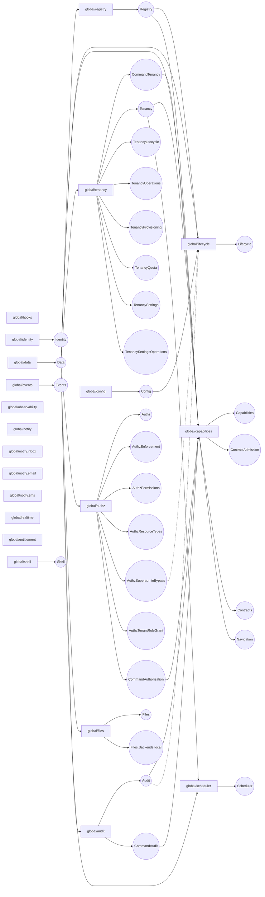

> For AI agents: the complete documentation index is available at /llms.txt, the full documentation bundle is available at /llms-full.txt.

# seam 图

> 本页由构建脚本镜像自仓库 [`docs/generated/seam-graph.md`](https://github.com/idadawn/qian/blob/main/docs/generated/seam-graph.md)，请修改源文件，不要改本页。

由 `qian docs generate` 派生；profile：`platform`。请修改输入后重新生成。

由清单 inject/optionalInject/provides 派生；同 scope 优先，其次 global。optionalInject 的消费方标注「（可选）」并以虚线连接：Provider 缺席时仍装载，在树里时先于消费方装载。骨架的空键集合不代表未来没有依赖。

| 服务键                         | Provider 条目           | Consumer 条目                                                                                                                                 |
| --------------------------- | --------------------- | ------------------------------------------------------------------------------------------------------------------------------------------- |
| `Registry`                  | `global/registry`     | `global/lifecycle`、`global/capabilities`                                                                                                    |
| `Lifecycle`                 | `global/lifecycle`    |                                                                                                                                             |
| `Capabilities`              | `global/capabilities` |                                                                                                                                             |
| `ContractAdmission`         | `global/capabilities` |                                                                                                                                             |
| `Contracts`                 | `global/capabilities` |                                                                                                                                             |
| `Navigation`                | `global/capabilities` |                                                                                                                                             |
| `CommandTenancy`            | `global/tenancy`      | `global/capabilities`                                                                                                                       |
| `Tenancy`                   | `global/tenancy`      | `global/capabilities`、`global/scheduler`                                                                                                    |
| `TenancyLifecycle`          | `global/tenancy`      |                                                                                                                                             |
| `TenancyOperations`         | `global/tenancy`      |                                                                                                                                             |
| `TenancyProvisioning`       | `global/tenancy`      |                                                                                                                                             |
| `TenancyQuota`              | `global/tenancy`      |                                                                                                                                             |
| `TenancySettings`           | `global/tenancy`      |                                                                                                                                             |
| `TenancySettingsOperations` | `global/tenancy`      |                                                                                                                                             |
| `Identity`                  | `global/identity`     |                                                                                                                                             |
| `Authz`                     | `global/authz`        |                                                                                                                                             |
| `AuthzEnforcement`          | `global/authz`        |                                                                                                                                             |
| `AuthzPermissions`          | `global/authz`        |                                                                                                                                             |
| `AuthzResourceTypes`        | `global/authz`        |                                                                                                                                             |
| `AuthzSuperadminBypass`     | `global/authz`        | `global/lifecycle`（可选）                                                                                                                      |
| `AuthzTenantRoleGrant`      | `global/authz`        |                                                                                                                                             |
| `CommandAuthorization`      | `global/authz`        | `global/capabilities`                                                                                                                       |
| `Data`                      | `global/data`         | `global/registry`、`global/lifecycle`、`global/capabilities`、`global/tenancy`、`global/authz`、`global/files`、`global/audit`、`global/scheduler` |
| `Files`                     | `global/files`        |                                                                                                                                             |
| `Files.Backends:local`      | `global/files`        |                                                                                                                                             |
| `Config`                    | `global/config`       | `global/lifecycle`                                                                                                                          |
| `Events`                    | `global/events`       |                                                                                                                                             |
| `Audit`                     | `global/audit`        | `global/capabilities`、`global/lifecycle`（可选）                                                                                                |
| `CommandAudit`              | `global/audit`        | `global/capabilities`                                                                                                                       |
| `Scheduler`                 | `global/scheduler`    |                                                                                                                                             |
| `Shell`                     | `global/shell`        |                                                                                                                                             |

