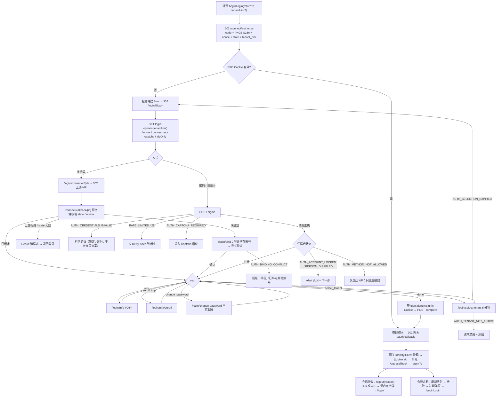
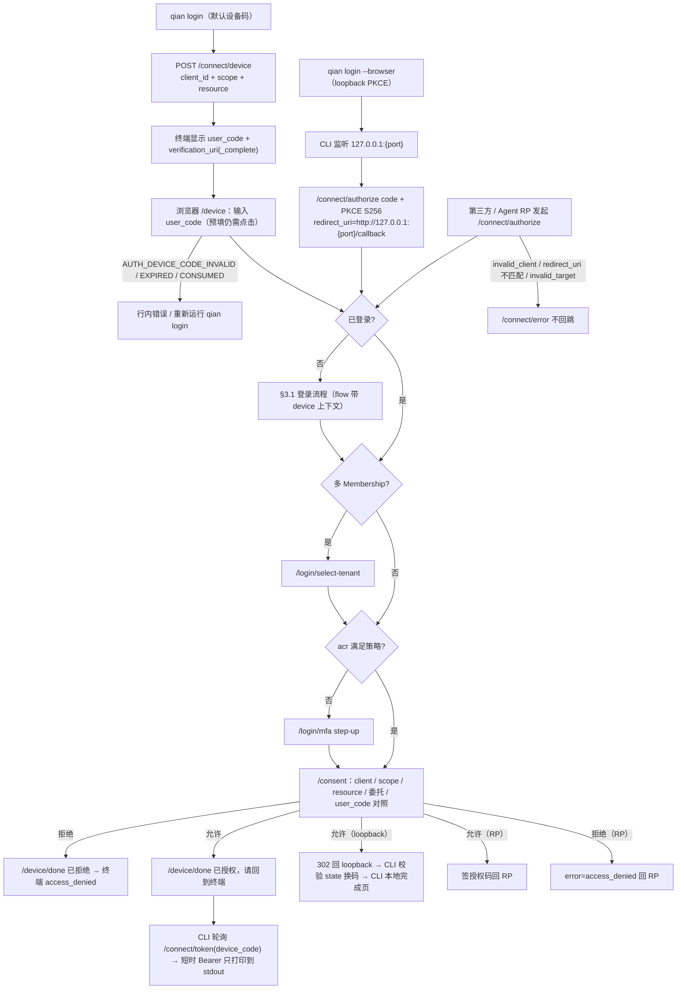

> For AI agents: the complete documentation index is available at /llms.txt, the full documentation bundle is available at /llms-full.txt.

# 认证页族设计规格（登录 / 第二因子 / 租户选择与切换 / 强制改密 / 绑定 / 设备码 / 授权同意）

> 本页由构建脚本镜像自仓库 [`docs/prd/specs/auth-pages.md`](https://github.com/idadawn/qian/blob/main/docs/prd/specs/auth-pages.md)，请修改源文件，不要改本页。

状态：草案 2026-10-21，待产品负责人确认（§8 D1–D14）。合成自三份设计（企业后台派为主线，发行方视角派与无密码多渠道派并入）与九份评审，纠错记录见 §9。

入库说明（2026-11-15）：本文写于 2026-10-21，此后一直是工作区里的未提交文件。2026-11-15 按产品负责人的指示入库：除本段与下面三条外，正文只在 §8 D14 一行删去一处括注（本仓库是公开仓库，删节处标「〔已删节〕」），其余一字未改；§8 的 D1–D14 仍未拍板，由 [S1-DEC-035](https://github.com/idadawn/qian/blob/main/pm/tasks/S1-DEC-035.md) 跟踪。读正文前先看三点：

- 认证页已经实现。S1-YUE-006（认证页族）、S1-YUE-002（外壳认证流程）、S1-YUE-012（薄入口并入外壳）都已完成；S1-YUE-019 又按产品负责人给的开通流程原型复刻了登录页等八个页面；S1-YUE-021（待做）要把强制改密、SSO 回调与连接器回调页对齐现在的登录表单。入库时没有逐条核对本文与已实现页面是否一致。本文是未拍板的设计草案，不代表已实现页面的现状；要了解现状，看各任务的验收记录。
- 文中的 IDP-012 是[框架细化备忘录](/design/decisions/framework-refinement-2026-10.md) §8 的候选任务号，指拟新建的「agent 客户端与 token exchange」，这个任务还没有建档。看板上的 S1-IDP-012 是另一件事（拆分部署下授权变更到身份修订递增）。
- 文中的 Q5、Q20、Q22、Q25 指备忘录 §9 的待拍板项，也都没有拍板。

设计画板（13 块：登录页密码态 / 暗色 / 手机单一方式与凭据错误 / 仅企业 IdP 与会话失效横幅、第二因子 TOTP、租户选择、强制修改密码、确认绑定、连接器回调错误、登录过期弹窗、租户切换器与代管横幅、设备码、授权同意）：[https://claude.ai/artifact/6So7dKqETKHjXEukWXmu3m](https://claude.ai/artifact/6So7dKqETKHjXEukWXmu3m)（私有链接，所有者分享后他人才能打开；取值只用 `@yue/tokens` 的 light / dark 语义色）。

与既有文档的关系：

| 文档                                                                | 关系                                                                                                                                                                                                                    |
| ----------------------------------------------------------------- | --------------------------------------------------------------------------------------------------------------------------------------------------------------------------------------------------------------------- |
| ADR-005（D5.1–D5.13）                                               | 本文是 D5.2 账号模型、D5.3 因子、D5.4 会话失效、D5.6 连接器、D5.11 显式绑定、D5.13 服务端强制「仅企业 IdP」在前端层（yue）的呈现规格；不改任何决策                                                                                                                         |
| PRD 7.4.1 / 7.4.2                                                 | 后端登录状态机（锁定 / 延时、选择令牌、强制改密、绑定）的页面映射；连接器按租户 scope 过滤、未挂载与不存在不可区分                                                                                                                                                        |
| PRD 7.15.1 / 7.15.2                                               | 外壳认证流程（OIDC code + PKCE、AuthProvider、刷新队列、过期弹窗、租户切换器、代管横幅）与 yue 最小集的消费清单                                                                                                                                              |
| `docs/prd/specs/yue.md` §1.1                                      | 本文是「认证页族」一行（账号密码、SSO 跳转与回调、多租户二次选择、登录过期弹窗；可选验证码登录、第三方登录按钮区、忘记密码、Captcha）的展开；实现归 S1-YUE-006（经注入的 `AuthProvider` 对 mock 验收），真实接线归 S1-YUE-002                                                                            |
| `docs/decisions/framework-refinement-2026-10.md` §7.3 / Q20 / Q22 | Agent 时代新增的设备码（RFC 8628）/ loopback PKCE 取令牌页与授权同意页；备忘录尚未拍板，本文按其默认建议预留并标条件                                                                                                                                             |
| `contracts/v0`                                                    | 全部错误响应为 ErrorDetail（必填 `type` / `title` / `status` / `code` / `message` / `trace_id`，可选 `detail` / `instance` / `pointer` / `allowed` / `errors[]`；业务错误只用 409 / 422；封闭对象）；本文新增的 `AUTH_*` 码为提案，需登记进 `error-codes.json` |

三层口径：Kun = 框架层（`Kun.Identity.AspNetCore` RP 侧 Cookie 会话、`Identity.Client`），Qian = 平台层（`qian.identity` 唯一 issuer、`qian.tenancy`、`qian.realtime`），yue = 前端层（`@yue/shell` 认证页族、`@yue/form` 登录表单、`@yue/core` 组件、`@yue/tokens` 令牌、`@yue/sdk` i18n / `PlatformClient`）。

## 1 设计原则

1. **服务端是唯一裁判**：锁定、延时、仅企业 IdP（D5.13）、绑定唯一、租户状态、会话吊销、强制改密全部由平台层判定；前端隐藏、禁用、倒计时只是体验层（PRD 13.10 第 4 条）。页面按服务端返回的「下一步」（`next ∈ { done, mfa, select_tenant, change_password, bind, enroll_totp }`）机械推进，不自判策略；刷新页面重新 GET 当前 flow 即可恢复到同一步。
2. **能力驱动而非配置驱动**：登录方式、连接器、验证码开关、密码策略全部来自 `getLoginOptions({ tenantHint })` 按租户 scope 下发；未挂载的连接器在 DOM 中不存在（PRD 7.4.2「与不存在无法区分」）。只有一种方式时版式仍成立（S1-A 首屏只有密码 + 通用 OIDC）。
3. **防枚举优先于友好**：账号不存在 / 密码错误 / 账号已锁定 / 延时中 / 仅企业 IdP / 租户不可登录，在凭据校验通过之前一律同码同文案（`AUTH_CREDENTIALS_INVALID`）；锁定通知只经 7.12 带外送达；发码对未知标识同响应且不发码；不显示剩余尝试次数；租户状态与成员状态只在主因子校验通过之后可见。
4. **错误即 ErrorDetail**：`code` 决定 UI 分支，`message` 为可见文案，`pointer` / `errors[]` 经 `@yue/form` 落到字段，`trace_id` 折叠在「错误编号」后供报障；非 ErrorDetail 响应只显示状态级通用文案；未知 `code` 走通用错误态而不是白屏。
5. **凭据只与 issuer 同源**：密码、验证码、绑定票据、选择令牌只在 `qian.identity` 宿主的同源页面与 HttpOnly Cookie 中流转，永不经过依赖方（外壳）的 JavaScript；外壳只做 RP 侧（跳转、回调、过期弹窗、切换器、代管横幅）。令牌不进 localStorage / URL / iframe，权限不进令牌（ADR-006），登录页 `frame-ancestors 'none'`。
6. **可解释的拒绝、显式的同意**（PRD 11.1.4、D5.11）：每个拒绝态在同一版式用 Alert + 按钮态说明原因与下一步，不用弹窗遮盖；外部身份绑定、第三方 / Agent 客户端授权、设备码批准都要用户看见对象后显式点一次，没有静默绑定、没有预勾选、没有「记住此决定」（S1）。
7. **Agent 时代原则**：开发者与 Agent 客户端走标准取令牌通道（授权码 + PKCE S256、RFC 8628 设备码、RFC 8252 loopback），不发静态 API Key；同意页诚实展示 client（来自注册表）、scope（目录人话 + 副作用等级）、resource（RFC 8707 受众）与委托语义（有效权限 = 委托人权限 ∩ scope，`humanOnly` 一律拒绝，PRD 13.11）；浏览器端永不显示或接收令牌。

无障碍按 WCAG 2.2（W3C Recommendation，2023-10-05）AA，三语言（zh-CN / zh-TW / en-US）与明暗两态从第一天就在；移动端优先、单一 DOM。

## 2 信息架构

阶段列同时给旧 S1 的 P 级与备忘录 §7.2 的 S1-A / S1-B 口径（备忘录未拍板前两套并列；Q6 拍板后以 S1-A / S1-B 为准）。宿主列：`identity` = `qian.identity` 宿主同源挂载的 `@yue/shell` 认证页库；`shell` = `qian.shell` 外壳；`cli` = `qian` CLI 内置静态页。

| 路由                                                   | 页面                                                | 阶段                              | 宿主              | 用途                                                                                 | 归属任务                           |
| ---------------------------------------------------- | ------------------------------------------------- | ------------------------------- | --------------- | ---------------------------------------------------------------------------------- | ------------------------------ |
| `/login?flow=`                                       | 登录页（租户号折叠步骤 + 密码 / 验证码 Tab + 连接器区 + 策略态 + 会话失效横幅） | S1-P0 · S1-A                    | identity        | 统一入口；按 login-options 渲染；承载全部策略态                                                    | S1-YUE-006 / IDP-003 / IDP-007 |
| `/login/mfa?flow=`                                   | 第二因子验证（TOTP）                                      | S1-P0 · S1-B（TOTP 随 IDP-006）    | identity        | 主因子后按租户策略 step-up；S1 只有 TOTP                                                       | YUE-006 / IDP-006              |
| `/login/select-tenant?flow=`                         | 租户选择（5 分钟租户选择令牌，11.2）                             | S1-P0 · S1-A                    | identity        | 命中多个 Membership 时选定 `tenant_id` / `membership_id`                                  | YUE-006 / IDP-003              |
| `/login/change-password?flow=`                       | 强制修改密码（不可取消）                                      | S1-P0 · S1-A                    | identity        | 初始密码 / 管理员重置 / 到期；完成前不签发会话 Cookie                                                  | YUE-006 / IDP-003              |
| `/login/connector/{connectorId}?flow=`               | 连接器出站中转 + 回调后落点                                   | S1-P0 · S1-A                    | identity        | 服务端 302 上游前的瞬时态；`/connect/callback/{connectorId}` 处理后 302 回本路由读 `next`             | YUE-006 / IDP-007              |
| `/login/bind?flow=`                                  | 确认绑定外部身份                                          | S1-P0 · S1-A                    | identity        | 首次经连接器登录：登录已有账号 → 显式确认；同租户重复绑定被拒                                                   | YUE-006 / IDP-007              |
| `/auth/callback`                                     | 依赖方回调态（换码中 / 失败）                                  | S1-P0 · S1-A（外壳 v0.1 可选）        | shell           | 网关 `Identity.Client` 换码后的 UI 落点；state / error 校验；清 URL                             | YUE-002 / IDP-005              |
| （外壳全局）                                               | 会话弹窗族：登录过期 AlertDialog、会话失效接收、权限变更 Toast、上次登录提示   | S1-P0 · S1-A                    | shell           | 刷新失败弹过期；logout 事件 ≤ 3s 跳登录；`identityRevisionChanged` 静默刷新                          | YUE-002 / IDP-004 / AZ-004     |
| （外壳用户菜单）                                             | 租户切换器 Dialog + 平台代管常驻横幅                           | S1-P0 · S1-A（横幅随 TEN-010 S1-B）  | shell           | 运行中切换 = 服务端重签 + 重拉菜单与权限；代管态常驻横幅                                                    | YUE-002 / IDP-003 / TEN-010    |
| `/connect/logout`                                    | 登出确认 / 已登出                                        | S1-P0 · S1-A                    | identity（服务端渲染） | GET 只展示表单、POST 带 antiforgery；后通道登出静默                                               | IDP-002 / IDP-004              |
| `/login`（验证码 Tab）                                    | 短信验证码登录                                           | S1-P1 · S1-B                    | identity        | 短信 OTP 一等因子（D5.3）；由 options.factors 驱动出现                                           | YUE-006 / IDP-006              |
| `/login/forgot?flow=` → `/login/reset`               | 找回密码                                              | S1-P1 · S1-B                    | identity        | 短信 OTP 验证 → 新密码；成功吊销全部会话                                                           | YUE-006 / IDP-006              |
| `/login/mfa/enroll?flow=`                            | TOTP 绑定（租户强制两步验证的首次登录）                            | S1-P0（7.4.1 E2E）· S1-B          | identity        | 二维码 + 手动密钥 + 6 位校验；不可跳过                                                            | YUE-006 / IDP-006              |
| `/login/wecom?flow=`                                 | 企业微信工作台免登中转                                       | S1-P0（7.4.2）· S1-B              | identity        | UA 识别 → `ExchangeImplicitAsync`；未绑定 → bind；多租户先反查                                  | YUE-006 / IDP-008              |
| `/device` → `/device/confirm?flow=` → `/device/done` | 设备码授权（`qian login`，RFC 8628）                      | 条件：Q22 拍板后随 IDP-012（候选号）升 S1-P0 | identity        | 输入 user_code → 登录 → 同意 → 回终端                                                       | IDP-012（候选）/ YUE-006           |
| `/consent?flow=`                                     | 授权同意（第三方 / CLI / Agent 客户端）                       | 条件：Q5 / Q22 / Q25 拍板后随 IDP-012  | identity        | 展示 client / scope / resource / 委托 / 有效期；每次询问                                       | IDP-012（候选）/ YUE-006           |
| `http://127.0.0.1:{port}/callback`                   | CLI 本地完成页（loopback PKCE，RFC 8252 §7.3）            | 条件：同上                           | cli             | 静态 HTML，令牌不显示                                                                      | IDP-012（候选）                    |
| `/login`（Captcha 槽位）                                 | 自托管图形验证码                                          | S1-P2                           | identity        | 策略开关或 `AUTH_CAPTCHA_REQUIRED` 后插入；需新增组件                                            | YUE-006 / IDP-003              |
| `/login`（邮箱验证码渠道）                                    | 邮箱 OTP                                            | 待 Q20（默认建议「加，S1-B」）             | identity        | 与短信共用 Tab，Segmented 切渠道；单渠道时不渲染 Segmented                                          | IDP-006                        |
| `/connect/error`                                     | 授权请求无效终态页                                         | S1-P1                           | identity        | invalid_client / redirect_uri 不匹配 / invalid_target 等不可回跳错误（OIDC Core 1.0 §3.1.2.6） | IDP-002                        |
| （外壳）                                                 | 闲置预警弹窗                                            | S1-P1                           | shell           | 租户策略有空闲超时时提前 60s 预警（WCAG 2.2.1）                                                    | YUE-002 / IDP-006              |
| `/login`（连接器新条目）                                     | 钉钉 / 飞书 / 微信网站扫码                                  | S2                              | identity        | 只是 `options.connectors` 新条目，无新页面                                                   | S2 连接器任务                       |
| `/account/security/authorizations`                   | 已授权的应用与 Agent 客户端（查看 / 吊销）                        | S2                              | shell           | 同意页承诺的撤销途径                                                                         | S2                             |
| `/login`（邮箱域发现、品牌登录域、Passkey、扫码登 PC、恢复码）             | HRD / 品牌 / Passkey                                | S3                              | identity        | 只换登录页宿主不改 issuer（Q4）                                                               | S3                             |

个人中心（资料 / 改密 / 社交账号绑定解绑 / TOTP 管理 / 会话列表）归 IDP-006「个人中心最小集」，不在本页族（§7）。

## 3 端到端流程

### 3.1 人类登录全流程

### 3.2 Agent / CLI 取令牌与同意流程

## 4 逐页规格

通用约定（各页不重复）：

- 版式：发行方页面统一 `AuthLayout`（需新增，放 `@yue/shell`）——页面背景 `--yue-background`；≥ `--yue-p-breakpoint-md`（48rem）单张 `Card` 居中、宽 25rem（同意页 32rem）；≥ `--yue-p-breakpoint-lg`（64rem）左侧品牌栏约 40%（`--yue-sidebar` / `--yue-sidebar-foreground`，只放平台标识、名称、一句定位、环境标识）；\< `--yue-p-breakpoint-sm`（40rem，含 375px）单列、无卡片边框与阴影、16px 侧边距、品牌栏收成顶部一行、按钮全宽。三种断点共用同一 DOM。
- 标题层级：每页一个 `h1`（可见或 `sr-only`，如「登录到 \{租户名}」）；`CardTitle` 渲染为 `h3`、`Result` 标题为 `h2`，都不作页面标题。
- 表单：登录 / 改密 / 找回密码 / 绑定表单经 `@yue/form`（shell → form 是分层规则唯一例外）；`INPUT_INVALID` 的 `errors[].pointer` 由 `@yue/form` 统一映射到 `FieldError`；提交失败焦点移到首个无效控件（`aria-invalid` + `aria-describedby`），只有整体错误（锁定、仅企业 IdP、服务不可用）才把焦点移到 `tabIndex=-1` 的 Alert 容器。
- 错误展示：`AuthErrorNotice`（需新增，组合件）= `Alert tone=error role="alert"` + `message` + 折叠行「错误编号 \{trace_id}」（`Button variant=ghost size=sm`「复制」，图标需新增 copy）；`Alert` 内不放 muted 色文字（对比度单测不覆盖 muted on tone-bg）；倒计时不放进 `role=alert` 容器，单独 `aria-live=polite` 区域每 10 秒更新一次。
- 消息出口：Toast / 确认走 `@yue/form` 的 `useMessage` / `useConfirm`（`@yue/core` 的 `Toast` 无 `tone`）。
- 按钮：`Button` 变体只有 `primary | secondary | outline | ghost | destructive`；文本链接用 `variant=ghost size=sm`；高度沿用 `--yue-button-height`（36px，`size=lg` 40px），目标尺寸按 WCAG 2.2 2.5.8（≥ 24×24），不覆盖为 44px。
- `data-testid`：`auth-<page>-<element>`（如 `auth-login-identifier`、`auth-login-submit`、`auth-login-connector-{connectorId}`、`auth-mfa-code`、`auth-select-tenant-item-{membershipId}`），不含用户数据；连接器 id 可以、displayName 不行。
- 加载：`getLoginOptions` / `getFlow` 未返回前 `Skeleton`（`aria-hidden`）占位，避免方式闪烁；提交中 `Button loading`（自带 `aria-busy` 与 spinner，不再嵌 `Spinner`），字段 `readOnly`。
- 文案：zh-CN 为主，关键处给 en-US；zh-TW 由 `auth.*` 命名空间按 `@yue/sdk` 内置用词（登入 / 載入 / 搜尋 / 重新整理）翻译，通用键复用 `common.cancel` / `common.retry` / `common.unauthorized`；按钮内文案不换行，en-US 长句在 25rem 卡内允许两行。

### 4.1 登录页 `/login?flow=`（S1-P0）

**用途**：统一登录入口；按 `login-options` 渲染因子与连接器；承载锁定后态、延时、仅企业 IdP、租户不可登录、会话失效回落、回调错误等策略态。

**版式**：右列（或单列）自上而下：租户区 → 提示区（Alert）→ 登录卡（Card）→ 连接器区 → 页脚。

**元素清单**（自上而下）：

| 元素           | @yue 组件                                                                                                                                                                                                                                      | 说明                                                                     |
| ------------ | -------------------------------------------------------------------------------------------------------------------------------------------------------------------------------------------------------------------------------------------- | ---------------------------------------------------------------------- |
| 品牌栏          | 文本 + `Avatar`                                                                                                                                                                                                                                | 平台标识与名称来自 `window.__APP_CONF__.brand`；S3 才接租户 `data-brand`             |
| 租户区          | `Avatar` / `AvatarFallback` + 文本 + `Button ghost sm`「切换租户」                                                                                                                                                                                   | 有 `tenantHint` 时显示租户 LOGO + 名称；无则显示平台名 + `Button ghost sm`「指定租户」       |
| 租户号步骤（折叠）    | `Field` + `FieldLabel`「租户号」+ `Input`（`autocomplete=organization`，小写字母数字）+ `FieldDescription`「由管理员提供；企业员工一般需要填写」+ `Checkbox`「在此设备记住租户号」+ `Button secondary`「继续」                                                                               | 未知 / 未挂载 / 不存在的租户号回落平台默认方式，不报错                                         |
| 提示区          | `Alert`（`tone` 按态；错误传 `role="alert"`）                                                                                                                                                                                                        | 会话失效原因、回调错误、仅企业 IdP、租户不可登录、锁定后态                                        |
| 登录卡          | `Card` + `CardHeader`（`CardTitle`「登录」+ `CardDescription` 租户名或平台名）+ `CardContent`                                                                                                                                                             | 页面 `h1` 为 sr-only「登录到 \{租户名 / 平台名}」                                    |
| 方式切换         | `Tabs` + `TabsList` + `TabsTab`「密码」「验证码」                                                                                                                                                                                                     | 只有一种因子或 idpOnly 时不渲染 Tabs                                              |
| 密码面板         | `Field`「账号」`Input`（`autocomplete=username`，占位「用户名 / 手机号 / 邮箱」）；`Field`「密码」`InputPassword`（`autocomplete=current-password`，`showLabel`「显示密码」`hideLabel`「隐藏密码」）；Captcha 槽位（需新增 `CaptchaField`）；`Button ghost sm`「忘记密码」；`Button primary` 全宽「登录」 | 密码允许粘贴；不做前端哈希                                                          |
| 验证码面板（S1-P1） | `Segmented`「手机」「邮箱」（仅两渠道都启用时）；`Field`「手机号」`Input`（`autocomplete=tel inputmode=tel`）+ `Button outline`「获取验证码」（倒计时）；`Field`「验证码」`PinInput length=6`（`label`「6 位验证码」`getSlotLabel`「第 \{i} 位」，`autocomplete=one-time-code`）；`Button primary`「登录」 | 6 位填满不自动提交（WCAG 3.2.2）                                                 |
| 连接器区         | `Separator` + muted 文本「或使用企业身份源」+ `Button outline` 全宽 × N「使用 \{displayName} 登录」                                                                                                                                                              | 列表只来自 `options.connectors`；图标需新增（Icon 入口无品牌图形），S1 可纯文字；idpOnly 时该区成为主体 |
| 页脚           | `Select`（`aria-label`「语言」，zh-CN / zh-TW / en-US）、`IconButton`（主题三态 light / dark / system，经 `@yue/tokens` `ThemeController`，图标需新增）、`options.links` 帮助 / 隐私、版本号                                                                                | 主题偏好写 localStorage `yue-theme`（非敏感）                                    |
| 技术详情（折叠）     | `Accordion`「技术详情」+ `Descriptions`（发行方、flow、client_id、trace_id、环境）                                                                                                                                                                            | 非生产默认展开；生产默认折叠，由 `__APP_CONF__.support.showTechDetails` 门控（D7）         |

**状态表**：

| 状态                       | 触发                                                       | UI 表现                                                                                                                                                                                                                                                             | ErrorDetail.code（提案）                                     |
| ------------------------ | -------------------------------------------------------- | ----------------------------------------------------------------------------------------------------------------------------------------------------------------------------------------------------------------------------------------------------------------- | -------------------------------------------------------- |
| 默认                       | 无 tenantHint                                             | 平台默认方式（密码 + 平台级连接器）；Tab 停在上次方式（localStorage 仅偏好）                                                                                                                                                                                                                  | —                                                        |
| 加载 options               | GET login-options 进行中                                    | 表单区 `Skeleton` × 3，不渲染按钮                                                                                                                                                                                                                                          | —                                                        |
| options 失败               | 503 / 网络                                                 | `Result tone=error`「无法连接登录服务」+「重试」                                                                                                                                                                                                                                | `UNAVAILABLE`                                            |
| 单一方式                     | `options.factors` 只有密码且无连接器                              | 不渲染 Tabs 与连接器区，版式不塌                                                                                                                                                                                                                                               | —                                                        |
| 仅企业 IdP                  | `options.idpOnly`（需 tenantHint）                          | 凭据卡不渲染；`Alert tone=info`「该租户仅允许通过企业身份源登录」+ 连接器按钮；不自动跳转                                                                                                                                                                                                            | —                                                        |
| 本地校验错误                   | 空值 / 格式                                                  | `FieldError`「请输入账号」「请输入密码」，焦点到首个无效控件                                                                                                                                                                                                                              | —                                                        |
| 字段错误                     | 400 `errors[]` 带 pointer                                 | 经 `@yue/form` 落到 `#/identifier` / `#/secret` / `#/captcha`                                                                                                                                                                                                        | `INPUT_INVALID`                                          |
| 凭据无效                     | 密码错 / 账号不存在 / 锁定中 / 延时中 / 无 tenantHint 的仅企业 IdP 账号       | `AuthErrorNotice`「账号或密码不正确」；密码框清空并聚焦；不显示剩余次数                                                                                                                                                                                                                      | `AUTH_CREDENTIALS_INVALID`（422）                          |
| 限流 / 延时                  | 429 + `Retry-After`                                      | `Alert tone=warn`「尝试过于频繁，请 \{n} 秒后重试」；主按钮 `disabled` 至归零；倒计时区 `aria-live=polite` 每 10 秒播报                                                                                                                                                                         | `RATE_LIMITED`（既有，429）                                   |
| 需图形验证码                   | 策略开关或阈值                                                  | 插入 `CaptchaField` 并聚焦；「请输入图形验证码后再试」                                                                                                                                                                                                                               | `AUTH_CAPTCHA_REQUIRED`（422）                             |
| 图形验证码错误                  | 校验失败                                                     | `FieldError`「图形验证码不正确」+ 自动换图                                                                                                                                                                                                                                      | `AUTH_CAPTCHA_INVALID`（422）                              |
| 账号已锁定（凭据正确后）             | 阈值触发                                                     | `Alert tone=error role=alert`「账号已锁定。\{unlockHint}」（`unlockHint` 来自 message：「请联系租户管理员解锁」或「请稍后再试」，不给具体解锁时间）；主按钮 `disabled`；连接器按钮可见但提交同样得到锁定态                                                                                                                        | `AUTH_ACCOUNT_LOCKED`（422）                               |
| 自然人 / 成员已停用（凭据正确后）       | 状态                                                       | `AuthErrorNotice`「账号已停用，请联系租户管理员」                                                                                                                                                                                                                                 | `AUTH_PERSON_DISABLED` / `AUTH_MEMBERSHIP_DISABLED`（422） |
| 仅企业 IdP（凭据正确后或策略拒绝）      | D5.13 服务端强制                                              | 重取 options 并切换为「仅企业 IdP」态；文案同上                                                                                                                                                                                                                                    | `AUTH_METHOD_NOT_ALLOWED`（422）                           |
| 租户不可登录（凭据正确后）            | 待激活 / 宽限 / 只读 / 冻结 / 注销                                  | `Alert tone=warn`「\{租户名} 当前不可登录（\{status}），请联系管理员」；status 词表：待激活 / 宽限期 / 只读 / 已冻结 / 已注销                                                                                                                                                                           | `AUTH_TENANT_NOT_ACTIVE`（422）                            |
| flow 失效                  | 超时 / Cookie 不匹配                                          | 整卡 `Result tone=warn`「本次登录已超时，请重新开始」+「重新开始」                                                                                                                                                                                                                       | `AUTH_FLOW_EXPIRED`（422）/ `NOT_FOUND`                    |
| 下一步                      | signin 返回 `next`                                         | mfa → `/login/mfa`；enroll_totp → `/login/mfa/enroll`；select_tenant → `/login/select-tenant`；change_password → `/login/change-password`；done → POST complete → `location.assign(return_to)`                                                                        | —                                                        |
| 会话失效回落                   | 服务端 302 到 `/login` 并写一次性登出提示 Cookie；降级为 `?reason=` 白名单枚举 | `Alert tone=info`：password_changed「密码已修改，请重新登录」/ disabled「账号已被停用」/ locked「账号已被锁定」/ tenant_suspended「所在租户已冻结」/ tenant_expired「所在租户已进入宽限期」/ revoked_by_admin「管理员已将您下线」/ concurrent_limit「该账号已在其他设备登录，当前设备已下线」/ connector_disabled「登录方式已变更，请重新登录」/ 未知「请重新登录」；账号字段不预填 | —                                                        |
| 回调错误                     | 连接器回调失败后 302 回本页                                         | `AuthErrorNotice`「企业身份源登录未完成」+ message                                                                                                                                                                                                                            | 见 §4.5                                                   |
| 离线 / 5xx / 非 ErrorDetail | 网络                                                       | `AuthErrorNotice`「服务暂不可用，请稍后重试」+「重试」                                                                                                                                                                                                                              | `INTERNAL` / `UNAVAILABLE`                               |
| 已登录态（S1-P1）              | SSO Cookie 有效且 RP 未要求 `prompt=login`                     | 卡顶 `Avatar` +「以 \{displayName} 继续」`Button primary` +「切换账号」`Button ghost sm`；`prompt=login` / `max_age` 过期时不出现此态，必须重新认证（OIDC Core 1.0 §3.1.2.1）                                                                                                                    | —                                                        |

**文案**（zh-CN / en-US）：

| 键                                   | zh-CN                              | en-US                                                                          |
| ----------------------------------- | ---------------------------------- | ------------------------------------------------------------------------------ |
| `auth.login.title`                  | 登录                                 | Sign in                                                                        |
| `auth.login.tenantCode`             | 租户号                                | Tenant ID                                                                      |
| `auth.login.tenantCode.hint`        | 由管理员提供；企业员工一般需要填写                  | Provided by your administrator                                                 |
| `auth.login.identifier`             | 账号                                 | Account                                                                        |
| `auth.login.identifier.placeholder` | 用户名 / 手机号 / 邮箱                     | Username, phone or email                                                       |
| `auth.login.password`               | 密码                                 | Password                                                                       |
| `auth.login.submit`                 | 登录                                 | Sign in                                                                        |
| `auth.login.forgot`                 | 忘记密码                               | Forgot password                                                                |
| `auth.login.sendCode`               | 获取验证码                              | Send code                                                                      |
| `auth.login.resend`                 | \{n} 秒后重发                          | Resend in \{n}s                                                                |
| `auth.login.or`                     | 或使用企业身份源                           | Or continue with your organization                                             |
| `auth.login.connector`              | 使用 \{name} 登录                      | Continue with \{name}                                                          |
| `auth.error.credentials`            | 账号或密码不正确                           | Incorrect account or password                                                  |
| `auth.error.rateLimited`            | 尝试过于频繁，请 \{n} 秒后重试                 | Too many attempts. Try again in \{n}s                                          |
| `auth.error.locked`                 | 账号已锁定。\{unlockHint}                | Account locked. \{unlockHint}                                                  |
| `auth.error.idpOnly`                | 该租户仅允许通过企业身份源登录                    | This tenant only allows sign-in through its identity provider                  |
| `auth.error.tenantNotActive`        | \{tenant} 当前不可登录（\{status}），请联系管理员 | \{tenant} is not available for sign-in (\{status}). Contact your administrator |
| `auth.error.traceId`                | 错误编号 \{trace_id}                   | Reference \{trace_id}                                                          |
| `auth.error.unavailable`            | 服务暂不可用，请稍后重试                       | Service unavailable. Please try again later                                    |

**安全要点**：

- 连接器与因子只来自服务端 `login-options`；前端不持有连接器配置、secret、IdP 地址；`login-options` 匿名端点按 IP 限流；未知租户号回落默认集不报错，`tenantHint` 只是租户号，不解析租户状态。
- 凭据校验前一律 `AUTH_CREDENTIALS_INVALID`；锁定 / 停用 / 租户状态 / 仅企业 IdP 只在凭据正确后可见；`RATE_LIMITED` 以（IP，标识哈希）为键，对不存在的标识同样计数与返回；账号维度的延时在服务端静默执行（统一时延），不回传秒数。
- 同源 POST，antiforgery 走 cookie-to-header（`GET /account/antiforgery` 下发，请求头 `RequestVerificationToken`）；Cookie `qian.identity.signin` / `qian.identity.flow` 建议 `__Host-` 前缀、`Secure`、`HttpOnly`、`SameSite=Lax`（连接器回调为顶级 GET 回跳，Strict 不可用）；响应 `Cache-Control: no-store`、`Referrer-Policy: no-referrer`、CSP `frame-ancestors 'none'`；`/login*` 与 `/connect*` 同一组安全头（现有中间件只覆盖 `/connect` 与 `/.well-known`，需扩）。
- URL 只允许出现 `flow`（不透明、非机密、与 HttpOnly Cookie 绑定）、`tenant`（租户号）、`reason`（白名单枚举）；`return_to` 只接受服务端 flow 记录；不回显任何 URL 参数原文。
- localStorage 只存租户号与上次方式与主题偏好；账号、密码、令牌一律不落盘；S1 不做「记住我 / 记住账号」。
- Captcha 自托管（D5.10，不接外部 SaaS）；图片不含账号信息；发码端点平台级防线（每 IP 与全局预算、未知标识不发码且同响应、尝试上限）。

**无障碍要点**：`Field` 自动关联 label / description / error；`autocomplete` 用 WHATWG HTML Living Standard token；Tabs 方向键漫游；连接器按钮可访问名称含身份源名；图形验证码无音频替代（WCAG 2.2 1.1.1 / 3.3.8 缺口）→ 默认关、只按策略开、优先延时 / 锁定（§7）；对比度由 `@yue/tokens` 单测覆盖的语义成对令牌保证；`motion-reduce` 下无过渡。

**接触点**：`AuthProvider.interaction.getLoginOptions({ tenantHint })` → `GET /account/login-options?tenant=`；`getFlow(flow)` → `GET /account/flows/{flow}`；`getAntiforgery()`；`signIn(flow, { factor: 'password' | 'sms_otp' | 'email_otp', identifier, secret, captchaTicket? })` → `POST /account/flows/{flow}/signin`；`sendOtp(flow, { channel, identifier, purpose: 'login' })` → `POST /account/flows/{flow}/otp`；`getCaptcha()` → `GET /account/captcha`；`beginConnector(flow, connectorId)`；`complete(flow)` → `POST /account/flows/{flow}/complete`（返回 `return_to`）。路径为提案，由 IDP-003 / 006 / 007 登记。

### 4.2 第二因子验证 `/login/mfa?flow=`（S1-P0；TOTP 随 IDP-006）

**用途**：主因子通过后按目标租户策略 step-up；S1 只有 TOTP（PRD 13.3.2：短信 / 邮箱 OTP 作第二因子、Passkey、恢复码 S3）；`amr` / `acr` 由此确定。

**版式**：同外框；单任务卡：返回行 → 身份摘要 → 卡片（PinInput）→ 帮助。

**元素清单**：`Button ghost sm`「返回登录」（放弃 flow）；`Avatar` + 掩码账号（服务端下发）；`Card` + `CardTitle`「验证您的身份」+ `CardDescription`「打开身份验证器应用，输入 6 位动态码」；`Field` + `PinInput length=6`（`autocomplete=one-time-code inputmode=numeric`）；`Button primary` 全宽「验证」；`Button ghost sm`「无法使用验证器？」→ `Popover`「请联系租户管理员重置两步验证」；`AuthErrorNotice`。不渲染 `Segmented`（S1 单因子）；「30 天内此设备不再验证」不做（§7）。

**状态表**：

| 状态    | 触发            | UI 表现                                               | ErrorDetail.code              |
| ----- | ------------- | --------------------------------------------------- | ----------------------------- |
| 默认    | 进入            | 第一格聚焦；填满不自动提交                                       | —                             |
| 验证中   | 提交            | 按钮 `loading`，PinInput `readOnly`                    | —                             |
| 动态码错误 | 校验失败          | `FieldError`「动态码不正确，请确认设备时间已同步」；清空并聚焦第一格；计入阈值       | `AUTH_TOTP_INVALID`（422）      |
| 挑战过期  | `ExpiresAt` 到 | `Result tone=warn`「验证已超时，请重新登录」+「返回登录」              | `AUTH_CHALLENGE_EXPIRED`（422） |
| 尝试超限  | 阈值            | `Alert tone=warn` + 按钮 `disabled` 至 `Retry-After`   | `RATE_LIMITED`                |
| 锁定    | 阈值触发锁定        | 同 §4.1 锁定态                                          | `AUTH_ACCOUNT_LOCKED`         |
| 成功    | 校验通过          | 按 `next` 续接（select_tenant / change_password / done） | —                             |

**文案**：「验证您的身份」/ Verify it's you；「6 位动态码」/ 6-digit code；「验证」/ Verify；「动态码不正确，请确认设备时间已同步」/ Incorrect code. Check your device time；「无法使用验证器？」/ Can't use your authenticator?

**安全要点**：challengeId 只在 flow（服务端）与同源 Cookie，不进 URL；TOTP（RFC 6238，IETF 2011-05）校验、时间窗与重放防护在服务端；错误次数计入统一阈值；成功后 `amr=totp`、`acr` 提升写入会话 Cookie 供 step-up 判定。

**无障碍要点**：`PinInput` 传 `label` 与 `getSlotLabel`（第 1 格依赖 sr-only 整组 label）；错误后焦点回第一格；`Popover` 键盘可开关。

**接触点**：`verifyFactor(flow, { factor: 'totp', code })` → `POST /account/flows/{flow}/challenge`（IDP-006 `IAuthenticatorFactor.Verify` → `AuthenticationResult(amr, acr)`）。

### 4.3 租户选择 `/login/select-tenant?flow=`（S1-P0）

**用途**：命中多个 Membership（成员）时选定 `tenant_id` / `membership_id`，以 5 分钟租户选择令牌（11.2 词表）换正式签发；运行中切换租户复用同一列表部件（§4.9）。

**版式**：同外框；卡内：说明 + 倒计时 → （> 8 项时）搜索框 → 单选列表 → 主按钮 → 退出登录。

**元素清单**：`CardTitle`「选择要进入的租户」+ `CardDescription`「您的账号属于多个租户」；倒计时文本「请在 \{m:ss} 内完成选择」（`CountdownText` 需新增；独立 `aria-live=polite`，只在 60s / 30s / 10s / 0 播报）；`Input`（`aria-label`「搜索租户」，> 8 项时）；`RadioGroup` + 每项以 `Label` 包整行的 `Radio`：`Avatar` / `AvatarFallback`（首字）+ 租户名 + 租户号（mono）+ 成员显示名 + `Badge tone=info`「租户管理员」+ 状态 `Badge`（`tone=warn`「宽限期」/「只读」，`tone=neutral`「已冻结」/「待激活」）+ 可见原因文本（不用 Tooltip）；上次使用项 `Tag`「上次使用」并预选（不自动提交）；`Button primary` 全宽「进入」；`Button ghost sm`「退出登录」。375px 下状态 Badge 换到第二行。

**状态表**：

| 状态              | 触发          | UI 表现                                                       | ErrorDetail.code                                      |
| --------------- | ----------- | ----------------------------------------------------------- | ----------------------------------------------------- |
| 加载              | GET flow    | `Skeleton` × 3                                              | —                                                     |
| 默认              | 列表来自登录响应    | 按服务端顺序（最近使用优先）；预选上次使用                                       | —                                                     |
| 提交中             | 点「进入」       | 按钮 `loading`「正在进入 \{租户名}…」，其余禁用                             | —                                                     |
| 禁用项             | 租户 / 成员不可用  | `Radio disabled` + Badge + 可见原因「请联系管理员」；服务端同样拒绝             | `AUTH_TENANT_NOT_ACTIVE` / `AUTH_MEMBERSHIP_DISABLED` |
| 仅企业 IdP 租户经密码进入 | 策略          | 该项显示「需企业账号登录」+ `Button ghost sm`「用企业账号登录」→ `beginConnector` | `AUTH_METHOD_NOT_ALLOWED`                             |
| 选择超时            | 倒计时归零 / 服务端 | 整卡 `Result tone=warn`「选择已超时，请重新登录」+「重新登录」；不静默跳转             | `AUTH_SELECTION_EXPIRED`（422）                         |
| 全部不可用           | 零可用项        | `Result tone=warn`「没有可进入的租户，请联系管理员」+「退出登录」                  | —                                                     |
| 目标租户要求 MFA      | 策略更严        | 跳 `/login/mfa` 后回签发                                         | —                                                     |
| 成功              | 选定          | 服务端签 Cookie → `next`（change_password 可能在此之后）→ done          | —                                                     |

**文案**：「选择要进入的租户」/ Choose a tenant；「请在 \{m:ss} 内完成选择」/ Choose within \{m:ss}；「进入」/ Continue；「选择已超时，请重新登录」/ Selection timed out. Please sign in again。

**安全要点**：选择令牌留在服务端 flow 记录，页面只提交 `membership_id`，不进 JS 内存、URL 或存储；列表只含本人 Membership；冻结 / 到期租户的拒绝在服务端（IDP-003 R95）；切换 = 服务端重签（`membership_id` 变化、`identity_revision` 重取），不是前端改请求头。

**无障碍要点**：每项可访问名称 = 「\{租户名}，\{成员名}\{，租户管理员}\{，已冻结}」；`RadioGroup` 方向键移动、Space 选中、Enter 提交；禁用项原因为常驻可见文本并 `aria-describedby`；归零后 `Result` 外层 `tabIndex=-1` 容器获得焦点。

**接触点**：`selectTenant(flow, { membershipId })` → `POST /account/flows/{flow}/select-tenant`（IDP-003）。

### 4.4 强制修改密码 `/login/change-password?flow=`（S1-P0）

**用途**：初始密码 / 管理员重置 / 到期的强制改密；不可取消、不可跳过、完成前不签发会话 Cookie；刷新或直访其他路由都回到本步。

**版式**：全页单任务；原因 Alert → 卡片（三字段 + 策略清单）→ 退出登录（唯一出口）。

**元素清单**：`Alert tone=info role=status`「首次登录或管理员重置密码后必须设置新密码，完成前无法进入系统」；`CardTitle`「设置新密码」；`Field`「当前密码」`InputPassword`（`autocomplete=current-password`，按 `options.requiresCurrentPassword` 渲染）；`Field`「新密码」`InputPassword`（`autocomplete=new-password`）+ `PasswordPolicyChecklist`（需新增：`ul` 每项 `Icon check / minus` + 文本「已满足 / 未满足」，规则来自 `options.passwordPolicy`：最少 \{n} 位、至少 \{k} 类字符、不与最近 \{h} 次相同、不含账号）；`Field`「确认新密码」`InputPassword`；`Button primary` 全宽「设置并继续」；`Button ghost sm`「退出登录」。不做强度条。

**状态表**：

| 状态     | 触发     | UI 表现                                                               | ErrorDetail.code                     |
| ------ | ------ | ------------------------------------------------------------------- | ------------------------------------ |
| 默认     | 进入     | 新密码聚焦；清单全部「未满足」，输入时翻转本地可判项；状态变化在 blur / 提交时汇总 `aria-live=polite` 播报 | —                                    |
| 本地校验   | 两次不一致  | `FieldError`「两次输入的密码不一致」                                            | —                                    |
| 策略违规   | 服务端    | `errors[]` pointer `#/new_password` 逐条映射到清单与 `FieldError`           | `AUTH_PASSWORD_POLICY_VIOLATED`（422） |
| 历史密码复用 | 服务端    | `FieldError`「不能与最近 \{n} 次使用过的密码相同」                                  | `AUTH_PASSWORD_REUSED`（422）          |
| 当前密码错误 | 服务端    | `FieldError` 落 `#/current_password`；计入阈值                            | `AUTH_CREDENTIALS_INVALID`           |
| 限流     | 429    | `Alert tone=warn` + 倒计时                                             | `RATE_LIMITED`                       |
| 成功     | 写入     | `useMessage().success`「密码已更新，其他设备已退出登录」→ 按 `next` 续接                | —                                    |
| 绕行     | 直访其他路由 | 服务端 302 回本页                                                         | —                                    |

**文案**：「设置新密码」/ Set a new password；「设置并继续」/ Set and continue；「密码已更新，其他设备已退出登录」/ Password updated. Other devices have been signed out。

**安全要点**：新密码只在请求体，不回显；清单仅提示，策略权威在租户级密码策略（13.3.2）；改密触发 13.3.3 第 1 条（其他会话 ≤ 5s 失效），本页明示；当前设备会话是否豁免需 IDP-003 / 004 提供「吊销除当前 sid 外全部会话」语义（§6 新增验收）。

**无障碍要点**：三处密码开关各自独立且有 `aria-pressed` 与可见名称；无取消按钮但有「退出登录」，不构成键盘陷阱（WCAG 2.1.2）。

**接触点**：`changePassword(flow, { current?, next })` → `POST /account/flows/{flow}/password`（IDP-003；成功后服务端吊销其他会话，IDP-004）。

### 4.5 连接器出站中转与回调落点 `/login/connector/{connectorId}?flow=`（S1-P0）

**用途**：`BeginChallengeAsync` 的 302 出口与 `/connect/callback/{connectorId}`（服务端统一校验 state / nonce，IDP-007）处理完成后的 UI 落点；页面只 GET flow 读 `next`，不接触上游 code / id_token。

**版式**：居中单屏：`h1` + `Spinner` + 手动继续按钮；错误时整卡替换为 `Result`。

**元素清单**：出站：`h1`「正在前往 \{connectorName}…」+ `Spinner label`「正在跳转」+ `Button ghost sm`「若未自动跳转，点击继续」（3 秒后出现并获得焦点）+ `Button ghost sm`「返回登录」；回调处理态：`h1`「正在完成登录…」+ `Spinner`；错误态：`Result tone=error`（标题「无法通过 \{connectorName} 登录」，description = `message`）+ `ButtonGroup`「重试」「返回登录」+ `AuthErrorNotice`。

**状态表**：

| 状态               | 触发               | UI 表现                                                  | ErrorDetail.code                    |
| ---------------- | ---------------- | ------------------------------------------------------ | ----------------------------------- |
| 跳转中              | POST begin → 302 | Spinner；3 秒后出现手动按钮（WCAG 2.2.1 / 3.2.5）                 | —                                   |
| 回调处理中            | 服务端 302 回本页      | GET flow 一次                                            | —                                   |
| state / nonce 无效 | 篡改 / 过期          | `Result`「登录请求已失效或被篡改，请重新开始」                            | `AUTH_CONNECTOR_STATE_INVALID`（422） |
| 上游取消             | `access_denied`  | `Result tone=warn`「您在 \{connectorName} 取消了登录」+「返回登录」   | `AUTH_CONNECTOR_DENIED`（422）        |
| 上游换码失败           | 502 / 504        | `Result` +「重试」；不自动重试                                   | `BAD_GATEWAY` / `GATEWAY_TIMEOUT`   |
| 连接器不存在或未挂载       | 404              | `Result`「该登录方式不可用」，不区分两种原因                             | `NOT_FOUND`                         |
| 租户不可登录           | 凭据后              | `AuthErrorNotice`                                      | `AUTH_TENANT_NOT_ACTIVE`            |
| 下一步              | `next`           | bind → `/login/bind`；select_tenant / mfa / done 同 §4.1 | —                                   |

**安全要点**：出站 URL 由服务端生成并 302，前端只触发；回调完成后 `history.replaceState` 清除 query；`return_to` 只来自服务端 flow 记录；上游 `error_description` 视为不可信数据，只在技术详情折叠区转义展示并截断 200 字。

**无障碍要点**：进度文本 `role=status`；错误态标题容器获得焦点；「重试」「返回登录」为真实按钮。

**接触点**：`beginConnector(flow, connectorId)` → `POST /account/flows/{flow}/connectors/{connectorId}/begin`（返回 `redirect_uri`）；回调由服务端 `/connect/callback/{connectorId}` 处理后页面只调 `getFlow`。

### 4.6 确认绑定 `/login/bind?flow=`（S1-P0）

**用途**：首次经连接器登录且未绑定：展示外部身份 → 登录已有账号（新鲜一因子认证）→ 显式确认；同租户重复绑定被拒（D5.11、IDP-007 验收 1）。

**版式**：单卡两段：外部身份 `Descriptions` → 步骤 A 内嵌登录（未认证）或步骤 B 确认区（已认证）→ 按钮行。

**元素清单**：`h1`「将企业账号与平台账号关联」；`Card` 内 `Descriptions`：来源（`connectorName` + `Badge`「OIDC」/「企业微信」）、显示名、掩码标识（服务端脱敏）、租户；步骤 A：复用 §4.1 的 Tabs + 表单（`intent=bind`，不渲染连接器区），`h2`「登录您的账号以完成关联」；步骤 B：`Avatar` +「将 \{external} 关联到 \{displayName}（\{tenantName}）」+ `FieldDescription`「关联后可直接用 \{connectorName} 登录此租户」+ `Checkbox`（必选）「我确认将上述企业身份与此账号关联」；`Button secondary`「取消」+ `Button primary`「确认关联」（Checkbox 未勾时 `disabled` 并 `aria-describedby` 说明）；JIT 分支仅 `options.allowJitProvision` 时渲染 `Button outline`「创建新账号并关联」（S1 默认关）；无账号文案「没有账号？请联系租户管理员开通」；倒计时「请在 \{m:ss} 内完成」；`AuthErrorNotice`。步骤指示用 `ol` + `aria-current=step`，不用 Tabs。

**状态表**：

| 状态                  | 触发             | UI 表现                                                                        | ErrorDetail.code                 |
| ------------------- | -------------- | ---------------------------------------------------------------------------- | -------------------------------- |
| 识别态 A / 确认态 B / 提交中 | 流程             | 步骤切换时 `h2` 获得焦点                                                              | —                                |
| 同租户已绑定其他账号          | 唯一键冲突          | `Alert tone=error role=alert`「该企业身份已在本租户关联到其他账号」+「用已关联的账号登录」+「联系管理员」；不显示对方标识 | `AUTH_BINDING_CONFLICT`（409）     |
| 绑定票据过期              | 建议 10 分钟       | `Result`「关联请求已超时，请重新登录」+「重新开始」                                               | `AUTH_BINDING_EXPIRED`（422）      |
| 步骤 A 登录错误           | 同 §4.1         | 同 §4.1 各态                                                                    | 同 §4.1                           |
| 已登录账号多租户            | Membership > 1 | 先 `/login/select-tenant` 再回确认（绑定键 tenant × connector × subject）              | —                                |
| 配额满（JIT）            | 服务端            | `AuthErrorNotice`                                                            | `CARDINALITY_USER_LIMIT`（既有，422） |
| 成功                  | 确认             | `useMessage().success`「已关联 \{connectorName}」→ `next`                         | —                                |
| 取消                  | 点取消            | 服务端作废票据 → `/login`                                                           | —                                |

**安全要点**：外部断言只存服务端并与 flow 绑定，JS 只拿脱敏展示值；绑定前要求新鲜认证（`auth_time` 在 N 分钟内）；不做静默自动绑定；冲突文案不泄露对方账号；绑定写审计与 `identity.login` 事件；JIT 受租户策略与配额约束。

**无障碍要点**：`Descriptions` 为 `dl` 语义；步骤切换 `h2` 聚焦；确认按钮文字明确（不是「确定」）。

**接触点**：`getFlow` 返回 `binding { connector, externalProfile(脱敏), allowJitProvision, expiresAt }`；`signIn(flow, …, intent: 'bind')`；`confirmBinding(flow, { mode: 'link' | 'create' | 'cancel' })` → `POST /account/flows/{flow}/bind`（IDP-007）。

### 4.7 外壳回调态 `/auth/callback`（S1-P0，外壳）

**用途**：网关 `Identity.Client`（框架层 Kun）服务端换码并设 `qian.sid` 后的 UI 落点；校验 `iss`（RFC 9207，IETF 2022-03）/ `state`、读 `error`、清 URL、回 `returnTo`。换码模型（服务端 BFF Cookie 会话 vs 外壳 SPA 直接换码）由 YUE-002 / IDP-005 裁定（D5）。

**版式**：全屏居中，不渲染外壳侧栏与顶栏；`Spinner` + 一行文字；错误时 `Result`。

**元素清单**：`Spinner label`「正在完成登录」+ 文本「正在完成登录…」；错误态：`Result tone=error` 标题「登录未完成」+ `AuthErrorNotice` + `ButtonGroup`「重新登录」「返回首页」；技术详情折叠（client_id、iss、state 前 6 位、trace_id）。

**状态表**：

| 状态             | 触发                                                                                            | UI 表现                                        | ErrorDetail.code             |
| -------------- | --------------------------------------------------------------------------------------------- | -------------------------------------------- | ---------------------------- |
| 换码中            | 回调                                                                                            | 先 `history.replaceState` 清除 code / state 再渲染 | —                            |
| state 不匹配 / 缺失 | 校验                                                                                            | 硬错误，不重试                                      | `AUTH_STATE_MISMATCH`（外壳本地码） |
| iss 不匹配        | RFC 9207                                                                                      | 硬错误                                          | `AUTH_ISS_MISMATCH`（外壳本地码）   |
| 用户取消           | `error=access_denied`                                                                         | `Result tone=warn`「您取消了登录」+「重新登录」            | —                            |
| 需要交互           | `interaction_required` / `login_required` / `consent_required` / `account_selection_required` | 自动以对应 `prompt` 重发一次（sessionStorage 计数上限 1）   | —                            |
| 授权码过期 / 重放     | `invalid_grant`                                                                               | 「登录链接已失效，请重新登录」                              | —                            |
| 网络失败           | —                                                                                             | `AuthErrorNotice` +「重试」（同一 code 只重试一次）       | —                            |
| returnTo 非法    | 非同源相对路径 / 以 `//` 开头                                                                           | 忽略并回首页                                       | —                            |

**安全要点**：PKCE `code_verifier` / `state` / `nonce` 由网关或 sessionStorage 持有并用后即删；access token 只在内存；refresh 只在 HttpOnly Cookie；回调路由不加载 MF2 远程；`returnTo` 白名单。

**无障碍要点**：`role=status` 进度；错误态标题容器聚焦。

**接触点**：`AuthProvider.rp.beginLogin({ returnTo, tenantHint?, prompt? })` → `GET /auth/login`（网关生成 PKCE + state 后 302 `/connect/authorize`）；`completeLogin(url)`；`TokenProvider.getAccessToken / refreshAccessToken`（`@yue/sdk` `PlatformClient` 的 `tokenProvider`，合并并发；`onSessionExpired` 只触发一次）。

### 4.8 会话弹窗族（S1-P0，外壳全局）

**用途**：登录过期 AlertDialog、会话失效接收、权限变更 Toast、上次登录提示（PRD 13.3.2）、闲置预警（S1-P1）。

**版式**：`AlertDialog` 居中模态（宽 `min(32rem, 100vw − 2rem)`，`showCloseButton=false`，受控 `open` 在 `onOpenChange` 中忽略 Esc 与遮罩关闭——这是有意偏离 WAI-ARIA APG Alert Dialog 模式的产品决策，理由：没有可返回的安全状态）；Toast 右下角 `ToastViewport`。

**元素清单**：`AlertDialogTitle`「登录已过期」+ `AlertDialogDescription`「为保护您的数据，请重新登录。当前页面的未保存内容会尽量保留」+ `Button primary`「重新登录」+ `Button outline`「重试」+ 折叠技术详情（原因码 + trace_id）；权限变更 `useMessage().info`「您的权限已更新」5s；上次登录提示：登录成功后 `useMessage().info`「上次登录：\{time}，\{ipRegion}，\{deviceType}」（数据来自 `getSession()`，8s）；闲置预警：`AlertDialog`「您已闲置一段时间，将在 \{s} 秒后退出」+「继续使用」「退出登录」（到期前 60s）。

**状态表**：

| 状态                 | 触发                        | UI 表现                                                                         | ErrorDetail.code / 事件                              |
| ------------------ | ------------------------- | ----------------------------------------------------------------------------- | -------------------------------------------------- |
| 登录过期               | 刷新队列合并并发 401，refresh 失败一次 | 弹过期对话框，只弹一个；打开时焦点在「重新登录」                                                      | `UNAUTHENTICATED`（401）                             |
| 重试成功               | 已在其他标签页登录                 | 关闭对话框，队列请求重放                                                                  | —                                                  |
| 离线                 | 网络断开                      | 不弹过期，显示外壳离线兜底横幅（S1-YUE-002 兜底页范围，非 `@yue/core` 组件）；恢复后再判定                     | —                                                  |
| 强制下线（有实时通道）        | `logout(reason)`          | ≤ 3s：清内存令牌 → 取消在途请求 → 阻断路由 → 跳 `/login`（服务端写一次性登出提示 Cookie；降级 `?reason=` 白名单） | `identity.logout.v1`（`reason` 枚举需登记）               |
| 强制下线（无实时通道，v0 主路径） | 下一次请求 401                 | 刷新失败 → 过期对话框文案改为服务端 `message`                                                 | `UNAUTHENTICATED` + `AUTH_SESSION_REVOKED` 子码（提案）  |
| 权限变更               | `identityRevisionChanged` | 不弹窗、不跳转：静默刷新令牌 + 重载菜单 / 权限快照 + Toast                                          | `authz.grant.changed.v1` / `authz.role.changed.v1` |
| 多标签页               | 任一标签登出                    | `BroadcastChannel` 同步到 `/login`                                               | —                                                  |

**文案**：「登录已过期」/ Your session has expired；「重新登录」/ Sign in again；「您的权限已更新」/ Your permissions were updated；reason 文案见 §4.1 会话失效回落行。

**安全要点**：对话框内不收集密码；`returnTo` 只是同源相对路由；令牌只在内存，弹出即清空；`reason` 来自服务端事件载荷或一次性 Cookie，不信任 URL；实时握手用 30s 一次性票据（7.13.2），URL 不带 access_token；无实时通道时（备忘录 §7.2 砍 SCH-003、7.13.2 改「明确不支持」的建议拍板后）「≤ 3s」验收降为「下一请求被拒 → 刷新失败 → 对话框」。

**无障碍要点**：`role=alertdialog`，`aria-labelledby` / `aria-describedby` 关联；Esc 被禁用时描述中说明「需要重新登录才能继续」；Toast `polite`；闲置预警至少提前 20s 可延长（WCAG 2.2.1）。

**接触点**：`AuthProvider.rp.subscribe('logout' | 'identityRevisionChanged')`；`PlatformClient.onSessionExpired`；`rp.getSession()`（`tenant_id` / `membership_id` / `amr` / `acr` / `exp` / `lastLogin` / `idleTimeout`，后两项需会话信息端点，待登记）。

### 4.9 租户切换器与平台代管横幅（S1-P0，外壳）

**用途**：运行中切换租户 = 服务端重签（`membership_id` 变化、`identity_revision` 重取）+ 清缓存 + 重拉菜单与权限（权限不进令牌）；平台代管模式下顶栏常驻横幅（数据来自 `qian.tenancy` 代管上下文，TEN-010，S1-B）。

**版式**：用户菜单（`DropdownMenu` 别名 = `Menu`）项「切换租户（当前：\{name}）」→ `Dialog`（宽 28rem）复用 §4.3 列表部件；当前项 `Badge tone=neutral`「当前」且不可选；切换中全屏遮罩 + `Spinner`；代管横幅：顶栏 `Alert tone=warn role=status`「您正以平台运营身份代管租户 \{name}；操作将以您的真实身份审计」+ `Button ghost sm`「退出代管」。

**状态表**：

| 状态     | 触发                     | UI 表现                                                         | ErrorDetail.code         |
| ------ | ---------------------- | ------------------------------------------------------------- | ------------------------ |
| 加载成员列表 | 打开 Dialog              | `Skeleton`                                                    | —                        |
| 有未保存更改 | 表单脏                    | `useConfirm`「有未保存的更改，仍要切换？」+ `destructive`「放弃并切换」             | —                        |
| 切换中    | 确认                     | 遮罩 `aria-busy`；取消在途请求；`sdk.error.contextChanged` 拦截旧请求        | —                        |
| 目标更严   | 要求 MFA                 | 跳 `/login/mfa`，`returnTo=/`                                   | —                        |
| 目标不可用  | 冻结 / 宽限 / 只读           | 项禁用 + Badge + 原因                                              | `AUTH_TENANT_NOT_ACTIVE` |
| 失败     | 服务端                    | 回滚原租户上下文 + `useMessage().error`「切换失败，已保留当前租户」                 | 任意                       |
| 成功     | 重签完成                   | 清 TanStack Query 缓存 → 重拉菜单与权限 → 跳目标租户首页 → Toast「已切换到 \{name}」 | —                        |
| 代管态    | `getContext().managed` | 横幅常驻；切换器列表只显示代管来源可达的租户；审计标 `actor` 为真实运营身份                    | —                        |

**安全要点**：运行中切换时 5 分钟选择令牌已过期，需 IDP-003 提供「基于现有 SSO 会话的切换端点」（§6 新增验收），否则退化为 `prompt=select_account` 顶层往返；前端不改 tenant 头冒充；旧令牌从内存清除。

**无障碍要点**：`DropdownMenuItem` 无 `menuitemradio`（`Menu` 无 RadioItem），当前项以可见文本「当前」+ `aria-current` 标识；Dialog 焦点管理；遮罩 `aria-busy`。

**接触点**：`rp.listMemberships()` → `GET /api/identity/me/memberships`；`rp.switchTenant({ membershipId })` → `POST /auth/session/switch-tenant`（网关转 `qian.identity` 重签）；代管上下文来自 `qian.tenancy`（TEN-010）。

### 4.10 登出确认 `/connect/logout`（S1-P0，服务端渲染）

**用途**：RP 发起登出的确认页；GET 只展示表单，POST 带 antiforgery（`Qian.Identity.Server` 既有）；后通道登出对用户静默。

**版式**：服务端渲染的极简 HTML（不加载 React），引用 `@yue/tokens` 生成的 CSS 变量 + 一份 `auth.css`，版式与 `AuthLayout` 一致；需为此页单独加截图基线（yue 视觉门禁对 16px 图标有盲区）。

**元素清单**：`h1`「退出登录？」；说明「将结束您在 \{client} 的登录；已连接的其他应用会同步退出」（`id_token_hint` 解析失败则省略 client）；`<form method=post>` + 隐藏 antiforgery 字段；按钮「取消」「退出」；完成态「已退出登录」+「重新登录」；携带已注册 `post_logout_redirect_uri` 时自动跳转前有 `role=status` 提示。

**状态表**：

| 状态                 | 触发         | UI 表现                                                                           | ErrorDetail.code |
| ------------------ | ---------- | ------------------------------------------------------------------------------- | ---------------- |
| 默认 / 提交中           | GET / POST | 主按钮默认焦点；提交中禁用                                                                   | —                |
| `id_token_hint` 无效 | 校验         | 仍显示确认，不展示 client、不回跳（OIDC RP-Initiated Logout 1.0，OpenID Foundation 2022-09-12） | —                |
| 回跳不在白名单            | 校验         | 忽略回跳，走完成态                                                                       | —                |
| antiforgery 失败     | POST       | 重新渲染表单 +「页面已过期，请重试」                                                             | `INPUT_INVALID`  |
| 无会话                | 直访         | 直接完成态                                                                           | —                |

**安全要点**：GET 只展示、POST 才登出；`post_logout_redirect_uri` 严格白名单；`no-store`；外壳侧先 `/auth/logout`（网关清 `qian.sid`）再 302 本页；其他标签页经 `BroadcastChannel` 同步；「同时退出所有设备」勾选项 S1 不做（revoke-all 归 IDP-004 管理面与个人中心）。

**无障碍要点**：无 JS 完整可用；`h1` 唯一；按钮有可见文字。

**接触点**：`rp.logout()` → `/auth/logout` → `GET /connect/logout?id_token_hint&post_logout_redirect_uri` → POST。

### 4.11 短信验证码登录（`/login` 验证码 Tab，S1-P1 · S1-B）

**用途**：短信 OTP 作一等登录因子（D5.3）；邮箱渠道待 Q20。

**元素与状态**（增量于 §4.1）：

| 状态          | 触发       | UI 表现                                                                                                               | ErrorDetail.code                  |
| ----------- | -------- | ------------------------------------------------------------------------------------------------------------------- | --------------------------------- |
| 未发码         | 默认       | `PinInput disabled`，主按钮 `disabled`；标识格式本地校验后才允许发码                                                                   | —                                 |
| 发送中 / 已发送   | POST otp | 统一响应；`FieldDescription aria-live=polite`「如果该手机号已注册，验证码会在 1 分钟内送达」；焦点移到 PinInput；重发按钮按服务端 `resend_after` 倒计时（默认 60s） | —                                 |
| 重发过快 / 预算用尽 | 429      | 按钮保持倒计时；`Alert tone=warn`「验证码发送过于频繁，请稍后再试」；对未注册号同样返回                                                                | `RATE_LIMITED`                    |
| 需图形验证码      | 策略       | `CaptchaField` 插在发码按钮之前                                                                                             | `AUTH_CAPTCHA_REQUIRED`           |
| 验证码错误 / 过期  | 校验       | `FieldError`「验证码不正确或已过期」（不区分）；清空并聚焦第一格                                                                              | `AUTH_OTP_INVALID`（422）           |
| 尝试超限        | 5 次      | `FieldError`「尝试次数过多，请重新获取验证码」；PinInput `disabled`                                                                   | `AUTH_OTP_ATTEMPTS_EXCEEDED`（422） |
| 成功          | 校验       | 按 `next`（`amr=sms` 时策略可能仍要求 TOTP → `/login/mfa`）                                                                    | —                                 |

**安全要点**：OTP 服务端哈希存储、`purpose=login` 隔离、常量时间比较、「Verify 成功 → 签发 → Consume」顺序、冷却 `SET NX 60s`（备忘录 §12.2）；发码对已知 / 未知标识同响应且不发码；不设「该账号无验证码渠道」之类的区分响应；按标识与 IP 限流。

**接触点**：`sendOtp(flow, { channel: 'sms' | 'email', identifier, purpose: 'login', captchaTicket? })`；`signIn(flow, { factor: 'sms_otp' | 'email_otp', identifier, secret })`。

### 4.12 找回密码 `/login/forgot?flow=` → `/login/reset`（S1-P1 · S1-B）

**用途**：短信 OTP 验证身份 → 新密码；成功后吊销全部会话；防枚举同响应。

**元素清单**：`h1`「找回密码」+ `Progress`（`label`「第 \{i} 步，共 3 步」）；步骤 1：`Field` + `Input` 手机号 + `CaptchaField` 槽位 + `Button primary`「发送验证码」；步骤 2：`PinInput length=6` +「重新发送（\{n}s）」+ `Button primary`「验证」；步骤 3：`InputPassword` 新密码 / 确认 + `PasswordPolicyChecklist` + `Button primary`「重置密码」；完成：`Result tone=ok`「密码已重置，其他设备已退出登录」+「去登录」；`Button ghost sm`「返回登录」。

**状态表**：

| 状态               | 触发       | UI 表现                                                             | ErrorDetail.code    |
| ---------------- | -------- | ----------------------------------------------------------------- | ------------------- |
| 步骤 1 发送          | POST     | 统一响应「如果该账号存在，验证码已发送；若无法收到，请联系租户管理员」，直接进入步骤 2（无渠道 / 仅企业 IdP 账号同响应） | —                   |
| OTP 错误 / 超限 / 限流 | 同 §4.11  | 同 §4.11                                                           | 同 §4.11             |
| 策略违规 / 复用        | 同 §4.4   | 同 §4.4                                                            | 同 §4.4              |
| 恢复票据过期           | 建议 10 分钟 | `Result`「操作已超时」+「重新开始」                                            | `AUTH_FLOW_EXPIRED` |
| 成功               | 重置       | `Result` → `/login`（账号不预填）                                        | —                   |

**安全要点**：恢复票据服务端持有并与 Cookie 绑定、一次性、短时；`purpose=reset` 的 OTP 与登录 OTP 隔离；不发邮件链接；不提供安全问题；用户名无手机 / 邮箱的账号只能管理员重置（TEN-010 端口）；重置成功触发全部会话失效与审计。

**接触点**：`recover.send / verify / reset` → `POST /account/recover/{send|verify|reset}`（IDP-006）。

### 4.13 TOTP 绑定 `/login/mfa/enroll?flow=`（S1-P0 · S1-B）

**用途**：租户策略要求两步验证且无因子时的首次登录绑定；不可跳过；7.4.1 E2E「TOTP 绑定与校验」依赖本页。

**元素清单**：`Alert tone=info`「您的租户要求启用两步验证」；`CardTitle`「启用身份验证器」+ `CardDescription`「用身份验证器应用扫描二维码」；`img`（服务端返回 SVG data URI，`alt`「TOTP 绑定二维码」，不新增组件）；`Button ghost sm`「无法扫码？」→ 手动密钥（`--yue-p-font-mono` 4 位分组 + `Button ghost sm`「复制密钥」，图标需新增）；`Field` + `PinInput length=6`「输入应用显示的 6 位动态码」；`Button primary`「启用并继续」；`Button ghost sm`「退出登录」。

**状态表**：

| 状态   | 触发          | UI 表现                                   | ErrorDetail.code    |
| ---- | ----------- | --------------------------------------- | ------------------- |
| 加载密钥 | POST enroll | `Skeleton`                              | —                   |
| 校验失败 | 首码错         | `FieldError`「动态码不正确，请检查设备时间」            | `AUTH_TOTP_INVALID` |
| 密钥过期 | 超时          | `Alert` +「重新生成」                         | `AUTH_FLOW_EXPIRED` |
| 成功   | 确认          | `useMessage().success`「两步验证已启用」→ `next` | —                   |

**安全要点**：密钥只在本页会话内，不写日志、不进 URL；成功校验前不激活；手动密钥默认折叠。**无障碍**：二维码 `alt` + 文本密钥替代；复制后 `aria-live`「已复制」。**接触点**：`beginTotpEnrollment(flow)` / `confirmTotpEnrollment(flow, { code })`（IDP-006）。

### 4.14 企业微信工作台免登中转 `/login/wecom?flow=`（S1-P0 · S1-B）

**用途**：UA 识别为企微工作台且连接器已在当前租户 scope 挂载 → `ExchangeImplicitAsync(code)`；未绑定 → §4.6；多租户先反查 openid 绑定的租户 → §4.3（IDP-008）。PC 扫码走 §4.5 连接器流程（S1 为整页跳转，内嵌二维码面板 S2）。

**元素与状态**：`Spinner` +「正在通过企业微信登录…」（`role=status`）+ `Button ghost sm`「改用其他方式登录」；失败 `Result`：连接器未挂载 → `NOT_FOUND`「该登录方式不可用」；code 失效 →「登录已过期，请重新打开应用」；成功按 `next`。企微 WebView 下按 \< sm 单列渲染。

**安全要点**：code 换 userId 全在服务端；凭据来自 secretRef；`policy.egress` 只含企微域名；UA 识别只是触发条件，不作信任依据；企微 code 只在请求体，exchange 后清 URL。**接触点**：`exchangeImplicit(flow, 'wecom', code)`。

### 4.15 设备码授权 `/device` → `/device/confirm?flow=` → `/device/done`（条件：Q22 / IDP-012）

**用途**：`qian login` 设备码路径（RFC 8628，IETF 2019-08）；输入 user_code → 登录 → 同意 → 回终端；loopback PKCE（RFC 8252，IETF 2017-10）回跳后由 CLI 渲染本地完成页。前提：`IdentityServerHosting` 当前只启用 AuthorizationCode / RefreshToken / ClientCredentials 三种 flow，设备授权端点与显式同意需随 IDP-012 开启。

**元素清单**：`h1`「授权命令行或 Agent」+ 说明「在终端运行 qian login 后，输入终端显示的代码」；`Field`「设备代码」：两组 `PinInput length=4`（8 槽 `size-10` + 间距在 375px 溢出）或单个 `Input`（mono、`autocapitalize=characters`、`autocomplete=off`、占位「WDJB-MJHT」）+ `FieldDescription`「不区分大小写，可省略连字符」；`Alert tone=warn role=note`（常驻）「只输入您自己终端上显示的代码；他人发给您的代码不要输入」；`Button primary`「继续」；确认页（`/device/confirm`，凭服务端 flow 渲染，user_code 不进 URL）：客户端卡（`Avatar` + 名称 + `Badge`「命令行」/「Agent」+ 发布者 + 信任等级）+「以 \{displayName}（\{tenant}）的身份」+ 多 Membership 时 `Select` + 请求发起时间与 IP 归属 + 权限 / 资源列表（同 §4.16）+ `Button primary`「授权」+ `Button outline`「拒绝」；完成：`Result tone=ok`「已授权，请回到终端继续」/ `Result tone=neutral`「已拒绝，终端不会获得访问权限」；CLI 本地完成页：静态 HTML ≤ 4KB、内联 `@yue/tokens` 语义变量两态，「登录完成，可以回到终端」/「登录失败」/「您拒绝了授权」。

**状态表**：

| 状态      | 触发                                                       | UI 表现                                                          | ErrorDetail.code                 |
| ------- | -------------------------------------------------------- | -------------------------------------------------------------- | -------------------------------- |
| 预填      | `?user_code=`（`verification_uri_complete`，RFC 8628 §3.2） | 预填但不自动提交；警示升为 `tone=warn` 并要求 `Checkbox`「这是我自己终端上的代码」          | —                                |
| 代码不正确   | 校验                                                       | `FieldError`「代码不正确，请核对终端上的代码」                                  | `AUTH_DEVICE_CODE_INVALID`（422）  |
| 代码过期    | 校验                                                       | `Alert tone=warn`「代码已过期，请在终端重新运行 qian login」                   | `AUTH_DEVICE_CODE_EXPIRED`（422）  |
| 已使用     | 校验                                                       | `Result`「该代码已完成授权」                                             | `AUTH_DEVICE_CODE_CONSUMED`（422） |
| 限流      | 猜测                                                       | 按钮 `disabled` + 倒计时                                            | `RATE_LIMITED`                   |
| 未登录     | 会话                                                       | 先 §4.1（flow 带 device 上下文）再回确认页                                 | —                                |
| acr 不足  | 策略                                                       | 跳 `/login/mfa` 再回                                              | —                                |
| 授权 / 拒绝 | 决策                                                       | `/device/done`；CLI 轮询 `/connect/token(grant_type=device_code)` | —                                |

**安全要点**：user_code 熵 ≥ 20 bit、按 IP + 账号限流（RFC 8628 §5.1）；user_code 只经 POST 与服务端会话绑定，不记日志、不进确认页 URL 或 Referer；客户端信息只在代码有效后展示；对抗远程钓鱼（RFC 8628 §5.4）：常驻警示 + 确认页显示账号 / 成员身份 / 发起时间 / IP 归属；批准绑定当前会话与所选 Membership；浏览器端永不显示或接收令牌；loopback 只接受 `127.0.0.1` / `[::1]` 注册端口、单次请求后关闭；短时 Bearer 只打印到 stdout。

**接触点**：`verifyDeviceCode({ userCode })` → `POST /account/device`；`decideDevice(flow, { membershipId, decision })`；CLI：`POST /connect/device`、`POST /connect/token`（OpenIddict 内建，IDP-012 开启）。

### 4.16 授权同意 `/consent?flow=`（条件：Q5 / Q22 / Q25 / IDP-012）

**用途**：第三方 / CLI / Agent 客户端授权；展示 client、scope、resource、委托与有效期；公开客户端每次同意（RFC 8252 §8.6）；官方受信 implicit-consent 客户端不出现本页（`Qian.Identity.Server` README：S1 只接受此类客户端，显式同意需 IDP-012 放开 `ConsentType` 校验）。

**版式**：同外框，内容列 32rem；客户端卡 → 身份行 → 权限分组 → 资源 → 委托 → 有效期 → 按钮行（拒绝在前）。

**元素清单**：`h1`「\{client} 请求访问您的账号」；`Card`：`Avatar`（注册表图标）+ 名称 + `Badge` 类型（第三方应用 / 命令行工具 / Agent 客户端 / 平台插件）+ `Badge` 信任等级 + `CardDescription`「由 \{owner} 注册」（Agent：「归属人 \{ownerPerson}」）+ 回跳地址主机名（可见，反钓鱼）；身份行：`Avatar` + displayName + `Tag`「\{tenantName}」+ `Button ghost sm`「切换账号」；权限列表 `ul`：每项 `Icon check` + 目录标题 + 描述 + `Badge` 副作用等级（只读 / 写入 / 外部 / 破坏性）；含破坏性时上方 `Alert tone=warn`；资源 `Descriptions`「将访问」= RFC 8707（IETF 2020-02）resource 标签 + mono aud；委托段（`client.type=agent`）`Alert tone=info`「该客户端将以您的名义执行操作；其有效权限 = 您的权限 ∩ 以上范围；标记为『仅限人工』的操作始终被拒绝；所有操作记录为 actor=agent、on_behalf_of=您」；有效期「授权有效期由策略下发：\{expiresAt}；撤销途径：联系租户管理员（S2 起可在『安全 → 已授权的应用』自助撤销）」；设备码上下文 `Alert tone=warn`「此请求来自终端代码 \{user_code}，请确认与终端显示一致」；`Checkbox`（含破坏性 scope 时必选）「我了解上述操作可能不可逆」；`Button secondary`「拒绝」（DOM 在前、默认焦点）+ `Button primary`「允许」（Checkbox 未勾时 `disabled`）；两按钮都正常响应 Enter / Space。

**状态表**：

| 状态                    | 触发             | UI 表现                            | ErrorDetail.code            |
| --------------------- | -------------- | -------------------------------- | --------------------------- |
| 加载 / 默认 / 提交中         | GET flow       | `Skeleton`；默认焦点「拒绝」              | —                           |
| 请求过期                  | 5 分钟           | `Result`「授权请求已过期，请回到应用重新发起」      | `AUTH_CONSENT_EXPIRED`（422） |
| 未审核客户端                | 信任等级 community | `Alert tone=warn`「该客户端未经平台审核」    | —                           |
| scope / resource 超白名单 | 服务端            | `/connect/error`（§4.17）          | 协议错误                        |
| acr 不足                | 策略             | 跳 `/login/mfa` 再回                | —                           |
| 允许                    | 决策             | 签授权码回 RP / `/device/done`        | —                           |
| 拒绝 / 超时 / 关闭          | 决策             | `error=access_denied` 回 RP；视为未同意 | —                           |

**安全要点**：client 名称 / 类型 / 归属来自注册表，scope 文案来自服务端目录，不渲染 RP 自报；不预勾选、不自动同意、超时默认拒绝；S1 不做 scope 裁剪（必需 / 可选拆分 S2，§7）；决策 POST 带 antiforgery，不进 URL；同意记录进审计（建议事件 `identity.consent.v1`，需登记）；`act` / `on_behalf_of` 方向按 `contracts/v0` 裁决后回填委托段文案；`frame-ancestors 'none'`。

**接触点**：`getFlow` 返回 `consent { client, scopes[], resources[], delegation, device?, expiresAt }`；`decideConsent(flow, { decision: 'allow' | 'deny', membershipId? })` → `POST /account/consent/{flow}`。

### 4.17 授权请求无效 `/connect/error`（S1-P1）

**用途**：`invalid_client` / `redirect_uri` 不匹配 / `invalid_target` / `invalid_scope` 等不得重定向的协议错误（OIDC Core 1.0 §3.1.2.6）；当前仓库无此路由（Authorize 的 Reject 走 OpenIddict pass-through），为新增项。

**元素与状态**：`Result tone=error`「无法处理此授权请求」+ 人话（「应用未注册或已停用」「应用的回跳地址未注册」「应用请求了未授权的资源」）+ 协议错误码（mono）+ 转义截断的 `error_description` + 技术详情折叠（client_id、redirect_uri 主机、scope、resource、trace_id）+ 文本「您可以关闭此页面，并把以上信息提供给应用开发者」。永不按未验证的 `redirect_uri` 跳转；可回跳的错误（`login_required` 等）不进本页。

## 5 视觉规范

只引用 `@yue/tokens`（`packages/yue/tokens/src/registry.json`）：

| 项          | 令牌 / 取值                                                                                                                                                                                  | 说明                                                                                                             |
| ---------- | ---------------------------------------------------------------------------------------------------------------------------------------------------------------------------------------- | -------------------------------------------------------------------------------------------------------------- |
| 品牌色        | `--yue-primary` / `--yue-primary-foreground`；`brands.default → blue`（oklch 色相 260，chroma .18）；light 用 brand-600、dark 用 brand-400                                                         | 主按钮、焦点环 `--yue-ring`（3px）、`Badge tone=info`；连接器按钮一律 `outline`，不用各家品牌色填充                                        |
| 中性色        | `--yue-background` / `--yue-foreground` / `--yue-card` / `--yue-border` / `--yue-muted` / `--yue-muted-foreground` / `--yue-sidebar`                                                     | neutral 调色板色相 260、chroma 0                                                                                     |
| 状态色        | `--yue-error` / `--yue-error-bg`、`--yue-warn` / `-bg`、`--yue-info` / `-bg`、`--yue-ok` / `-bg`；`Tone = ok \| warn \| error \| info \| neutral`                                            | `Alert` / `Badge` / `Tag` / `Result` 的 `tone` 已映射；`Alert` 内文字只用 tone 色不用 muted                                 |
| 圆角         | `--yue-radius` = `--yue-p-radius-base` = 0.625rem；按钮 `--yue-button-radius` 与输入 `--yue-input-radius` = `calc(var(--yue-radius) − 2px)`；`Card` 用 `rounded-xl`（主题映射 `calc(--radius + 4px)`） | 任务文本中的「.5rem」是 `--yue-p-radius-md`，不是组件默认圆角                                                                    |
| 字体         | `--yue-p-font-sans`（系统栈含 PingFang SC / Microsoft YaHei / Noto Sans CJK SC）；`--yue-p-font-mono`（租户号、user_code、密钥、trace_id）                                                                | h1 `--yue-p-font-size-xl` font-semibold；正文 `--yue-p-font-size-sm`；行高 `--yue-p-line-height-normal`              |
| 间距与高度      | 字段间 `--yue-p-space-4`，分区 `--yue-p-space-6`，卡片内边距 `--yue-p-space-6`；控件高度 `--yue-button-height`（2.25rem）；`PinInput` 槽 `size-10`                                                            | 不覆盖为 44px                                                                                                      |
| 阴影 / 层级    | `--yue-p-shadow-sm`；弹窗 `--yue-p-z-modal`                                                                                                                                                 | —                                                                                                              |
| 明暗         | `html.dark` + `color-scheme`，首帧防闪烁脚本（需 CSP nonce / hash）；偏好经 `ThemeController`（localStorage `yue-theme`，light / dark / system 三态）；`data-theme` / `.dark` 是脚本输出不是覆盖入口                     | 登录页宿主与外壳不同源，偏好不共享：登录域默认跟随系统 + 自带切换（D8）                                                                         |
| 品牌区与租户品牌预留 | S1 平台级一套，来自 `__APP_CONF__.brand`；S3 租户品牌经 `data-brand`（registry `brands: default / teal`）由服务端按租户下发；只保留注入点                                                                                | 不做营销区、插画、公告位                                                                                                   |
| 动效         | 只用 `--yue-p-duration-normal` + `--yue-p-ease-standard` 的透明度 / 高度过渡（标识态 ↔ 验证码态）；`motion-reduce` 全部关闭                                                                                      | `Button loading` 的 spinner 自带 `motion-reduce:animate-none`                                                     |
| 响应式断点      | `--yue-p-breakpoint-sm` 40rem / `md` 48rem / `lg` 64rem / `xl` 80rem                                                                                                                     | \< sm：单列、无卡片边框、16px 侧边距、按钮全宽、连接器纵向堆叠、`Descriptions` 改纵向、mono 长串 `break-all`；md–lg：单卡居中；≥ lg：分栏 + 品牌栏；≥ xl 只增留白 |
| 门禁         | 认证页族补 375×667 与 1440×900 的 axe + 截图基线（现有 Playwright 只跑 Desktop Chrome）                                                                                                                   | 登出页（服务端 HTML）单独加基线                                                                                             |

## 6 验收映射

| 本规格页面                        | 对应既有验收条目                                                                                                                       |
| ---------------------------- | ------------------------------------------------------------------------------------------------------------------------------ |
| §4.1 登录页、§4.3 租户选择、§4.8 过期弹窗 | S1-YUE-006 验收 1（靶场经 AuthProvider + mock：账号密码登录、SSO 跳转与回调失败态、多租户二次选择、401 刷新失败弹过期、令牌不进 URL）；验收 3（a11y critical = 0；兜底页场景示例）      |
| §4.1 / §4.5 / §4.7 / §4.9    | S1-YUE-002 验收 1（真实 OIDC code + PKCE 登录 → 多租户选择 → 切换租户 → 令牌重签 → 菜单与权限刷新；刷新队列合并；过期对话框）；验收 3（localStorage 无令牌明文；URL / iframe 无令牌） |
| §4.1 / §4.3 / §4.4           | S1-IDP-003 验收 1（A / B 两 Membership 选择与切换重签）、验收 2（阈值锁定；初始密码强制改密不可跳过）、R95（pending / grace / suspended 拒绝新登录）                     |
| §4.8                         | S1-IDP-004 验收 1（改密 ≤ 5s 失效；强制下线后 refresh 被拒）、验收 2（并发上限、单端）、验收 3（`identity_revision` 递增旧令牌被拒）、R95（租户到期 / 冻结 ≤ 60s 失效）           |
| §4.2 / §4.11 / §4.12 / §4.13 | S1-IDP-006 验收 1（TOTP 绑定与校验、短信 OTP 登录 staging 走通）、验收 2（锁定通知经 7.12）、验收 3（租户级登录策略下次登录生效）                                          |
| §4.5 / §4.6                  | S1-IDP-007 验收 1（通用 OIDC 首次登录进入确认绑定，同租户重复绑定被拒）、TCK（state 篡改拒绝、回调幂等）                                                             |
| §4.1 连接器区 / §4.14            | S1-IDP-008 验收 1（扫码与工作台免登；同一企微账号两租户不同 Membership）、验收 2（A 出现企微入口、B 不出现且回调路由与不存在同错）                                               |
| §4.8 权限变更                    | S1-AZ-004 验收 2（移除角色后 `identity_revision` 递增，旧令牌被拒）                                                                             |

需要新增到任务验收的条目（只列，不改任务文件）：

| 任务          | 新增条目                                                                                                                                                                                                                                                                                                                                                                                                                                     |
| ----------- | ---------------------------------------------------------------------------------------------------------------------------------------------------------------------------------------------------------------------------------------------------------------------------------------------------------------------------------------------------------------------------------------------------------------------------------------- |
| S1-IDP-003  | 登记 `GET /account/login-options`、`/account/flows/*`（signin / select-tenant / password / bind / complete）、`/account/antiforgery` 接口形状与 flow Cookie 绑定；`AUTH_*` 错误码（§4 状态表）登记进 `contracts/v0/error-codes.json`（owner、kind、status、双语文案）；凭据校验前一律 `AUTH_CREDENTIALS_INVALID`，锁定 / 停用 / 租户状态 / 仅企业 IdP 只在凭据正确后返回；`RATE_LIMITED` 以（IP，标识哈希）为键并对未知标识同样返回且带 `Retry-After`；基于现有 SSO 会话的切换租户端点；改密时「吊销除当前 sid 外全部会话」语义；`/login*` 与 `/connect*` 同一组安全头 |
| S1-IDP-004  | `identity.logout.v1` 的 `reason` 登记为枚举（password_changed / disabled / locked / tenant_suspended / tenant_expired / revoked_by_admin / concurrent_limit / connector_disabled / unbound）；服务端 302 回登录页时写一次性登出提示 Cookie；会话信息端点含 `lastLogin`（时间 / IP 归属 / 端类型）与 `idleTimeout`                                                                                                                                                                   |
| S1-IDP-006  | 发码对未知标识同响应且不发码、每 IP 与全局预算、尝试上限（send-code 四条防线）；`AUTH_OTP_INVALID` 不区分错误与过期；找回密码对无渠道 / 仅企业 IdP 账号同响应；TOTP 绑定页二维码以 SVG data URI 返回；step-up 因子 S1 只接受密码 / TOTP                                                                                                                                                                                                                                                                              |
| S1-IDP-007  | 绑定票据有效期（建议 10 分钟）与 `AUTH_BINDING_CONFLICT`（409）/ `AUTH_BINDING_EXPIRED`；回调处理后 302 到 `/login/connector/{id}?flow=` 读 `next`；上游 `error_description` 不透传                                                                                                                                                                                                                                                                                    |
| S1-IDP-008  | 工作台免登失败态文案与「改用其他方式登录」出口；企微 JS SDK 域名只在连接器对当前 `tenant_hint` 挂载时进 CSP                                                                                                                                                                                                                                                                                                                                                                      |
| S1-YUE-006  | 新增组合件（`AuthLayout`、`AuthErrorNotice`、`CountdownText`、`CaptchaField`、`PasswordPolicyChecklist`、连接器按钮图标槽）放 `@yue/shell`，各带 `*.browser.test.tsx` / `*.ssr.test.tsx` / 场景登记；Icon 入口扩 copy / refresh / sun / moon / search；登录表单经 `@yue/form`；`auth.*` 三语言包；375×667 与 1440×900 axe + 截图基线；每页一个 `h1`；testId 命名 `auth-<page>-<element>`                                                                                                          |
| S1-YUE-002  | 平台代管横幅（数据来自 `qian.tenancy`）；上次登录提示 Toast；无实时通道时的两档验收（≤ 3s 仅在有通道时）；`returnTo` 白名单；`BroadcastChannel` 多标签同步                                                                                                                                                                                                                                                                                                                                |
| IDP-012（候选） | 设备授权端点与显式 `ConsentType` 开启；`/device`、`/consent`、`/connect/error` 页面；`identity.consent.v1` 审计事件；user_code 不进日志与 URL                                                                                                                                                                                                                                                                                                                       |

## 7 明确不做与阶段延后

| 项                                                 | 处置                                                                           |
| ------------------------------------------------- | ---------------------------------------------------------------------------- |
| 短信 / 邮箱 OTP 作第二因子、Passkey、恢复码、可信设备「30 天不再验证」      | S3（PRD 13.3.2）；S1 MFA 页只有 TOTP                                               |
| 邮箱 OTP 一等因子                                       | 待 Q20；拍板前只预留渠道 Segmented 槽位                                                  |
| 租户自助配 IdP、邮箱域发现（HRD）、域名验证、品牌登录域、租户主题              | S3；S1 用租户号 + `data-brand` 注入点                                                |
| 扫码登 PC、SAML / CAS / LDAP、自助注册 / 申请 / 邀请 / 注销      | S3                                                                           |
| 钉钉 / 飞书 / 微信网站扫码、桌面端内嵌企微二维码面板                     | S2（只是连接器条目；内嵌面板需 `ConnectorPanel` + CSP 白名单）                                 |
| 「记住我 / 保持登录 / 记住账号」                               | 不做；refresh 14 天与单端 / 并发策略由服务端决定，前端只记租户号与上次方式                                 |
| 「记住此授权决定」、scope 必需 / 可选裁剪、已授权应用管理页                | S2；S1 每次询问、整体允许 / 拒绝                                                         |
| 外部 SaaS 图形验证码                                     | 不做（与 D5.10 私有化冲突）；Captcha 自托管且 S1-P2，音频替代 S2                                 |
| 显示剩余尝试次数、区分「账号不存在 / 密码错误 / 已锁定」、给具体解锁时间           | 不做（防枚举）                                                                      |
| 弹窗内嵌登录表单、iframe 嵌入登录页、`prompt=none` 的 iframe 静默登录 | 不做（`frame-ancestors 'none'`，令牌不进 iframe）                                     |
| 前端密码哈希、接口体加密、锁屏                                   | 不做（PRD 7.9、7.15.1、13.10 第 5 条）                                               |
| 登录页公告 / 营销位 / 轮播 / 第三方统计脚本                        | 不做                                                                           |
| 个人中心（资料、改密、社交账号绑定解绑、TOTP 管理、会话列表与下线、换绑）           | 归 IDP-006 个人中心最小集，不在本页族                                                      |
| 管理员重置他人密码 / MFA、批量强制下线、在线用户                       | TEN-010 / IDP-004 管理面，`humanOnly`（13.5）                                      |
| 「同时退出所有设备」勾选项                                     | S1 不在登出页；revoke-all 归个人中心                                                    |
| 新增 `@yue/core` 组件                                 | 不新增；组合件全部放 `@yue/shell`（§5.5 首屏预算）；Steps 用 `ol` + `aria-current`，二维码用服务端 SVG |

## 8 待产品负责人确认

| 编号  | 问题                                                                                                                                                                                                                                   | 默认建议                                                                   |
| --- | ------------------------------------------------------------------------------------------------------------------------------------------------------------------------------------------------------------------------------------ | ---------------------------------------------------------------------- |
| D1  | 认证页族宿主：凭据页面（登录 / MFA / 选租户 / 改密 / 绑定 / 设备码 / 同意）由 `qian.identity` 宿主同源挂载 `@yue/shell` 认证页库（identity profile 提供静态制品），外壳只做 RP 侧；S1-YUE-002 / YUE-006 / IDP-003 的任务文本「登录在外壳」需改口；R31「shell 制品随 platform 镜像经 gateway 提供」需补 identity 侧托管一条 | 接受同源托管；若否，外壳跨源 POST 凭据的 CSRF / SameSite 方案须重做且「密码不经 RP JavaScript」前提失效 |
| D2  | 面向终端用户的租户叫法：按 11.2 词表用「租户」、按 7.3 租户主档用「租户号」；或在词表新增「组织 = 租户的用户可见别名」并把 7.4.3 的「组织」改称「部门」                                                                                                                                               | 用「租户」；不单方面改词表                                                          |
| D3  | 防枚举口径：凭据校验前一律 `AUTH_CREDENTIALS_INVALID`，锁定 / 停用 / 租户状态 / 仅企业 IdP 只在凭据正确后可见；锁定通知只经 7.12；不给具体解锁时间                                                                                                                                     | 接受；代价是输错密码的被锁用户只看到「账号或密码不正确」，靠短信知晓                                     |
| D4  | `login-options` 对已知租户号返回租户名、LOGO 与连接器列表，等于公开「该租户存在且用哪家 IdP」；对标项目普遍接受此暴露                                                                                                                                                              | 接受，按 IP 限流 + 未知即默认集；S3 域名验证后收紧                                         |
| D5  | 外壳取令牌模型：网关 BFF Cookie 会话（`qian.sid`，Kun `Identity.Client` 服务端换码，外壳经 `POST /auth/session/token` 换 15 分钟内存 Bearer，需自定义请求头 + 不放行 CORS）vs 外壳 SPA 直接换码（`code_verifier` 在 sessionStorage）                                                  | BFF Cookie 模型（与 PRD 7.9 / IDP-005 一致）；由 YUE-002 / IDP-005 登记           |
| D6  | 认证失败的状态码归类：登录失败 / 锁定归 422 业务错误、延时归 429 `RATE_LIMITED`，401 `UNAUTHENTICATED` 只给「缺凭据 / 会话失效」；与 contracts/v0 R46 对齐                                                                                                                     | 接受；`AUTH_SESSION_REVOKED` 作 401 的子码提案                                  |
| D7  | `trace_id` 对终端用户的可见性：PRD 11.1 说机器面向信息对终端用户不出现；本规格折叠为「错误编号」并由 `__APP_CONF__.support.showTechDetails` 门控（非生产默认展开）                                                                                                                      | 折叠展示、生产默认折叠但可展开；无编号企业 IT 无法报障                                          |
| D8  | 登录域与外壳域不同源时的主题 / 语言偏好：登录域默认跟随系统 + 自带切换；或 authorize 带 `ui_locales` / 主题参数透传                                                                                                                                                           | 跟随系统 + 自带切换；`ui_locales` 透传语言                                          |
| D9  | 权限变更的前端行为：ADR-005 D5.4 / 7.4.1 把「权限变更」列为会话失效触发，PRD 13.3.3 第 5 条说令牌可用到刷新；本规格按 `identityRevisionChanged` 静默刷新 + Toast，不跳登录                                                                                                             | 按 13.3.3 第 5 条静默刷新；需一次文档裁决消除 ADR / PRD 内部不一致                           |
| D10 | 会话失效「≤ 3s」依赖 7.13.2 实时通道；备忘录建议砍 SCH-003 并改「明确不支持」                                                                                                                                                                                    | 两档验收：有通道 ≤ 3s；无通道（v0）下一请求被拒 → 刷新失败 → 对话框                               |
| D11 | `tenant_hint` 作为 authorize 的 Qian 私有扩展参数并在 discovery 声明；登录页 `?tenant=` 与路径 `/t/{code}/login` 别名                                                                                                                                      | 接受扩展参数；否则登录前无法按租户 scope 过滤连接器，IDP-008 验收要改为登录后判定                       |
| D12 | 改密后当前设备会话是否豁免（7.4.1 字面为「全部会话 ≤ 5s 失效」）                                                                                                                                                                                               | 豁免当前 sid，服务端重签；IDP-003 / 004 提供语义并在审计区分                                |
| D13 | 设备码 / 同意页 / `/connect/error` 的立项：依赖 Q22 / Q5 / Q25 拍板与候选 IDP-012；备忘录 §7.2 把 YUE-001 / 002 / 006 列为 v0.1 可选，而 v0 需要取令牌通道                                                                                                              | 这三页在 v0 由 identity 宿主以同源静态制品提供（与 D1 一致），不依赖外壳                          |
| D14 | Captcha 与无障碍冲突：若策略要求对匿名发码强制图形验证码〔已删节〕，视障用户无替代路径                                                                                                                                                                                      | Captcha 默认关、只按策略开，优先延时 / 锁定与发码预算；开启的租户在策略说明里标注并提供管理员通道；音频替代 S2         |

## 9 评审纠错记录（去重）

| #  | 原设计表述                                                                                                                                             | 纠正                                                                                                                                   | 依据                                                                                          |
| -- | ------------------------------------------------------------------------------------------------------------------------------------------------- | ------------------------------------------------------------------------------------------------------------------------------------ | ------------------------------------------------------------------------------------------- |
| 1  | 用「组织 / 组织标识 / 切换组织」指代租户                                                                                                                           | 改为「租户 / 租户号 / 切换租户」（D2）                                                                                                              | 11.2 词表；7.3「租户号」；7.4.3「组织」为组织树                                                              |
| 2  | MFA 页列「短信验证码」为第二因子并与 TOTP 并列；「30 天内此设备不再验证」                                                                                                       | S1 MFA 只有 TOTP；短信第二因子与可信设备 S3                                                                                                        | 13.3.2 MFA 行                                                                                |
| 3  | 锁定态显示 `locked_until`、延时 `retry_after`、「第 2 次失败起追加提示」；`OTP_CHANNEL_UNAVAILABLE`、`RECOVERY_NOT_AVAILABLE`、无 tenantHint 时 `LOGIN_METHOD_NOT_ALLOWED` | 全部为枚举信道，改按 D3 口径；删除两个区分性响应                                                                                                           | 13.3.2 防枚举；备忘录 §12.2 「未知标识同响应」                                                              |
| 4  | 「账号已锁定……连接器仍可用」                                                                                                                                   | 锁定是 Person 级状态，所有方式一律拒绝                                                                                                              | ADR-005 D5.4；13.3.3 第 2 条                                                                   |
| 5  | 租户状态词「已到期」、缺「只读」                                                                                                                                  | 待激活 / 宽限 / 只读 / 冻结 / 注销                                                                                                              | 7.3 状态机                                                                                     |
| 6  | `Button variant=link`                                                                                                                             | 不存在；用 `ghost size=sm`                                                                                                                | `button.tsx` 变体 primary / secondary / outline / ghost / destructive                         |
| 7  | `tone=warning / success / destructive`、`Toast tone=`                                                                                              | `Tone = ok \| warn \| error \| info \| neutral`；`Toast` 无 tone，消息走 `useMessage`                                                      | `tokens.ts`、`notification.tsx`                                                              |
| 8  | 「`DropdownMenu` 不存在」（评审）与「`menuitemradio`」（设计）                                                                                                    | `index.ts` 以别名导出 `DropdownMenu*`；但无 RadioItem，当前项用可见文本 + `aria-current`                                                              | `packages/yue/core/src/index.ts`、`menu.tsx`                                                 |
| 9  | 「Result 标题为 h1」「CardTitle 承载页面标题」                                                                                                                 | `Result` 为 `section` + `h2`，`CardTitle` 为 `h3`；每页另设 `h1`                                                                             | `feedback.tsx`、`layout.tsx`                                                                 |
| 10 | 「Esc 不关闭以符合 alertdialog 语义」                                                                                                                       | APG Alert Dialog 模式 Esc 关闭；禁用 Esc 是产品决策，经受控 `open` 实现                                                                                | WAI-ARIA APG；Base UI AlertDialog                                                            |
| 11 | 「只新增 Captcha 与连接器图标」                                                                                                                              | Icon 入口仅 14 个图形，还缺 copy / refresh / sun / moon / search                                                                              | `icon.tsx`                                                                                  |
| 12 | 「全部页面只用 @yue/core」                                                                                                                                | 登录表单必须经 `@yue/form`（shell → form 唯一例外）                                                                                               | yue.md §3.1；S1-YUE-006                                                                      |
| 13 | 「对比度 ≥ 4.5:1 由 tokens CI 单测保证」用于 Alert 内 muted 文字                                                                                                 | 单测只覆盖 `contrastWith` 成对令牌；Alert 内不用 muted 色                                                                                          | `tokens.test.ts`                                                                            |
| 14 | 同意页「默认焦点在允许但 Enter 不触发」                                                                                                                           | 默认焦点「拒绝」，两按钮正常响应；破坏性 scope 勾选前「允许」禁用                                                                                                 | WCAG 2.2 2.1.1；原生 button 语义                                                                 |
| 15 | `PinInput length=8`（4-4 分组、自动大写）                                                                                                                  | 8 槽 376px 在 375px 溢出；无分组 / 大写能力；改两组 4 位或 mono `Input`                                                                                | `input.tsx` `size-10 gap-2`                                                                 |
| 16 | 「按钮 44px（移动）/ 40px（桌面）」「按钮 `--yue-radius`」「radius .5rem」                                                                                          | `--yue-button-height` 36px、`size=lg` 40px；按钮圆角 `--yue-button-radius`；`--yue-radius` = 0.625rem                                       | `registry.json`                                                                             |
| 17 | 「页脚 Toggle 只写 data-theme」「尊重 data-theme 覆盖」                                                                                                       | 经 `ThemeController.setTheme`，写 localStorage `yue-theme`；`data-theme` 是输出                                                             | `theme.ts` / `theme-init.js`                                                                |
| 18 | 「Spinner size=lg」、提交态「disabled + 内嵌 Spinner」                                                                                                      | `Spinner` 无 size、`label` 必填；提交用 `Button loading`                                                                                     | `feedback.tsx`、`button.tsx`                                                                 |
| 19 | 「PinInput 每格有 aria-label」                                                                                                                         | 第 1 格无 `aria-label`，依赖 sr-only 整组 label                                                                                              | `input.tsx`                                                                                 |
| 20 | 禁用项用 Tooltip 提供原因                                                                                                                                 | disabled 元素不可聚焦、Tooltip 不可达；原因作常驻可见文本                                                                                                | `tooltip.tsx`                                                                               |
| 21 | 焦点移到「首个 FieldError」；倒计时放在 `role=alert` 内；Checklist 每项变化即播报                                                                                        | 焦点到首个无效控件；倒计时独立 `aria-live=polite` 节流；Checklist blur / 提交汇总播报                                                                        | WCAG 4.1.3；`Alert` 默认 `role=status`                                                         |
| 22 | 「以 \{displayName} 继续」适用于 `prompt=login`                                                                                                           | `prompt=login` 必须重新认证                                                                                                                | OIDC Core 1.0 §3.1.2.1；`IdentityProtocolEndpoints.cs` 对 prompt≠none 返回 interaction_required |
| 23 | `/connect/consent`、`/connect/error` 作 React 页放 `/connect` 前缀；「OpenIddict 设备端点由 CLI 调用」为既有                                                         | `/connect*` 现有 CSP `default-src 'none'` 无 script-src；`ConsentType` 强制 Implicit；设备授权 flow 未启用；路由改 `/consent`，三者随 IDP-012              | `IdentityServerHosting.cs:40/80/100`                                                        |
| 24 | 「antiforgery 头由 `GET /account/antiforgery` 下发，与 `/connect/logout` 同一机制」                                                                           | `/connect/logout` 是服务端表单隐藏字段；cookie-to-header 为新提案                                                                                   | `IdentityProtocolEndpoints.cs:125–136`                                                      |
| 25 | `/connect/logout` 画成 yue Card / Result                                                                                                            | 现为 identity 宿主自渲染裸 HTML；本规格要求引 tokens CSS 对齐并单独加截图基线                                                                                 | README「登出」节                                                                                 |
| 26 | 「Q20 裁决『加，S1-B』」「Q22 接受」「IDP-012 候选已接受」                                                                                                           | 备忘录为草案，Q 均未拍板；表述改为「默认建议」                                                                                                             | 备忘录状态行                                                                                      |
| 27 | 「Agent 专属 scope S4 启用」「act S4」                                                                                                                    | 备忘录 §2.1 把 D18.5 前移 S1-A、§7.3 列入 IDP-012（v0）；本规格按条件标注                                                                                | 备忘录 §2.1 / §7.3                                                                             |
| 28 | 「权限 ⊆ 本人、仅限人工不授权（13.11）」出处                                                                                                                        | 13.11 只在「越权 / 混淆代理」行（Agent 只拿委托人权限子集）与「身份冒用」行（`humanOnly` 服务端拒绝）各有一句；完整定义在 13.1.1 Agent 主体行、13.5、key-decisions Q26，引用时并列             | 13-security.md                                                                              |
| 29 | 「扫码登 PC 为 ADR-005 S3 项」                                                                                                                           | 出自 PRD 7.4.1 ❌ 清单；ADR-005 §6 S3 未列                                                                                                   | ADR-005 §6                                                                                  |
| 30 | 评审称「`ConnectorDescriptor` 尚无 `DisplayName` 字段，属提案」                                                                                                | 该字段已存在：`ConnectorDescriptor(Id, DisplayName, Protocol, Terminals, ConfigSchema)`；`login-options` 下发的 `displayName` 取自此，只有连接器图标字段仍属提案 | `packages/Qian.Identity.Abstractions/Contracts.cs:84`                                       |
| 31 | 同意页「令牌最长 14 天」写死                                                                                                                                  | 由策略 / `expiresAt` 下发；14 天只是 issuer refresh 默认与 iClaw 过渡描述                                                                            | README；备忘录 §12.4                                                                            |
| 32 | 「可在『安全 → 已授权的应用』随时撤销」（管理页 S2）                                                                                                                     | S1 文案改「联系租户管理员」，S2 起自助                                                                                                               | §7                                                                                          |
| 33 | `verification_uri_complete` 引作 RFC 8628 §3.3.1                                                                                                    | 定义在 §3.2；§3.3.1 是非文本 URI                                                                                                             | RFC 8628                                                                                    |
| 34 | `TOTP 绑定`、`/login/wecom`、`/account/security` 标 S1-P1；`/consent` 标 S1-P1；邮箱 Tab 标 S1-P2                                                            | TOTP 绑定 P0（7.4.1 E2E）但 S1-B；企微 S1-B；个人中心移出；同意页条件化；邮箱待 Q20                                                                            | 7.4.1；备忘录 §7.2                                                                              |
| 35 | 「权限变更 → 会话失效」归因于任务文本                                                                                                                              | ADR-005 D5.4 / 7.4.1 本身列入，与 13.3.3 第 5 条不一致，需文档裁决（D9）                                                                                | ADR-005；13.3.3                                                                              |
| 36 | 「i18n 硬编码 lint」为现状；三语言只给两种                                                                                                                        | lint 尚未启用（yue.md §8）；补 zh-TW 口径与长度预算                                                                                                 | yue.md §8                                                                                   |
| 37 | 「RFC 9457 引用缺版本」                                                                                                                                  | RFC 9457 Problem Details，IETF 2023-07                                                                                                | —                                                                                           |
| 38 | 5 分钟选择令牌放 JS 内存                                                                                                                                   | 留在服务端 flow，页面只提交 `membership_id`                                                                                                     | XSS 攻击面                                                                                     |
| 39 | `?reason=` 驱动文案、账号跨源预填                                                                                                                            | reason 只接受白名单且优先服务端一次性 Cookie；不预填                                                                                                    | 钓鱼铺垫；跨源内存不可达                                                                                |
| 40 | 缺平台代管横幅、上次登录提示、企微工作台免登、`/connect/error`                                                                                                           | 已补 §4.9 / §4.8 / §4.14 / §4.17                                                                                                       | 7.15.1；13.3.2；IDP-008；OIDC Core §3.1.2.6                                                    |
