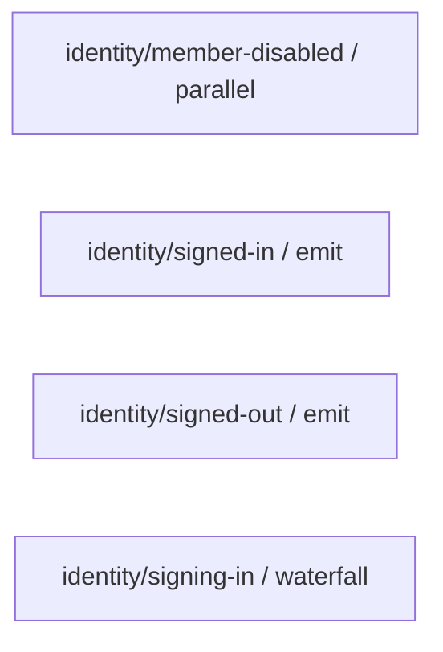

# 事件图

由 `qian docs generate` 派生；profile：` platform `。请修改输入后重新生成。

从选定 C# 源码目录的 QianEvent 定义与绑定调用派生，仅表示静态生产/消费关系；不代表当前 profile 已运行这些处理器。跨进程集成事件不在此图中。

| 事件 | 模式 | 声明位置 | 生产方 | 消费方 |
|---|---|---|---|---|
| ` identity/member-disabled ` | ` parallel ` | ` Qian.Identity.Abstractions.IdentityRuntimeEvents.MemberDisabled `（` packages/Qian.Identity.Abstractions/IdentityEvents.cs `:81） |  |  |
| ` identity/signed-in ` | ` emit ` | ` Qian.Identity.Abstractions.IdentityRuntimeEvents.SignedIn `（` packages/Qian.Identity.Abstractions/IdentityEvents.cs `:75） |  |  |
| ` identity/signed-out ` | ` emit ` | ` Qian.Identity.Abstractions.IdentityRuntimeEvents.SignedOut `（` packages/Qian.Identity.Abstractions/IdentityEvents.cs `:78） |  |  |
| ` identity/signing-in ` | ` waterfall ` | ` Qian.Identity.Abstractions.IdentityRuntimeEvents.SigningIn `（` packages/Qian.Identity.Abstractions/IdentityEvents.cs `:72） |  |  |

## 校验诊断

- warning：` packages/Qian.Runtime/Contracts.cs `:77，事件来自动态参数或外部二进制，未能静态解析；此调用不计入已验证映射。
- warning：` packages/Qian.Runtime/Contracts.cs `:81，事件来自动态参数或外部二进制，未能静态解析；此调用不计入已验证映射。
- warning：` packages/Qian.Runtime/PluginContext.Events.cs `:53，事件来自动态参数或外部二进制，未能静态解析；此调用不计入已验证映射。
