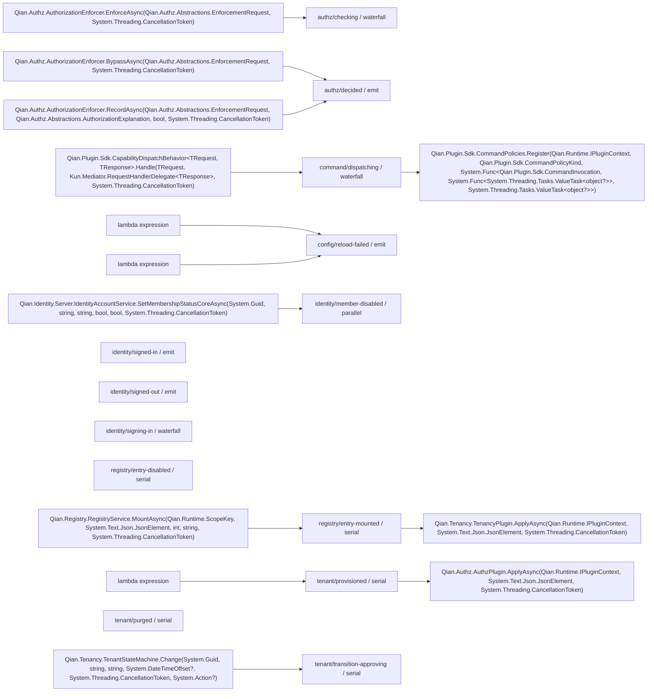

# 事件图

由 `qian docs generate` 派生；profile：` platform `。请修改输入后重新生成。

从选定 C# 源码目录的 QianEvent 定义与绑定调用派生，仅表示静态生产/消费关系；不代表当前 profile 已运行这些处理器。跨进程集成事件不在此图中。

| 事件 | 模式 | 声明位置 | 生产方 | 消费方 |
|---|---|---|---|---|
| ` authz/checking ` | ` waterfall ` | ` Qian.Authz.Abstractions.AuthzRuntimeEvents.Checking `（` packages/Qian.Authz.Abstractions/AuthzEnforcement.cs `:118） | ` Qian.Authz.AuthorizationEnforcer.EnforceAsync(Qian.Authz.Abstractions.EnforcementRequest, System.Threading.CancellationToken) `（` packages/Qian.Authz/AuthorizationEnforcer.cs `:45） |  |
| ` authz/decided ` | ` emit ` | ` Qian.Authz.Abstractions.AuthzRuntimeEvents.Decided `（` packages/Qian.Authz.Abstractions/AuthzEnforcement.cs `:122） | ` Qian.Authz.AuthorizationEnforcer.BypassAsync(Qian.Authz.Abstractions.EnforcementRequest, System.Threading.CancellationToken) `（` packages/Qian.Authz/AuthorizationEnforcer.cs `:83） ` Qian.Authz.AuthorizationEnforcer.RecordAsync(Qian.Authz.Abstractions.EnforcementRequest, Qian.Authz.Abstractions.AuthorizationExplanation, bool, System.Threading.CancellationToken) `（` packages/Qian.Authz/AuthorizationEnforcer.cs `:109） |  |
| ` command/dispatching ` | ` waterfall ` | ` Qian.Plugin.Sdk.CommandEvents.Dispatching `（` packages/Qian.Plugin.Sdk/Commands.cs `:21） | ` Qian.Plugin.Sdk.CapabilityDispatchBehavior<TRequest, TResponse>.Handle(TRequest, Kun.Mediator.RequestHandlerDelegate<TResponse>, System.Threading.CancellationToken) `（` packages/Qian.Plugin.Sdk/CommandPipeline.cs `:153） | ` Qian.Plugin.Sdk.CommandPolicies.Register(Qian.Runtime.IPluginContext, Qian.Plugin.Sdk.CommandPolicyKind, System.Func<Qian.Plugin.Sdk.CommandInvocation, System.Func<System.Threading.Tasks.ValueTask<object?>>, System.Threading.Tasks.ValueTask<object?>>) `（` packages/Qian.Plugin.Sdk/CommandPolicies.cs `:34） |
| ` config/reload-failed ` | ` emit ` | ` Qian.Config.ConfigRuntimeEvents.ReloadFailed `（` packages/Qian.Config.Abstractions/ConfigEvents.cs `:24） | ` lambda expression `（` packages/Qian.Config.Apollo/ConfigurationPlugins.cs `:33） ` lambda expression `（` packages/Qian.Config.Apollo/ConfigurationPlugins.cs `:52） |  |
| ` identity/member-disabled ` | ` parallel ` | ` Qian.Identity.Abstractions.IdentityRuntimeEvents.MemberDisabled `（` packages/Qian.Identity.Abstractions/IdentityEvents.cs `:121） | ` Qian.Identity.Server.IdentityAccountService.SetMembershipStatusCoreAsync(System.Guid, string, string, bool, bool, System.Threading.CancellationToken) `（` packages/Qian.Identity.Server/IdentityAccountService.Accounts.cs `:321） |  |
| ` identity/signed-in ` | ` emit ` | ` Qian.Identity.Abstractions.IdentityRuntimeEvents.SignedIn `（` packages/Qian.Identity.Abstractions/IdentityEvents.cs `:115） |  |  |
| ` identity/signed-out ` | ` emit ` | ` Qian.Identity.Abstractions.IdentityRuntimeEvents.SignedOut `（` packages/Qian.Identity.Abstractions/IdentityEvents.cs `:118） |  |  |
| ` identity/signing-in ` | ` waterfall ` | ` Qian.Identity.Abstractions.IdentityRuntimeEvents.SigningIn `（` packages/Qian.Identity.Abstractions/IdentityEvents.cs `:112） |  |  |
| ` registry/entry-disabled ` | ` serial ` | ` Qian.Surfaces.Abstractions.SurfaceHookEvents.EntryDisabled `（` packages/Qian.Surfaces.Abstractions/HookContracts.cs `:51） |  |  |
| ` registry/entry-mounted ` | ` serial ` | ` Qian.Surfaces.Abstractions.SurfaceHookEvents.EntryMounted `（` packages/Qian.Surfaces.Abstractions/HookContracts.cs `:49） | ` Qian.Registry.RegistryService.MountAsync(Qian.Runtime.ScopeKey, System.Text.Json.JsonElement, int, string, System.Threading.CancellationToken) `（` packages/Qian.Registry/RegistryService.cs `:161） | ` Qian.Tenancy.TenancyPlugin.ApplyAsync(Qian.Runtime.IPluginContext, System.Text.Json.JsonElement, System.Threading.CancellationToken) `（` packages/Qian.Tenancy/TenancyPlugin.cs `:33） |
| ` tenant/provisioned ` | ` serial ` | ` Qian.Surfaces.Abstractions.SurfaceHookEvents.TenantProvisioned `（` packages/Qian.Surfaces.Abstractions/HookContracts.cs `:45） | ` lambda expression `（` packages/Qian.Tenancy/TenantProvisioningOrchestrator.cs `:116） | ` Qian.Authz.AuthzPlugin.ApplyAsync(Qian.Runtime.IPluginContext, System.Text.Json.JsonElement, System.Threading.CancellationToken) `（` packages/Qian.Authz/AuthzPlugin.cs `:97） |
| ` tenant/purged ` | ` serial ` | ` Qian.Surfaces.Abstractions.SurfaceHookEvents.TenantPurged `（` packages/Qian.Surfaces.Abstractions/HookContracts.cs `:47） |  |  |
| ` tenant/transition-approving ` | ` serial ` | ` Qian.Tenancy.TenantLifecycle.Approving `（` packages/Qian.Tenancy.Abstractions/StateMachine.cs `:13） | ` Qian.Tenancy.TenantStateMachine.Change(System.Guid, string, string, System.DateTimeOffset?, System.Threading.CancellationToken, System.Action?) `（` packages/Qian.Tenancy/TenantStateMachine.cs `:59） |  |

## 校验诊断

- warning：` packages/Qian.Runtime/Contracts.cs `:77，事件来自动态参数或外部二进制，未能静态解析；此调用不计入已验证映射。
- warning：` packages/Qian.Runtime/Contracts.cs `:81，事件来自动态参数或外部二进制，未能静态解析；此调用不计入已验证映射。
- warning：` packages/Qian.Runtime/PluginContext.Events.cs `:51，事件来自动态参数或外部二进制，未能静态解析；此调用不计入已验证映射。
- warning：` packages/Qian.Surfaces.Hosting/HookBridgePlugin.cs `:32，事件来自动态参数或外部二进制，未能静态解析；此调用不计入已验证映射。
