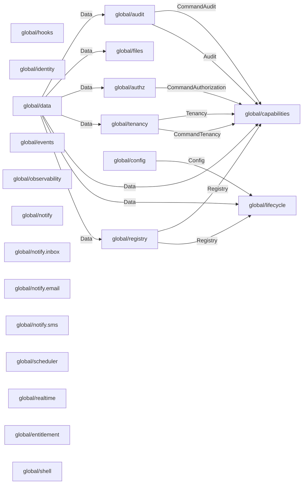

# 模块图

由 `qian docs generate` 派生；profile：` platform `。请修改输入后重新生成。

这是经过依赖校验的静态挂载计划，不是运行实例的就绪状态。

| 条目 | 组件 | 来源层 | 状态 |
|---|---|---|---|
| ` global/registry ` | ` qian.registry@1.0.0 ` | 0（bundle） | 配置骨架 |
| ` global/lifecycle ` | ` qian.lifecycle@1.0.0 ` | 0（bundle） | 配置骨架 |
| ` global/capabilities ` | ` qian.capabilities@1.0.0 ` | 0（bundle） | 配置骨架 |
| ` global/hooks ` | ` qian.hooks@1.0.0 ` | 0（bundle） | 配置骨架 |
| ` global/tenancy ` | ` qian.tenancy@1.0.0 ` | 0（bundle） | 配置骨架 |
| ` global/identity ` | ` qian.identity.client@1.0.0 ` | 0（bundle） | 配置骨架 |
| ` global/authz ` | ` qian.authz@1.0.0 ` | 0（bundle） | 配置骨架 |
| ` global/data ` | ` qian.data@1.0.0 ` | 0（bundle） | 已解析，尚未执行 |
| ` global/files ` | ` qian.files@1.0.0 ` | 0（bundle） | 已解析，尚未执行 |
| ` global/config ` | ` qian.config.apollo@1.0.0 ` | 0（bundle） | 配置骨架 |
| ` global/events ` | ` qian.events@1.0.0 ` | 0（bundle） | 已解析，尚未执行 |
| ` global/audit ` | ` qian.audit@1.0.0 ` | 0（bundle） | 配置骨架 |
| ` global/observability ` | ` qian.observability@1.0.0 ` | 0（bundle） | 配置骨架 |
| ` global/notify ` | ` qian.notify@1.0.0 ` | 0（bundle） | 配置骨架 |
| ` global/notify.inbox ` | ` qian.notify.channel.inbox@1.0.0 ` | 0（bundle） | 配置骨架 |
| ` global/notify.email ` | ` qian.notify.channel.email@1.0.0 ` | 0（bundle） | 配置骨架 |
| ` global/notify.sms ` | ` qian.notify.channel.sms@1.0.0 ` | 0（bundle） | 配置骨架 |
| ` global/scheduler ` | ` qian.scheduler@1.0.0 ` | 0（bundle） | 配置骨架 |
| ` global/realtime ` | ` qian.realtime@1.0.0 ` | 0（bundle） | 配置骨架 |
| ` global/entitlement ` | ` qian.entitlement@1.0.0 ` | 0（bundle） | 配置骨架 |
| ` global/shell ` | ` qian.shell@1.0.0 ` | 1（bundle） | 配置骨架 |

挂载顺序：` global/data ` → ` global/registry ` → ` global/config ` → ` global/lifecycle ` → ` global/audit ` → ` global/authz ` → ` global/tenancy ` → ` global/capabilities ` → ` global/hooks ` → ` global/identity ` → ` global/files ` → ` global/events ` → ` global/observability ` → ` global/notify ` → ` global/notify.inbox ` → ` global/notify.email ` → ` global/notify.sms ` → ` global/scheduler ` → ` global/realtime ` → ` global/entitlement ` → ` global/shell `

