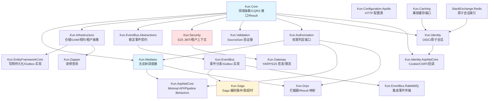
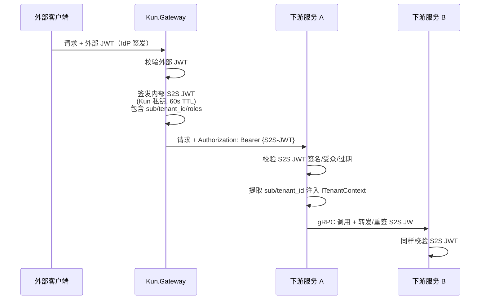

> For AI agents: the complete documentation index is available at /pr-preview/pr-122/llms.txt, the full documentation bundle is available at /pr-preview/pr-122/llms-full.txt.

# Kun Framework 架构设计与产品白皮书

:::info 镜像页
本页镜像自 kun 仓库 [`docs/whitepaper.md`](https://github.com/idadawn/kun/blob/v2026.10.14/docs/whitepaper.md)（`v2026.10.14`）。Kun 文档与代码不一致处以代码为准（[ADR-001 D1.8](/pr-preview/pr-122/design/adr/adr-001-kun-relationship.md)）；Qian 对 Kun 的选用与约束见[与 Qian 的关系](/pr-preview/pr-122/sdk/kun/with-qian.md)。改动请提到 kun 仓库。
:::

> **"北冥有鱼，其名为鲲。鲲之大，不知其几千里也；化而为鸟，其名为鹏。"** ——《庄子·逍遥游》

**Slogan**: _From the deep, to the sky._ (出于深渊，翱翔云端)
**作者**: Manus AI
**日期**: 2026年4月18日

***

## 1. 框架愿景与定位

**Kun Framework** 是一款专为 .NET 10 打造的现代化云原生微服务开发框架。名字源自《庄子·逍遥游》，寓意框架的演进能力：从轻量级单体（深渊之鲲），无缝演化为支撑海量并发的分布式微服务架构（云端之鹏）。

### 1.1 核心设计理念

1. **AOT-Ready 分层策略**：网关层、gRPC 无状态服务、CQRS 调度器、JSON 序列化层严格遵循 AOT 兼容（无反射、源生成优先）；数据访问层以 trimming-safe 为目标。定位诚实、落地可行。
2. **严格的领域驱动设计（DDD）**：领域层零基础设施依赖。内置聚合根、实体、值对象、规约模式（Specification）、领域事件基类，强制保护业务不变量。
3. **双引擎数据访问**：写侧（Command）使用 **EF Core 10** 以获得变更追踪、工作单元、丰富的 DDD 映射能力；读侧（Query）使用 **Dapper AOT** 以获得极致性能和 AOT 友好性。与 CQRS 天然契合。
4. **多协议 RPC**：对外 HTTP/JSON（Minimal API），内部 gRPC（HTTP/2 + Protobuf），网关层支持 gRPC-Web 协议转换。
5. **可靠的事件驱动（EDA）**：原生集成 Outbox Pattern，业务数据与事件在同一本地事务中原子落库；稳定事件标识符支持版本演进；跨进程边界自动传播 W3C Trace Context。
6. **内置分布式事务编排**：原生提供 Saga Orchestration，将跨服务的长事务（补偿、超时、幂等）下沉至框架，业务方只写正向步骤与补偿逻辑。
7. **零信任服务间通信**：网关签发短生命周期内部 S2S JWT，下游服务独立校验；配合 Kubernetes NetworkPolicy 形成纵深防御。
8. **多租户 First-Class**：v1 即内置 `ITenantContext` 抽象、EF Core 全局查询过滤器、缓存 Key 租户隔离、消息路由租户标签。
9. **面向 Serverless 与微服务**：无缝集成 .NET Aspire 进行编排与可观测性（OpenTelemetry）。

***

## 2. 完整技术栈

### 2.1 核心技术选型总览

| 分类           | 技术 / 组件                      |     版本     | 用途说明                                   |
| :----------- | :--------------------------- | :--------: | :------------------------------------- |
| **运行时**      | .NET                         |   10 LTS   | 基础运行时，部分服务走 Native AOT                 |
| **服务编排**     | .NET Aspire                  |     9.x    | 本地一键编排、服务发现、可观测性                       |
| **ORM（写侧）**  | EF Core 10                   |    10.x    | 聚合根变更追踪、UoW、Migrations、Fluent 映射       |
| **ORM（读侧）**  | Dapper AOT                   |     9.x    | 只读查询高性能数据访问，完整 AOT 兼容                  |
| **主数据库**     | PostgreSQL                   |     16+    | 默认选型；JSONB、分区、逻辑复制能力完善                 |
| **备选数据库**    | MySQL                        |     8.x    | 可替换方案，EF Core Provider 支持良好            |
| **API 网关**   | YARP                         |     2.x    | 反向代理、gRPC 透传、S2S JWT 签发                |
| **RPC 协议**   | gRPC（Grpc.AspNetCore）        | .NET 10 内置 | 微服务内部高性能强类型通信                          |
| **HTTP API** | Minimal APIs                 | .NET 10 内置 | 对外 REST 接口，AOT 友好                      |
| **CQRS 调度**  | Kun.Mediator（自研）             |      —     | `FrozenDictionary` 无反射调度，AOT 原生兼容      |
| **分布式事务**    | Kun.Saga（自研）                 |      —     | Saga Orchestration 编排器                 |
| **消息队列**     | RabbitMQ                     |     3.x    | 集成事件跨服务异步传递                            |
| **缓存**       | HybridCache                  | .NET 10 内置 | L1 内存 + L2 Redis 两级缓存                  |
| **分布式缓存**    | Redis                        |     7.x    | HybridCache L2、幂等键存储、分布式限流             |
| **外部认证**     | ASP.NET Core JWT Bearer      | .NET 10 内置 | 网关层校验外部 IdP 颁发的访问令牌                    |
| **内部认证**     | Kun.Security（自研）             |      —     | 网关签发、下游校验的短生命周期 S2S JWT                |
| **限流**       | ASP.NET Core Rate Limiting   | .NET 10 内置 | 网关层固定/滑动窗口限流                           |
| **可观测性**     | OpenTelemetry                |     1.x    | 追踪、指标、结构化日志；事件消息跨边界自动传播                |
| **验证**       | Kun.Validation（SourceGen）    |      —     | 编译时生成验证代码，AOT 友好                       |
| **序列化**      | System.Text.Json + SourceGen | .NET 10 内置 | 所有事件注册到 `JsonSerializerContext`        |
| **集成测试**     | Testcontainers for .NET      |     3.x    | PostgreSQL / RabbitMQ / Redis 真实容器集成测试 |
| **容器化**      | Docker / Kubernetes          |      —     | 微服务部署与编排                               |
| **CI/CD**    | GitHub Actions               |      —     | 自动化构建、AOT 发布、NuGet 包分发                 |

### 2.2 为什么选择 EF Core 10 + Dapper AOT 双引擎？

| 维度            | EF Core 10（写侧）                 | Dapper AOT（读侧）        |
| :------------ | :----------------------------- | :-------------------- |
| **适用场景**      | Command、聚合根持久化、复杂事务            | Query、报表、列表页、DTO 投影   |
| **核心能力**      | 变更追踪、导航属性、Fluent 映射、Migrations | 原生 SQL、零开销对象映射、编译时源生成 |
| **AOT 兼容性**   | .NET 10 中持续完善，trimming-safe    | 完整 AOT 原生支持           |
| **DDD 契合度**   | 天然支持聚合根 + 子实体持久化               | 无状态、无追踪，适合读模型         |
| **与 CQRS 契合** | Command Handler 中使用            | Query Handler 中使用     |

这个组合让**写侧可以放心使用 ORM 的表达能力**来保护领域不变量，**读侧则把性能和 AOT 兼容性拉满**——正是 CQRS 分治思想在技术栈上的自然落地。

### 2.3 通信协议选型原则

| 通信场景             | 推荐协议                      | 核心原因                   |
| :--------------- | :------------------------ | :--------------------- |
| 对外开放 API（前端、第三方） | HTTP/JSON（Minimal API）    | 通用性强，易于调试与集成           |
| 微服务内部同步调用        | gRPC（HTTP/2 + Protobuf）   | 强类型契约、二进制序列化、性能高       |
| 浏览器直连后端 gRPC     | gRPC-Web（网关协议转换）          | 浏览器不支持原生 HTTP/2 gRPC 帧 |
| 跨服务异步通知与解耦       | RabbitMQ + Outbox Pattern | 服务解耦、可靠投递、最终一致性        |
| 跨服务长事务           | Saga Orchestration        | 补偿、超时、幂等一体化编排          |

***

## 3. 整体架构概览

### 3.1 模块依赖关系



当前配置与权限端口增量见 [ADR-016](/pr-preview/pr-122/sdk/kun/architecture/adr-016-platform-ports.md)：Kun 只提供权限端口和接入点，平台负责引擎；Apollo 以独立标准配置源落位。

### 3.2 模块职责清单

| 模块                          | 核心职责                                        | 依赖                   |
| :-------------------------- | :------------------------------------------ | :------------------- |
| `Kun.Core`                  | 领域抽象、CQRS 接口、Result、异常、`ITenantContext`     | 无                    |
| `Kun.Mediator`              | `FrozenDictionary` 无反射调度、Pipeline Behaviors | `Kun.Core`           |
| `Kun.Infrastructure`        | 仓储接口、UoW、规约、`IProcessedMessageStore`        | `Kun.Core`           |
| `Kun.EntityFrameworkCore`   | 写侧 EF Core 实现、Outbox 落库、租户过滤器               | `Kun.Infrastructure` |
| `Kun.Dapper`                | 读侧 Dapper AOT 封装、只读连接工厂                     | `Kun.Infrastructure` |
| `Kun.EventBus.Abstractions` | 稳定事件标记与 JSON 注册端口                           | `Kun.Core`           |
| `Kun.EventBus`              | 领域事件、集成事件抽象、Outbox 发布器                      | `Kun.Core`           |
| `Kun.EventBus.RabbitMQ`     | RabbitMQ 传输、消费端幂等中间件                        | `Kun.EventBus`       |
| `Kun.Saga`                  | Saga 定义、编排器、补偿调度、超时检测                       | `Kun.EventBus`       |
| `Kun.Security`              | 内部 S2S JWT 签发/校验、租户上下文注入                    | `Kun.Core`           |
| `Kun.Validation`            | SourceGen 验证器，AOT 兼容                        | `Kun.Core`           |
| `Kun.AspNetCore`            | Minimal API 扩展、全局异常、Pipeline Behaviors      | `Kun.Mediator`       |
| `Kun.Grpc`                  | gRPC 拦截器、Result→gRPC 状态映射                   | `Kun.Mediator`       |
| `Kun.Gateway`               | YARP 扩展、S2S JWT 签发、限流、gRPC-Web              | `Kun.Security`       |

***

## 4. 核心构建块（Building Blocks）设计

### 4.1 纯净的领域模型

领域基类零基础设施依赖，所有持久化映射下沉至 `Kun.EntityFrameworkCore` 的 `IEntityTypeConfiguration<T>`。

```csharp
// Kun.Core - 零基础设施依赖
public abstract class AggregateRoot<TKey, TUserKey> : IAggregateRoot<TKey>, ISoftDelete, IAuditedObject<TUserKey>
{
    public TKey Id { get; protected set; } = default!;

    public DateTime CreatedAt { get; protected set; }
    public TUserKey? CreatedBy { get; protected set; }

    public DateTime? UpdatedAt { get; protected set; }
    public TUserKey? UpdatedBy { get; protected set; }

    public bool IsDeleted { get; protected set; }
    public DateTime? DeletedAt { get; protected set; }

    private readonly List<IDomainEvent> _domainEvents = new();

    public IReadOnlyCollection<IDomainEvent> DomainEvents => _domainEvents.AsReadOnly();
    public void AddDomainEvent(IDomainEvent domainEvent) => _domainEvents.Add(domainEvent);
    public void ClearDomainEvents() => _domainEvents.Clear();

    public virtual void Delete()
    {
        IsDeleted = true;
        DeletedAt = DateTime.UtcNow;
    }
}

// 便捷重载：用户 ID 默认为 Guid
public abstract class AggregateRoot<TKey> : AggregateRoot<TKey, Guid> { }
```

审计用户 ID 泛型化，兼容 `Guid`（本地用户）、`string`（外部 IdP 的 `sub`）、`long`（数据库自增）等不同场景。

### 4.2 持久化映射（下沉到基础设施层）

```csharp
// Kun.EntityFrameworkCore - 持久化细节隔离在此层
public class ProductConfiguration : IEntityTypeConfiguration<Product>
{
    public void Configure(EntityTypeBuilder<Product> builder)
    {
        builder.ToTable("products");
        builder.HasKey(p => p.Id);

        builder.Property(p => p.Name).HasMaxLength(200).IsRequired();
        builder.Property(p => p.Price).HasPrecision(18, 2);

        // 软删除全局过滤器
        builder.HasQueryFilter(p => !p.IsDeleted);

        // 值对象使用 Owned Type 映射
        builder.OwnsOne(p => p.Dimensions);

        // 领域事件不持久化
        builder.Ignore(p => p.DomainEvents);
    }
}
```

### 4.3 高性能 CQRS 调度器（Kun.Mediator）

`Kun.Mediator` 专为 .NET 10 Native AOT 设计，填补 MediatR v12 之后商业授权带来的空位。

```csharp
public sealed class KunMediator : ISender, IPublisher
{
    private readonly IServiceProvider _serviceProvider;
    private readonly FrozenDictionary<Type, RequestHandlerBase> _handlers;

    public KunMediator(IServiceProvider serviceProvider, FrozenDictionary<Type, RequestHandlerBase> handlers)
    {
        _serviceProvider = serviceProvider;
        _handlers = handlers;
    }

    public ValueTask<TResponse> Send<TResponse>(IRequest<TResponse> request, CancellationToken ct = default)
    {
        if (!_handlers.TryGetValue(request.GetType(), out var handlerBase))
            throw new InvalidOperationException($"未找到 {request.GetType().Name} 的处理器");

        var handler = (RequestHandlerWrapper<TResponse>)handlerBase;
        return handler.Handle(request, _serviceProvider, ct);
    }
}
```

Handler 注册由配套的源生成器在编译期完成，`FrozenDictionary` 查找 O(1)，零反射。

### 4.4 租户上下文抽象

```csharp
// Kun.Core
public interface ITenantContext
{
    string? TenantId { get; }
    bool IsMultiTenant { get; }
}

// Kun.EntityFrameworkCore - 自动挂载全局过滤器
public abstract class KunDbContext : DbContext
{
    private readonly ITenantContext _tenantContext;

    protected override void OnModelCreating(ModelBuilder modelBuilder)
    {
        foreach (var entityType in modelBuilder.Model.GetEntityTypes())
        {
            if (typeof(IMultiTenant).IsAssignableFrom(entityType.ClrType))
            {
                // 对实现了 IMultiTenant 的实体自动附加 TenantId 过滤
                modelBuilder.Entity(entityType.ClrType).AddTenantQueryFilter(_tenantContext);
            }
        }
    }
}
```

v1 即约定清楚"租户 ID 从哪来、怎么传、怎么过滤"，业务开发者后续接入 SaaS 场景时零改动。

***

## 5. 数据访问层：写读分离双引擎

### 5.1 写侧 —— EF Core 10 仓储与规约

```csharp
// 规约示例
public class ActiveProductsSpec : Specification<Product>
{
    public ActiveProductsSpec(int pageIndex, int pageSize)
    {
        AddCriteria(p => p.StockQuantity > 0);   // IsDeleted 由全局过滤器处理
        ApplyOrderByDescending(p => p.CreatedAt);
        ApplyPaging(pageIndex * pageSize, pageSize);
    }
}

// 基于 EF Core 的仓储实现
public class EfRepository<T> : IRepository<T> where T : class, IAggregateRoot
{
    private readonly KunDbContext _db;

    public async Task<T?> GetByIdAsync(object id, CancellationToken ct = default)
        => await _db.Set<T>().FindAsync(new[] { id }, ct);

    public async Task<List<T>> ListAsync(ISpecification<T> spec, CancellationToken ct = default)
        => await SpecificationEvaluator.Default.GetQuery(_db.Set<T>(), spec).ToListAsync(ct);

    public async Task AddAsync(T entity, CancellationToken ct = default)
        => await _db.Set<T>().AddAsync(entity, ct);
}
```

### 5.2 读侧 —— Dapper AOT 查询服务

```csharp
// 用于 Query Handler 的高性能只读投影
public interface IProductReadService
{
    Task<ProductListDto?> GetListAsync(Guid tenantId, int page, int size, CancellationToken ct);
}

public class ProductReadService : IProductReadService
{
    private readonly IReadDbConnectionFactory _factory;

    [DapperAot] // Dapper AOT 源生成器在编译期生成映射代码
    public async Task<ProductListDto?> GetListAsync(Guid tenantId, int page, int size, CancellationToken ct)
    {
        using var conn = await _factory.CreateAsync(ct);

        var sql = """
            SELECT id, name, price, stock_quantity
            FROM products
            WHERE tenant_id = @TenantId AND is_deleted = false
            ORDER BY created_at DESC
            LIMIT @Size OFFSET @Offset
            """;

        var items = await conn.QueryAsync<ProductItemDto>(sql,
            new { TenantId = tenantId, Size = size, Offset = page * size });

        return new ProductListDto(items.ToList(), page, size);
    }
}
```

Dapper AOT 通过 `[DapperAot]` 特性触发源生成器，在编译期生成 `DbDataReader → DTO` 的映射代码，**完全不走运行时反射**，Native AOT 发布无任何警告。

### 5.3 工作单元与 Outbox 原子化落库

当前入口为 `EfUnitOfWork.SaveChangesAsync`：在提交前、同 scope 派发领域通知，通知将集成事件暂存到 Buffer，再把业务变更与 Outbox 一并保存；不要以 `DbContext.SaveChangesAsync` 直接替代 UoW。完整实现与装配见 [消息指南](/pr-preview/pr-122/sdk/kun/guides/outbox-and-integration-events.md)。

**设计要点**：

1. **一个事务写入所有变更**：EF Core 的 `SaveChanges` 本身就是一个事务边界，聚合根的 Insert/Update 与 Outbox 的 Insert 在同一次提交中原子完成。
2. **稳定事件标识符**：用 `"order.created.v1"` 这样的字符串 ID 代替 `AssemblyQualifiedName`，消除程序集版本、强名称、命名空间重构带来的反序列化失败风险，并天然支持事件版本演进。
3. **AOT 安全的 JSON 序列化**：通过 `KunJsonContext` 源生成的 `JsonTypeInfo` 进行序列化，避免运行时反射。
4. **追踪上下文落库**：`TraceParent`/`TraceState` 随 Outbox 消息持久化，发布到 RabbitMQ 时写入 Header，消费端恢复 `Activity.Current`，分布式追踪不断链。

***

## 6. 事件驱动：Outbox 发布器与消费端幂等

### 6.1 Outbox 发布器

```csharp
public class OutboxPublisher : BackgroundService
{
    protected override async Task ExecuteAsync(CancellationToken stoppingToken)
    {
        while (!stoppingToken.IsCancellationRequested)
        {
            await using var scope = _serviceProvider.CreateAsyncScope();
            var db = scope.ServiceProvider.GetRequiredService<KunDbContext>();
            var bus = scope.ServiceProvider.GetRequiredService<IIntegrationEventBus>();

            var pending = await db.Set<OutboxMessage>()
                .Where(m => m.Status == OutboxStatus.Pending)
                .OrderBy(m => m.OccurredAt)
                .Take(100)
                .ToListAsync(stoppingToken);

            foreach (var msg in pending)
            {
                // 恢复追踪上下文，链路不断
                using var activity = _activitySource.StartActivity(
                    "outbox.publish", ActivityKind.Producer,
                    parentId: msg.TraceParent);

                await bus.PublishAsync(msg, stoppingToken);
                msg.Status = OutboxStatus.Published;
                msg.PublishedAt = DateTime.UtcNow;
            }

            await db.SaveChangesAsync(stoppingToken);
            await Task.Delay(TimeSpan.FromSeconds(1), stoppingToken);
        }
    }
}
```

### 6.2 消费端幂等中间件

Outbox 保证"至少一次"投递，消费者必须幂等。`Kun.EventBus` 内置 `IProcessedMessageStore`，消费 Handler 被自动包装一层去重检查：

默认存储为 `Kun.EventBus.Idempotency.RedisProcessedMessageStore`。装饰器先调用 `IsProcessedAsync` 检查成功记录，handler 成功后再调用 `TryMarkProcessedAsync` 并 ack；失败不留下成功标记。原先先标记后处理会使失败消息在重投时被误认为成功，S1-KUN-002 已修复。

框架提供至少一次投递和成功记录去重；并发重复、业务成功但标记未持久化等窗口仍可能再次调用 handler，业务写入必须用幂等键或同事务消费记录保护。详见 [可靠性边界与迁移](/pr-preview/pr-122/sdk/kun/guides/outbox-and-integration-events.md#可靠性边界与迁移s1-kun-002)。

***

## 7. 分布式事务：Saga 编排器（Kun.Saga）

在微服务架构下，跨服务的长事务无法用单库事务完成。Kun.Saga 采用 **Orchestration（编排）模式**：由一个中央协调器按顺序驱动各步骤，失败时按相反顺序执行补偿。

### 7.1 为什么选择 Orchestration 而非 Choreography

| 维度           | Orchestration（Kun 选用）       | Choreography        |
| :----------- | :-------------------------- | :------------------ |
| 流程可见性        | 中央协调器代码即流程定义，清晰             | 事件散落各服务，需拼图         |
| 补偿编写         | 集中在 Saga 定义里，显式             | 需要每个服务订阅失败事件        |
| 超时 / 状态持久化   | 协调器直接维护                     | 难以统一                |
| 与 Outbox 契合度 | 协调器通过 Outbox 发 Command，天然可靠 | 多服务各自发事件，幂等 / 顺序难保证 |
| 耦合度          | 协调器知道所有步骤                   | 各服务解耦但流程隐式          |
| 可测试性         | Saga 可作为单元测试对象              | 需跨服务集成测试            |

对于 **需要明确补偿逻辑** 的业务（下单、付款、发货、订阅变更），Orchestration 的工程收益显著大于耦合成本。

### 7.2 核心抽象

```csharp
// Kun.Saga
public interface ISagaContext
{
    Guid SagaId { get; }
    string TenantId { get; }
}

public interface ISaga<TContext> where TContext : ISagaContext
{
    string Name { get; }                                    // 稳定 Saga 标识，如 "order.create"
    IReadOnlyList<ISagaStep<TContext>> Steps { get; }
    TimeSpan DefaultStepTimeout { get; }
}

public interface ISagaStep<TContext> where TContext : ISagaContext
{
    string Name { get; }                                    // 稳定步骤标识
    Task ExecuteAsync(TContext ctx, CancellationToken ct);
    Task CompensateAsync(TContext ctx, CancellationToken ct);
    TimeSpan? Timeout { get; }                              // 步骤超时
}
```

### 7.3 业务示例：订单创建 Saga

```csharp
// 上下文（贯穿整个 Saga 的数据载体）
public class OrderSagaContext : ISagaContext
{
    public Guid SagaId { get; init; }
    public string TenantId { get; init; } = default!;
    public Guid OrderId { get; init; }
    public decimal TotalAmount { get; init; }
    public List<OrderLine> Items { get; init; } = new();

    // 各步骤产出的状态（用于补偿时知道要回滚什么）
    public Guid? ReservationId { get; set; }
    public Guid? PaymentId { get; set; }
    public Guid? ShipmentId { get; set; }
}

// Saga 定义
public class OrderSaga : ISaga<OrderSagaContext>
{
    public string Name => "order.create";
    public TimeSpan DefaultStepTimeout => TimeSpan.FromSeconds(30);

    public IReadOnlyList<ISagaStep<OrderSagaContext>> Steps { get; } = new ISagaStep<OrderSagaContext>[]
    {
        new ReserveInventoryStep(),
        new ProcessPaymentStep(),
        new CreateShipmentStep(),
        new NotifyCustomerStep()
    };
}

// 单个步骤：预留库存 + 补偿释放库存
public class ReserveInventoryStep : ISagaStep<OrderSagaContext>
{
    public string Name => "reserve-inventory";
    public TimeSpan? Timeout => TimeSpan.FromSeconds(15);

    private readonly ISender _mediator;

    public async Task ExecuteAsync(OrderSagaContext ctx, CancellationToken ct)
    {
        var result = await _mediator.Send(
            new ReserveInventoryCommand(ctx.OrderId, ctx.Items), ct);

        if (!result.IsSuccess)
            throw new SagaStepFailedException(Name, result.Error!);

        ctx.ReservationId = result.Value!.ReservationId;
    }

    public async Task CompensateAsync(OrderSagaContext ctx, CancellationToken ct)
    {
        // 补偿必须幂等：即使 ReservationId 为空（执行时就失败了）也不能抛错
        if (ctx.ReservationId is null) return;
        await _mediator.Send(new ReleaseInventoryCommand(ctx.ReservationId.Value), ct);
    }
}
```

### 7.4 编排器实现要点

```csharp
public interface ISagaOrchestrator
{
    Task<Guid> StartAsync<TContext>(TContext ctx, CancellationToken ct)
        where TContext : ISagaContext;
}

public class SagaOrchestrator<TSaga, TContext> : ISagaOrchestrator
    where TSaga : ISaga<TContext>
    where TContext : ISagaContext
{
    private readonly TSaga _saga;
    private readonly ISagaInstanceStore _store;     // 基于 EF Core 的状态持久化
    private readonly KunDbContext _db;

    public async Task<Guid> StartAsync(TContext ctx, CancellationToken ct)
    {
        // 1) 持久化 Saga 实例（与业务命令同事务）
        var instance = new SagaInstance
        {
            Id = ctx.SagaId,
            SagaName = _saga.Name,
            TenantId = ctx.TenantId,
            ContextPayload = JsonSerializer.Serialize(ctx, KunJsonContext.Default.GetTypeInfo(typeof(TContext))!),
            CurrentStepIndex = 0,
            State = SagaState.Running,
            StartedAt = DateTime.UtcNow,
            TimeoutAt = DateTime.UtcNow.Add(_saga.DefaultStepTimeout)
        };
        await _store.AddAsync(instance, ct);

        // 2) 投递首步执行消息到 Outbox（保证与业务事务原子）
        await _store.EnqueueStepAsync(instance.Id, stepIndex: 0, ct);

        await _db.SaveChangesAsync(ct);
        return instance.Id;
    }

    // 由 SagaStepExecutor 后台服务驱动，而非同步调用
    internal async Task ExecuteStepAsync(Guid sagaId, int stepIndex, CancellationToken ct)
    {
        var instance = await _store.GetAsync(sagaId, ct);
        var ctx = JsonSerializer.Deserialize<TContext>(
            instance.ContextPayload, KunJsonContext.Default.GetTypeInfo(typeof(TContext))!)!;
        var step = _saga.Steps[stepIndex];

        try
        {
            await step.ExecuteAsync(ctx, ct);
            instance.ContextPayload = JsonSerializer.Serialize(ctx, ...);
            instance.CurrentStepIndex = stepIndex + 1;

            if (instance.CurrentStepIndex >= _saga.Steps.Count)
            {
                instance.State = SagaState.Completed;
                instance.CompletedAt = DateTime.UtcNow;
            }
            else
            {
                await _store.EnqueueStepAsync(sagaId, instance.CurrentStepIndex, ct);
            }
        }
        catch (Exception ex)
        {
            _logger.LogWarning(ex, "Saga {SagaId} 步骤 {Step} 失败，进入补偿", sagaId, step.Name);
            instance.State = SagaState.Compensating;
            instance.FailureReason = ex.Message;
            await _store.EnqueueCompensationAsync(sagaId, stepIndex, ct);
        }

        await _db.SaveChangesAsync(ct);
    }

    internal async Task CompensateAsync(Guid sagaId, int fromStepIndex, CancellationToken ct)
    {
        var instance = await _store.GetAsync(sagaId, ct);
        var ctx = JsonSerializer.Deserialize<TContext>(instance.ContextPayload, ...)!;

        // 从失败步骤开始，反向执行已完成步骤的补偿
        for (var i = fromStepIndex; i >= 0; i--)
        {
            await _saga.Steps[i].CompensateAsync(ctx, ct);
        }

        instance.State = SagaState.Compensated;
        instance.CompletedAt = DateTime.UtcNow;
        await _db.SaveChangesAsync(ct);
    }
}
```

### 7.5 超时检测（后台服务）

```csharp
public class SagaTimeoutDetector : BackgroundService
{
    protected override async Task ExecuteAsync(CancellationToken stoppingToken)
    {
        while (!stoppingToken.IsCancellationRequested)
        {
            await using var scope = _serviceProvider.CreateAsyncScope();
            var db = scope.ServiceProvider.GetRequiredService<KunDbContext>();

            var timedOut = await db.Set<SagaInstance>()
                .Where(s => s.State == SagaState.Running && s.TimeoutAt < DateTime.UtcNow)
                .Take(50)
                .ToListAsync(stoppingToken);

            foreach (var instance in timedOut)
            {
                _logger.LogWarning("Saga {SagaId} 超时，触发补偿", instance.Id);
                instance.State = SagaState.Compensating;
                instance.FailureReason = "Timeout";
                // 入队补偿任务
                await _store.EnqueueCompensationAsync(instance.Id, instance.CurrentStepIndex - 1, stoppingToken);
            }

            await db.SaveChangesAsync(stoppingToken);
            await Task.Delay(TimeSpan.FromSeconds(5), stoppingToken);
        }
    }
}
```

### 7.6 设计保证

| 保证项        | 实现方式                                           |
| :--------- | :--------------------------------------------- |
| **启动原子性**  | SagaInstance 持久化 + 首步入队与业务 Command 同一 EF 事务    |
| **步骤幂等**   | 每次执行前通过 `IProcessedMessageStore` 去重            |
| **补偿反向顺序** | 编排器从失败步骤开始，`i-- CompensateAsync`               |
| **补偿自身幂等** | 约定：补偿实现必须允许在"未执行/部分执行"的上下文上安全调用                |
| **超时处理**   | `SagaTimeoutDetector` 后台服务检测 `TimeoutAt < Now` |
| **状态可查询**  | `SagaInstance` 表即是运行时快照，运维可直接查询状态              |
| **追踪串联**   | Saga 启动时的 TraceId 写入 `SagaInstance`，所有步骤继承     |

***

## 8. 微服务通信：Minimal API 与 gRPC 双引擎

对外 HTTP/JSON（Minimal API），内部 gRPC，两者共享底层 CQRS Handler。

### 8.1 gRPC 服务端 —— Result 模式无缝映射

```csharp
public class CatalogGrpcEndpoint : CatalogGrpcService.CatalogGrpcServiceBase
{
    private readonly ISender _mediator;

    public override async Task<ProductResponse> GetProductById(
        GetProductRequest request, ServerCallContext context)
    {
        var query = new GetProductByIdQuery(Guid.Parse(request.Id));
        var result = await _mediator.Send(query, context.CancellationToken);

        // Result 模式 → gRPC 状态映射交由 Kun.Grpc 拦截器统一处理
        // Handler 代码保持干净，只返回 Result<T>
        return result.EnsureSuccess().ToProto();
    }
}
```

### 8.2 gRPC 全局拦截器：Result → RpcException 自动映射

```csharp
public class KunResultToRpcInterceptor : Interceptor
{
    public override async Task<TResponse> UnaryServerHandler<TRequest, TResponse>(
        TRequest request, ServerCallContext context,
        UnaryServerMethod<TRequest, TResponse> continuation)
    {
        try
        {
            return await continuation(request, context);
        }
        catch (ResultFailureException ex)  // Kun 框架约定的失败异常
        {
            var status = ex.Error.Type switch
            {
                ErrorType.NotFound       => StatusCode.NotFound,
                ErrorType.Validation     => StatusCode.InvalidArgument,
                ErrorType.Conflict       => StatusCode.FailedPrecondition,
                ErrorType.Unauthorized   => StatusCode.Unauthenticated,
                ErrorType.Forbidden      => StatusCode.PermissionDenied,
                _                        => StatusCode.Internal
            };
            throw new RpcException(new Status(status, ex.Error.Message));
        }
        catch (Exception ex)
        {
            _logger.LogError(ex, "gRPC 未处理异常: {Method}", context.Method);
            throw new RpcException(new Status(StatusCode.Internal, "服务器内部错误"));
        }
    }
}
```

### 8.3 客户端调用（结合 .NET Aspire 服务发现）

```csharp
builder.Services.AddGrpcClient<CatalogGrpcService.CatalogGrpcServiceClient>(o =>
{
    o.Address = new Uri("https+http://catalog-api");
})
.AddKunServiceAuth();  // 自动在请求中注入 S2S JWT（见下一章）
```

***

## 9. 安全架构：零信任服务间通信

Kun Framework 采用 **内部 S2S JWT + 网络策略** 的纵深防御方案：任何能直连 Pod 的流量都不被默认信任，必须持有网关签发的有效 S2S 令牌。

### 9.1 信任边界与整体流程



关键设计点：

1. **两套 JWT 分离**：外部 JWT（用户身份）由 IdP 签发、网关校验；内部 S2S JWT（服务间令牌）由网关用**独立私钥**签发，下游用**独立公钥**校验。两套密钥互不相干。
2. **S2S JWT 短生命周期**：TTL 控制在 60 秒到 5 分钟，即使泄露风险窗口也极小。
3. **内部签名密钥不暴露**：S2S 公钥只在内部网络 JWKS 端点暴露，永不对外发布。
4. **特定 Audience**：S2S JWT 的 `aud` 声明为 `kun-internal`，下游只接受该 audience 的令牌，防止外部 JWT 被误用为内部令牌。
5. **网络层兜底**：配合 Kubernetes NetworkPolicy，下游服务**仅接受来自网关命名空间**的入站流量，形成纵深防御。

### 9.2 S2S JWT Claim 结构

```json
{
  "iss": "kun-gateway",
  "aud": "kun-internal",
  "exp": 1713456789,
  "iat": 1713456729,
  "jti": "a1b2c3d4-...",
  "sub": "user-42",
  "tenant_id": "tenant-contoso",
  "roles": ["customer"],
  "original_token_jti": "external-jti-xyz",
  "trace_id": "00-4bf92f3577b34da6a3ce929d0e0e4736-..."
}
```

### 9.3 网关签发实现（Kun.Gateway）

```csharp
public class S2sTokenIssuer
{
    private readonly SigningCredentials _signingCredentials;
    private readonly KunGatewayOptions _options;

    public string Issue(ClaimsPrincipal externalPrincipal, string? traceId)
    {
        var now = DateTime.UtcNow;
        var claims = new List<Claim>
        {
            new("sub",       externalPrincipal.FindFirstValue("sub")!),
            new("tenant_id", externalPrincipal.FindFirstValue("tenant_id") ?? ""),
            new("jti",       Guid.NewGuid().ToString()),
            new("trace_id",  traceId ?? "")
        };

        foreach (var role in externalPrincipal.FindAll(ClaimTypes.Role))
            claims.Add(new Claim("roles", role.Value));

        var token = new JwtSecurityToken(
            issuer: "kun-gateway",
            audience: "kun-internal",
            claims: claims,
            notBefore: now,
            expires: now.AddSeconds(_options.S2sTtlSeconds),  // 默认 60s
            signingCredentials: _signingCredentials);         // RS256 / ES256

        return new JwtSecurityTokenHandler().WriteToken(token);
    }
}

// YARP Transform：在转发前替换 Authorization 头为 S2S JWT
public class S2sAuthTransform : RequestTransform
{
    public override ValueTask ApplyAsync(RequestTransformContext ctx)
    {
        var principal = ctx.HttpContext.User;
        var traceId = Activity.Current?.TraceId.ToString();
        var s2sToken = _issuer.Issue(principal, traceId);

        ctx.ProxyRequest.Headers.Authorization =
            new AuthenticationHeaderValue("Bearer", s2sToken);

        return default;
    }
}
```

### 9.4 下游服务校验（Kun.Security）

```csharp
// 下游服务 Program.cs
builder.Services.AddKunServiceAuthentication(options =>
{
    options.JwksUri = "http://kun-gateway/internal/.well-known/jwks.json";
    options.ValidAudience = "kun-internal";
    options.ValidIssuer = "kun-gateway";
    options.ClockSkew = TimeSpan.FromSeconds(5);
});

// 自动把 JWT claim 映射到 ITenantContext / ICurrentUser
builder.Services.AddScoped<ITenantContext, JwtTenantContext>();
```

### 9.5 服务间调用的令牌传递

```csharp
// Kun.Security.Http - 自动把当前请求的 S2S JWT 附加到出站 HTTP/gRPC 请求
public static IHttpClientBuilder AddKunServiceAuth(this IHttpClientBuilder builder)
    => builder.AddHttpMessageHandler<PropagateS2sTokenHandler>();

// 对于服务发起的后台任务（无入站请求），从配置拉取机器身份，调用网关 /s2s/issue 端点换取令牌
```

### 9.6 安全实践清单

| 检查项                     | 实现                          |
| :---------------------- | :-------------------------- |
| 外部 JWT 与内部 S2S JWT 密钥分离 | ✅ 两套密钥对，不同 JWKS 端点          |
| S2S JWT 短生命周期           | ✅ 默认 60 秒                   |
| 受众校验防误用                 | ✅ `aud = kun-internal`      |
| 追踪 ID 随令牌传递             | ✅ `trace_id` claim          |
| 网络层隔离                   | ✅ K8s NetworkPolicy 限制仅网关入站 |
| 密钥轮换                    | ✅ JWKS 多 `kid` 支持无缝轮换       |
| 后台任务身份                  | ✅ 机器身份 → 网关 `/s2s/issue`    |

***

## 10. API 网关与服务编排

### 10.1 智能网关（Kun.Gateway）

基于 YARP 构建，职责包括：

1. **协议转发**：HTTP/1.1、HTTP/2、gRPC 透明转发，gRPC-Web 自动转换。
2. **外部认证**：校验 IdP 颁发的 OIDC/OAuth 访问令牌。
3. **S2S JWT 签发**：见第 9 章。
4. **分布式限流**：ASP.NET Core Rate Limiting 配合 Redis 后端，支持 IP、租户、用户多维度策略。
5. **请求追踪**：OpenTelemetry 自动为每个入站请求创建根 Span。

### 10.2 .NET Aspire 服务编排

```csharp
var builder = DistributedApplication.CreateBuilder(args);

// 基础设施
var postgres = builder.AddPostgres("postgres").WithDataVolume();
var catalogDb = postgres.AddDatabase("catalogdb");
var orderDb = postgres.AddDatabase("orderdb");

var rabbitmq = builder.AddRabbitMQ("rabbitmq");
var redis = builder.AddRedis("redis");

// 微服务
var catalogApi = builder.AddProject<Projects.Catalog_API>("catalog-api")
    .WithReference(catalogDb)
    .WithReference(rabbitmq)
    .WithReference(redis);

var orderApi = builder.AddProject<Projects.Order_API>("order-api")
    .WithReference(orderDb)
    .WithReference(rabbitmq)
    .WithReference(redis)
    .WithReference(catalogApi);  // 内部 gRPC 调用

// 网关
builder.AddProject<Projects.Kun_Gateway>("gateway")
    .WithReference(catalogApi)
    .WithReference(orderApi);

builder.Build().Run();
```

***

## 11. 可观测性与测试策略

### 11.1 OpenTelemetry 端到端链路

| 组件            | 埋点内容                                              |
| :------------ | :------------------------------------------------ |
| 网关            | 入站请求根 Span，S2S JWT 签发事件                           |
| CQRS Pipeline | 每个 Command/Query 的 Handler Span                   |
| EF Core       | 自动 SQL 执行 Span（命名为 `db.query`）                    |
| Outbox 发布器    | `outbox.publish` Span，父 Span 恢复自 `TraceParent`    |
| Saga 编排器      | `saga.step.execute` / `saga.step.compensate` Span |
| RabbitMQ 消费   | `queue.consume` Span，链路与生产端打通                     |
| gRPC 客户端/服务端  | 内置 `OpenTelemetry.Instrumentation.GrpcNetClient`  |

**关键保证**：从 HTTP 入站 → DB 写入 → Outbox 发布 → 消息队列 → 跨服务消费 → Saga 补偿，一条完整的 TraceId 贯穿始终。

### 11.2 测试策略与官方模板

Kun Framework 提供四层测试官方模板，避免业务方造轮子写出假测试：

**① 领域单元测试**：纯内存、零依赖，直接测试聚合根行为。

```csharp
[Fact]
public void AddingOrderLine_ShouldRaiseOrderLineAddedEvent()
{
    var order = Order.Create(customerId: Guid.NewGuid());
    order.AddLine(productId: Guid.NewGuid(), quantity: 2, price: 10m);

    order.DomainEvents.Should()
        .ContainSingle(e => e is OrderLineAddedEvent);
}
```

**② 集成测试（Testcontainers）**：真实 PostgreSQL + RabbitMQ + Redis，验证 Outbox 投递、幂等、租户隔离等跨层行为。

```csharp
public class OutboxIntegrationTests : IClassFixture<KunTestFixture>
{
    [Fact]
    public async Task SaveChanges_WithDomainEvent_ShouldPublishIntegrationEvent()
    {
        var product = new Product("iPhone 17", 9999m);
        product.AddDomainEvent(new ProductCreatedEvent(product.Id));

        await _repo.AddAsync(product);
        await _uow.SaveChangesAsync();
        await _fixture.WaitForOutboxDrainAsync();

        var received = await _fixture.ConsumedEvents<ProductCreatedIntegrationEvent>();
        received.Should().ContainSingle(e => e.ProductId == product.Id);
    }
}
```

**③ Saga 编排测试**：验证正向流程、失败补偿、超时路径。

```csharp
[Fact]
public async Task OrderSaga_WhenPaymentFails_ShouldCompensateInventoryReservation()
{
    // Arrange：让 Payment 步骤返回失败
    _fixture.MockPaymentService(result: Result.Fail(Error.Conflict("Card declined")));

    // Act
    var sagaId = await _orchestrator.StartAsync(new OrderSagaContext { ... }, CancellationToken.None);
    await _fixture.WaitForSagaCompletionAsync(sagaId);

    // Assert：库存被释放
    var instance = await _fixture.GetSagaInstanceAsync(sagaId);
    instance.State.Should().Be(SagaState.Compensated);

    var inventoryEvents = await _fixture.ConsumedEvents<InventoryReleasedEvent>();
    inventoryEvents.Should().ContainSingle();
}
```

**④ gRPC 契约测试**：基于 Proto 文件生成客户端，验证服务契约不破坏。

### 11.3 AOT 发布验证

CI 流水线中对所有应当走 AOT 的服务执行 `dotnet publish -p:PublishAot=true`，**零警告**才允许合入，防止依赖变更导致 AOT 兼容性悄悄退化。

***

## 12. 演进路线图（Roadmap）

### Phase 1: 深渊之鲲（v1.0）

- `Kun.Core` / `Kun.Mediator` / `Kun.Infrastructure` 核心抽象
- `Kun.EntityFrameworkCore`（写侧）+ `Kun.Dapper`（读侧）双引擎
- Outbox 模式完整实现（原子事务 + 稳定事件 ID + 追踪传播）
- `IProcessedMessageStore` 消费端幂等
- `Kun.Saga` —— Saga Orchestration 编排器（含补偿、超时、状态持久化）
- `ITenantContext` 多租户基础抽象
- `Kun.Security` —— S2S JWT 签发与校验
- Testcontainers 集成测试、Saga 编排测试、gRPC 契约测试官方模板

### Phase 2: 乘风破浪（v1.5）

- gRPC 无状态服务完整 Native AOT 支持与性能基准
- Proto 源生成器：从 `.proto` 自动生成 CQRS 胶水代码
- YARP 网关增强（gRPC-Web、分布式限流策略库）
- SaaS 多租户完整方案（共享库 / 独立 Schema / 独立库三种隔离策略）
- Saga 可视化监控面板（基于 SagaInstance 数据）

### Phase 3: 翱翔云端（v2.0）

- Kubernetes / Azure Container Apps 官方部署模板
- Service Mesh 集成（Istio / Linkerd mTLS 与 S2S JWT 协同）
- EF Core 完整 AOT 支持（若 .NET 官方 Provider 就绪）
- 多区域部署与跨区域事件复制

***

## 13. Phase 1 Deliverables（`0.1.0-phase1` 交付清单）

§12 的 Phase 1 描述的是**方向**；本章记录 `0.1.0-phase1` tag 实际**交付**的内容，供下游（NeuroAgent Phase 1）作为消费清单。

### 13.1 Phase 1 交付的新模块

§3 与 §12 确立的 M1–M6 奠基模块之外，Phase 1 在 `develop` 分支上新落地了 10 个下游服务直接依赖的新模块，全部 AOT 候选，全部接入 Directory.Build.props 统一的 trim/AOT 策略。

| 模块                  | 入口 API                                                            | 简介                                                                 |
| ------------------- | ----------------------------------------------------------------- | ------------------------------------------------------------------ |
| `Kun.Storage`       | `AddKunStorage()` → `KunStorageBuilder`                           | 7-method `IFileStorage` 契约 + 本地磁盘 / S3 两个官方实现                      |
| `Kun.Security`      | `AddKunSecurity()` / `AddKunServiceAuthentication()`              | S2S JWT 签发/校验 + JWKS + `ICurrentUser` / `ITracedCurrentUser`       |
| `Kun.Identity`      | `AddKunIdentity()`                                                | 外部 OIDC 客户端、JWT 校验与原子会话；不自建账号存储                                    |
| `Kun.MultiTenancy`  | `AddKunMultiTenancy()` / `UseKunMultiTenancy()`                   | `ITenantContext` + EF 查询过滤器 + SaveChanges 拦截器                      |
| `Kun.Audit`         | `AddKunAudit()` → `KunAuditBuilder.UseEventBus()`                 | 审计写入器抽象 + Null/EventBus 实现；EF 持久化在 `Kun.Audit.EntityFrameworkCore` |
| `Kun.RateLimit`     | `AddKunRateLimit()`                                               | 按租户分区限流器（基于 `.NET 10 RateLimiter`）+ 网关侧 IP fallback                |
| `Kun.Caching`       | `AddKunCaching()` → `KunCachingBuilder`                           | 统一 `IKunCache` 抽象 + `MemoryCache` / `StackExchange.Redis` 后端       |
| `Kun.Observability` | `AddKunObservability(name)`                                       | 一键装配 OTel traces + metrics + logs，注册全部 Kun ActivitySource          |
| `Kun.Configuration` | `AddKunOptions<T>()`                                              | 强类型 Options + DataAnnotations + fail-fast 启动校验                     |
| `Kun.Sandbox`       | `AddKunSandbox(o => o.UseSupervisor / UseE2BCloud / UseInMemory)` | E2B v2 兼容 sandbox 抽象；Supervisor 自研后端 + E2B Cloud 占位 + 内存伪实现        |

配套测试覆盖：Storage 23 / Security 15 / Identity 11 / MultiTenancy 12 / Audit 13 / RateLimit 6 / Caching 12 / Observability 5 / Configuration 13 / Sandbox 27（facts + theories 计数），全部绿色。

### 13.2 最小集成示例：Sandbox + Audit + Security 组合根

这是 NeuroAgent Phase 1 `csharp` 消费侧最常见的组合：外部 JWT 由网关校验，内部 S2S JWT 由下游 `Kun.Security` 认证，业务操作记入 `Kun.Audit`，并在 `Kun.Sandbox` 里执行不可信代码。

```csharp
using Kun.Audit.DependencyInjection;
using Kun.Observability;
using Kun.Sandbox.Extensions;
using Kun.Security.Authentication;
using Kun.Security.DependencyInjection;

var builder = WebApplication.CreateBuilder(args);

// 1) 观测：traces + metrics + logs，一条调用栈贯穿全部模块
builder.Services.AddKunObservability("neuroagent-agent");

// 2) 零信任：校验网关签发的 S2S JWT，注入 ITenantContext + ICurrentUser
builder.Services
    .AddAuthentication()
    .AddKunServiceAuthentication(o =>
    {
        o.Audience = "kun-internal";
        o.JwksUri = new Uri("https://gateway.internal/.well-known/jwks.json");
    });
builder.Services.AddKunSecurity();

// 3) 审计：业务侧通过 IAuditWriter 记录"谁在何时对什么做了什么"；
//    UseEventBus() 会把审计条目作为集成事件经 Outbox 发出，NullAuditWriter 是默认 fallback
builder.Services.AddKunAudit().UseEventBus();

// 4) Sandbox：NeuroAgent 调用远端 Supervisor 起沙箱执行 agent 产出的代码
builder.Services.AddKunSandbox(opts => opts.UseSupervisor(
    baseUrl: new Uri("https://sandbox-supervisor.internal:8443/")));

var app = builder.Build();
app.UseAuthentication();
app.UseAuthorization();
app.Run();
```

> 完整示例请见 `samples/Kun.Sample.Catalog/Program.cs`（已演示 `AddKunAudit()` + `AddKunSandbox(... UseInMemory())`）。

### 13.3 AOT 一致性状态

`0.1.0-phase1` 通过 `docs/architecture/AOT-audit-2026-04-23.md` 做了一次全仓扫描：18 个 AOT 候选模块 ILC 零 trim/AOT warning；非 AOT 模块（`Kun.AspNetCore` / `Kun.EntityFrameworkCore` 家族 / `Kun.Dapper` / `Kun.Saga`）均有记录的技术原因。CI 的 `aot-audit` 矩阵 job 对这 18 个模块分别执行 `dotnet publish -p:PublishAot=true -p:TreatWarningsAsErrors=true`；`sample-aot-integration` job 对 `Kun.Sample.Minimal` 做 end-to-end 原生 publish + 执行验证。

### 13.4 Phase 1 ADR / 设计文档索引

| ADR / 文档                                                                                                          | 主题                                                            |
| ----------------------------------------------------------------------------------------------------------------- | ------------------------------------------------------------- |
| [ADR-001 — Kun.Identity 决策](/pr-preview/pr-122/sdk/kun/architecture/adr-001-kun-identity-module-decision.md)      | 是否新增 `Kun.Identity`（最终接受为外部 OIDC 客户端抽象）                       |
| [ADR-003 — Kun.Audit 模块](/pr-preview/pr-122/sdk/kun/architecture/adr-003-kun-audit-module.md)                     | 审计写入器抽象 + EF/EventBus 后端拆分                                    |
| [ADR-004 — Kun.Observability 模块](/pr-preview/pr-122/sdk/kun/architecture/adr-004-kun-observability-module.md)     | 为什么把 OTel 从 `Kun.Sample.Shared` 抽出来                           |
| [ADR-005 — Kun.Caching 模块](/pr-preview/pr-122/sdk/kun/architecture/adr-005-kun-caching-module.md)                 | 统一 `IKunCache` vs 直接 `IMemoryCache` / `IDistributedCache` 的权衡 |
| [ADR-006 — Kun.RateLimit 模块](/pr-preview/pr-122/sdk/kun/architecture/adr-006-kun-ratelimit-module.md)             | 基于 `.NET 10 RateLimiter` 的租户分区策略                              |
| [ADR-007 — Kun.MultiTenancy 模块](/pr-preview/pr-122/sdk/kun/architecture/adr-007-kun-multitenancy-module.md)       | 租户过滤器在 EF Core 全局查询过滤器里实现                                     |
| [ADR-008 — Kun.Identity 模块](/pr-preview/pr-122/sdk/kun/architecture/adr-008-kun-identity-module.md)               | `Kun.Identity` 实际模块落地与 ADR-001 的关系                            |
| [ADR-009 — Kun.Configuration 模块](/pr-preview/pr-122/sdk/kun/architecture/adr-009-kun-configuration-module.md)     | 强类型 Options 的 fail-fast 验证策略                                  |
| [ADR-S02 — Kun.Sandbox 模块](/pr-preview/pr-122/sdk/kun/architecture/adr-s02-kun-sandbox-module.md)                 | E2B v2 兼容 abstraction 与 Supervisor 后端                         |
| [AOT 一致性审计 2026-04-23](https://github.com/idadawn/kun/blob/v2026.10.14/docs/architecture/AOT-audit-2026-04-23.md) | 全模块 AOT 状态矩阵 + CI 矩阵的来源                                       |

### 13.5 消费侧对接清单（neuroagent-csharp）

- 在 `Directory.Packages.props` 里固定 `Kun.*` 包版本到 `0.1.0-phase1`。
- 任何需要框架变更的工作单独派任务到 `claude-kun`（见 `neuroagent/CLAUDE.md` §路由边界铁律），**不要**在 `neuroagent-csharp` 里 fork Kun 抽象。
- 集成事件在 Phase 1 固定通过 `IEventTypeRegistry` 注册稳定 ID；Phase 2 的事件版本迁移由 `kun-outbox-events` skill 指导。

***

> **Kun Framework** —— 化繁为简，助您的 .NET 架构如鲲鹏般扶摇直上九万里。
