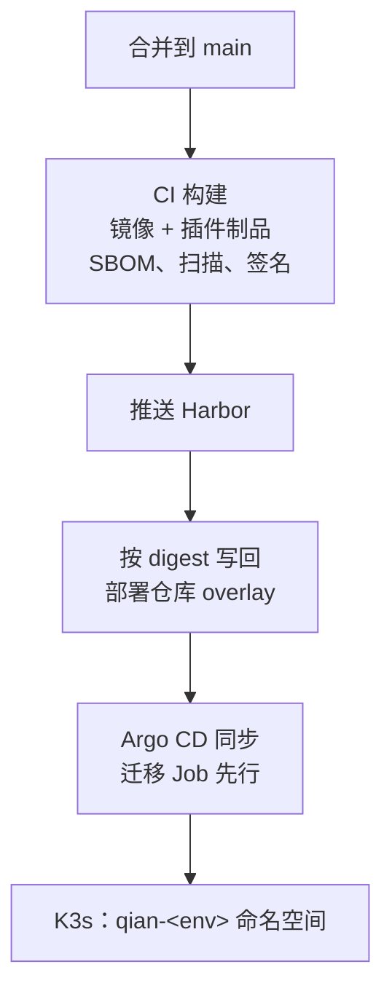

> For AI agents: the complete documentation index is available at /pr-preview/pr-181/llms.txt, the full documentation bundle is available at /pr-preview/pr-181/llms-full.txt.

# GitOps 部署

要点（[ADR-017](/pr-preview/pr-181/design/adr/adr-017-deployment.md)）：

- **三层与 app-of-apps**：沿用现有部署仓库的 L0 / L1 / L2 分层与 Argo CD app-of-apps；环境差异只放 overlay。
- **只认 digest**：发布事件不可变，清单按 digest 引用镜像与插件制品，禁止 `:latest`。
- **插件制品**：第二类制品「插件包」以 OCI artifact 推 Harbor，带文件摘要清单、SBOM 与 cosign 签名，走同一条发布链路。
- **命名空间与依赖**：Qian 用独立的 `qian-<env>` 命名空间与专属 PostgreSQL 16 / Redis 7；L1 新增 Apollo（含 MySQL）与 RabbitMQ。
- **治理**：业务命名空间 default-deny NetworkPolicy（出口规则由插件清单生成）、ResourceQuota / LimitRange、K3s 打开 secrets 加密。
- **多租户拓扑**：默认共享命名空间与 Pod，数据按 `tenant_id` / RLS 隔离；高隔离租户独立命名空间与独立 PG / Redis；不以每租户一个命名空间为默认。
