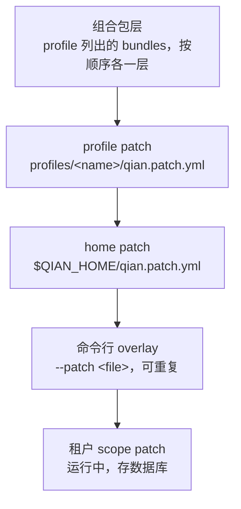

> For AI agents: the complete documentation index is available at /pr-preview/pr-181/llms.txt, the full documentation bundle is available at /pr-preview/pr-181/llms-full.txt.

# profile 与 patch

**profile** 是具名组装：`profiles/<name>/qian.profile.yml` 列出组合包、自己的 patch 与热重载开关，是可部署单元。**patch** 是按 `(scope, id)` 定位条目、替换其整个 `config`、禁用它或插入新条目的一条记录。一个环境 = 一个 profile + 若干层 patch。

## 叠加顺序

运行中的 Qian 是一棵插件树，启动时按序叠加，后层覆盖前层：



- 条目身份是 `(scope, id)`；后层同身份的记录**替换整个 `config`**，不做深合并，所以 `qian dump-config` 打印的任何条目都能原样复制成一条 patch。
- 后层给出 `plugin` 时替换组件（换 Provider），省略则沿用。
- `disabled: true` 让条目从树中移除，更后的层可以再 `disabled: false`。

## 一份 patch

patch 文件是条目数组。下面摘自规格 §7.4 的示例：全局 `files` 条目换成 OSS，再给租户 `t-001` 挂一条独立的 S3 条目，在该租户 scope 内遮蔽全局项。

```yaml
- id: files
  config:
    storage: { kind: oss, bucket: qian-prod, endpoint: "https://oss-cn-hangzhou.example.internal",
               accessKey: "secretRef://platform/oss/access-key", secretKey: "secretRef://platform/oss/secret-key" }
  note: 生产用 OSS
- id: files
  scope: tenant:t-001
  plugin: qian.files
  config:
    storage: { kind: s3, bucket: t-001-files, endpoint: "https://s3.example.internal",
               accessKey: "secretRef://tenant/t-001/s3/access-key", secretKey: "secretRef://tenant/t-001/s3/secret-key" }
  note: 租户 t-001 要求数据落自己的桶
```

密钥只以 `secretRef://` 出现，见 [密钥](/pr-preview/pr-181/ops/secrets.md)。

## 看最终结果

```bash
qian dump-config --profile standalone
```

打印层叠后的整棵插件树，每条记录带来源层。字段参考见 [profile、组合包与 patch](/pr-preview/pr-181/cli/profile-patch.md)。
