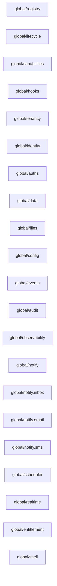

> For AI agents: the complete documentation index is available at /pr-preview/pr-202/llms.txt, the full documentation bundle is available at /pr-preview/pr-202/llms-full.txt.

# 模块图

> 本页由构建脚本镜像自仓库 [`docs/generated/module-graph.md`](https://github.com/idadawn/qian/blob/main/docs/generated/module-graph.md)，请修改源文件，不要改本页。

由 `qian docs generate` 派生；profile：`platform`。请修改输入后重新生成。

这是经过依赖校验的静态挂载计划，不是运行实例的就绪状态。

| 条目                     | 组件                                | 来源层       | 状态       |
| ---------------------- | --------------------------------- | --------- | -------- |
| `global/registry`      | `qian.registry@1.0.0`             | 0（bundle） | 配置骨架     |
| `global/lifecycle`     | `qian.lifecycle@1.0.0`            | 0（bundle） | 配置骨架     |
| `global/capabilities`  | `qian.capabilities@1.0.0`         | 0（bundle） | 配置骨架     |
| `global/hooks`         | `qian.hooks@1.0.0`                | 0（bundle） | 配置骨架     |
| `global/tenancy`       | `qian.tenancy@1.0.0`              | 0（bundle） | 配置骨架     |
| `global/identity`      | `qian.identity.client@1.0.0`      | 0（bundle） | 配置骨架     |
| `global/authz`         | `qian.authz@1.0.0`                | 0（bundle） | 配置骨架     |
| `global/data`          | `qian.data@1.0.0`                 | 0（bundle） | 已解析，尚未执行 |
| `global/files`         | `qian.files@1.0.0`                | 0（bundle） | 配置骨架     |
| `global/config`        | `qian.config.apollo@1.0.0`        | 0（bundle） | 配置骨架     |
| `global/events`        | `qian.events@1.0.0`               | 0（bundle） | 配置骨架     |
| `global/audit`         | `qian.audit@1.0.0`                | 0（bundle） | 配置骨架     |
| `global/observability` | `qian.observability@1.0.0`        | 0（bundle） | 配置骨架     |
| `global/notify`        | `qian.notify@1.0.0`               | 0（bundle） | 配置骨架     |
| `global/notify.inbox`  | `qian.notify.channel.inbox@1.0.0` | 0（bundle） | 配置骨架     |
| `global/notify.email`  | `qian.notify.channel.email@1.0.0` | 0（bundle） | 配置骨架     |
| `global/notify.sms`    | `qian.notify.channel.sms@1.0.0`   | 0（bundle） | 配置骨架     |
| `global/scheduler`     | `qian.scheduler@1.0.0`            | 0（bundle） | 配置骨架     |
| `global/realtime`      | `qian.realtime@1.0.0`             | 0（bundle） | 配置骨架     |
| `global/entitlement`   | `qian.entitlement@1.0.0`          | 0（bundle） | 配置骨架     |
| `global/shell`         | `qian.shell@1.0.0`                | 1（bundle） | 配置骨架     |

挂载顺序：`global/registry` → `global/lifecycle` → `global/capabilities` → `global/hooks` → `global/tenancy` → `global/identity` → `global/authz` → `global/data` → `global/files` → `global/config` → `global/events` → `global/audit` → `global/observability` → `global/notify` → `global/notify.inbox` → `global/notify.email` → `global/notify.sms` → `global/scheduler` → `global/realtime` → `global/entitlement` → `global/shell`

