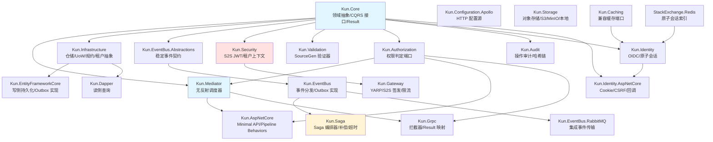

> For AI agents: the complete documentation index is available at /pr-preview/pr-202/llms.txt, the full documentation bundle is available at /pr-preview/pr-202/llms-full.txt.

# 模块地图

:::info 镜像页
本页镜像自 kun 仓库 [`docs/architecture/module-map.md`](https://github.com/idadawn/kun/blob/v2026.10.14/docs/architecture/module-map.md)（`v2026.10.14`）。Kun 文档与代码不一致处以代码为准（[ADR-001 D1.8](/pr-preview/pr-202/design/adr/adr-001-kun-relationship.md)）；Qian 对 Kun 的选用与约束见[与 Qian 的关系](/pr-preview/pr-202/sdk/kun/with-qian.md)。改动请提到 kun 仓库。
:::

> **Version**：`0.1.0-phase1`（2026-04-23 发布）。模块清单、主要 API、AOT 状态与测试用例数以该 tag 为准。
> 任何下游仓库（`neuroagent-csharp` 等）对 `Kun.*` 的消费都应以本表为 SoT（Single Source of Truth）。

## Phase 1 模块矩阵

图例：AOT 状态 ✅=IsAotCandidate=true（CI `aot-audit` 每次 publish 强制零 trim/AOT warning）；⚠️=trim-safe 但非 AOT（见 `docs/architecture/AOT-audit-2026-04-23.md`）。

### Core 层

| 模块         | 职责                                                                                                              | Phase 1 下游用途                                     | 主要 API                                                           | AOT |  测试 |
| ---------- | --------------------------------------------------------------------------------------------------------------- | ------------------------------------------------ | ---------------------------------------------------------------- | :-: | :-: |
| `Kun.Core` | 领域抽象（AggregateRoot / ValueObject / DomainEvent / Result / Error）、`ITenantContext`、`ICurrentUser`、`ISystemClock` | 所有 `Kun.*` 的编译期零依赖基底；NeuroAgent 的 DDD 建模直接使用这些类型 | `AggregateRoot<TKey>` / `Result<T>` / `Error` / `ITenantContext` |  ✅  |  34 |

### 分发与校验（Abstraction 层）

| 模块                   | 职责                                                   | Phase 1 下游用途             | 主要 API                                                    | AOT |  测试 |
| -------------------- | ---------------------------------------------------- | ------------------------ | --------------------------------------------------------- | :-: | :-: |
| `Kun.Mediator`       | `FrozenDictionary` 无反射 CQRS 调度器 + Pipeline Behaviors | 所有业务 Command/Query 的执行入口 | `AddKunMediator(builder => …)` / `ISender` / `IPublisher` |  ✅  |  8  |
| `Kun.Validation`     | `IValidator<T>` + `ValidationPipelineBehavior`       | 命令入口的统一校验                | `AddValidator<T, TValidator>()`                           |  ✅  |  12 |
| `Kun.Infrastructure` | 仓储 / UoW / 规约 / `IProcessedMessageStore` 抽象          | 持久化层契约，真实实现下沉到 EF 侧      | `IRepository<T>` / `IUnitOfWork` / `ISpecification<T>`    |  ✅  |  —  |
| `Kun.Configuration`  | 强类型 Options + DataAnnotations + fail-fast            | NeuroAgent 所有服务的配置装配     | `AddKunOptions<T>()`                                      |  ✅  |  13 |

### 平台端口增量（2026-10-09）

| 模块                         | 职责                     | 主要 API                                                      | AOT        |
| -------------------------- | ---------------------- | ----------------------------------------------------------- | ---------- |
| `Kun.Authorization`        | 权限判定、数据谓词与字段策略端口，无权限引擎 | `IPermissionChecker`、`IDataPermissionFilter`、`IFieldPolicy` | true，CI 验证 |
| `Kun.Configuration.Apollo` | HTTP 配置源、长轮询、签名和缓存     | `AddApollo`、`ApolloOptions`                                 | true，CI 验证 |

Mediator、ASP.NET Core 和 gRPC 增加对 Authorization 的依赖；具体语义与迁移见 [ADR-016](/pr-preview/pr-202/sdk/kun/architecture/adr-016-platform-ports.md)。历史 Phase 1 表保留为原始版本快照。

### 持久化（Infrastructure 层）

| 模块                        | 职责                                                  | Phase 1 下游用途             | 主要 API                                         |      AOT     |  测试 |
| ------------------------- | --------------------------------------------------- | ------------------------ | ---------------------------------------------- | :----------: | :-: |
| `Kun.EntityFrameworkCore` | 写侧 EF Core 实现 + `KunDbContext` + Outbox 落库 + 多租户过滤器 | 所有业务写路径；事务边界与 Outbox 同事务 | `AddKunEntityFrameworkCore()` / `KunDbContext` | ⚠️ trim-safe |  —  |
| `Kun.Dapper`              | 读侧 Dapper AOT 薄包                                    | 查询 handler 的连接池 + 分页模型   | `IReadDbConnectionFactory` / `PagedResult<T>`  | ⚠️ trim-safe |  6  |

### 事件与编排

| 模块                          | 职责                                         | Phase 1 下游用途                  | 主要 API                                                            |      AOT     |  测试 |
| --------------------------- | ------------------------------------------ | ----------------------------- | ----------------------------------------------------------------- | :----------: | :-: |
| `Kun.EventBus.Abstractions` | 稳定事件标记、注册与查询端口                             | 只声明事件的契约包                     | `IEventTypeRegistrar` / `IIntegrationEvent`                       |       ✅      |  3  |
| `Kun.EventBus`              | 集成事件 / Outbox 抽象 + 后台发布器 + 消费端幂等           | 跨服务发布/消费 `*.IntegrationEvent` | `AddKunEventBus(eb => eb.Register<T>("id.v1"))` / `IOutboxWriter` |       ✅      |  21 |
| `Kun.EventBus.RabbitMQ`     | RabbitMQ broker 适配 + 消费者 + DLQ             | NeuroAgent 各服务间事件总线的默认 broker | `AddRabbitMq(...)` / `.Subscribe<TEvent, THandler>()`             |       ✅      |  —  |
| `Kun.Saga`                  | Saga Orchestration（步骤 / 反向补偿 / 超时 / 实例持久化） | 跨服务长事务（下单-支付-发货）              | `AddKunSaga()` / `ISagaStep<TContext>`                            | ⚠️ trim-safe |  18 |

> **Kun.Saga Phase 1 为 `IsAotCandidate=false`**：其 `Persistence/Ef/` 透传 EF Core 的 IL2091/IL2060/IL2026。Phase 2 有计划拆分 `Kun.Saga.EntityFrameworkCore`（见 AOT 审计报告 §RED 与跟进编号 `P2-KN-Saga-EF-Split`）。

### 宿主与通信（Host 层）

| 模块               | 职责                                                 | Phase 1 下游用途                                    | 主要 API                                           |      AOT     |  测试 |
| ---------------- | -------------------------------------------------- | ----------------------------------------------- | ------------------------------------------------ | :----------: | :-: |
| `Kun.AspNetCore` | Minimal API 扩展 / `MapCommand` / `MapQuery` / 异常处理器 | NeuroAgent 对外 HTTP 路由                           | `AddKunAspNetCore()` / `MapCommand<TReq, TResp>` | ⚠️ trim-safe |  5  |
| `Kun.Grpc`       | gRPC 拦截器链（Tracing → Auth → Result 映射）              | NeuroAgent 内部 RPC；Catalog / Order gRPC endpoint | `AddKunGrpc()` / `KunResultToRpcInterceptor`     |       ✅      |  7  |
| `Kun.Gateway`    | YARP + 外部 JWT 校验 + S2S JWT 签发 + JWKS endpoint + 限流 | 统一边界：外部 JWT 验证 + 内部 S2S JWT 签发                  | `AddKunGateway()` / `MapKunJwks()`               |       ✅      |  21 |

### 安全、多租户、审计

| 模块                                     | 职责                                                           | Phase 1 下游用途                   | 主要 API                                               |      AOT     |  测试 |
| -------------------------------------- | ------------------------------------------------------------ | ------------------------------ | ---------------------------------------------------- | :----------: | :-: |
| `Kun.Security`                         | S2S JWT 校验 / JWKS 热加载 / `ITenantContext` / `ICurrentUser` 实现 | 每个下游服务都必须装配，验证网关签发的内部 token    | `AddKunSecurity()` / `AddKunServiceAuthentication()` |       ✅      |  15 |
| `Kun.Identity`                         | 外部 IdP（OIDC）客户端、JWT 校验与原子会话；**不**自建用户存储                      | 账号和凭据由身份权威提供，Kun 负责依赖方校验与会话    | `AddKunIdentity(...)`                                |       ✅      |  11 |
| `Kun.MultiTenancy`                     | `ITenantContext` 实现 + EF 查询过滤器 + SaveChanges 拦截器             | 所有租户隔离业务的透明过滤                  | `AddKunMultiTenancy()` / `UseKunMultiTenancy()`      |       ✅      |  12 |
| `Kun.MultiTenancy.EntityFrameworkCore` | EF 侧租户过滤器 + `HasTenantFilter<T>()` 扩展                        | 与 `Kun.MultiTenancy` 配套的 EF 实现 | `HasTenantFilter<T>()`                               | ⚠️ trim-safe |  —  |
| `Kun.Audit`                            | 审计写入器抽象 + `NullAuditWriter` / `EventBusAuditWriter`          | NeuroAgent 操作审计；通过 Outbox 异步记录 | `AddKunAudit()` / `.UseEventBus()`                   |       ✅      |  13 |
| `Kun.Audit.EntityFrameworkCore`        | EF 持久化后端                                                     | 需要审计 on-box 持久化时的可选后端          | `AddKunAuditEntityFrameworkCore()`                   | ⚠️ trim-safe |  —  |
| `Kun.RateLimit`                        | 基于 `.NET 10 RateLimiter` 的按租户分区限流                            | Gateway 与业务服务的请求级别保护           | `AddKunRateLimit(...)`                               |       ✅      |  6  |

### 缓存 / 存储 / 观测 / Sandbox

| 模块                  | 职责                                                                                                                     | Phase 1 下游用途                                   | 主要 API                                                            | AOT |  测试 |
| ------------------- | ---------------------------------------------------------------------------------------------------------------------- | ---------------------------------------------- | ----------------------------------------------------------------- | :-: | :-: |
| `Kun.Caching`       | `IKunCache` 抽象 + `MemoryCache` / `StackExchange.Redis` 后端                                                              | NeuroAgent 的热数据缓存（租户映射、Feature flag、Prompt 模板） | `AddKunCaching(c => c.UseMemory() / .UseRedis(…))`                |  ✅  |  12 |
| `Kun.Storage`       | 7-method `IFileStorage` 契约 + 本地磁盘 / S3 两个实现                                                                            | NeuroAgent 的文件工件（上传附件、agent 输出、sandbox 产物）     | `AddKunStorage().UseLocal(...)` / `.UseS3(...)`                   |  ✅  |  23 |
| `Kun.Observability` | 统一 OTel traces + metrics + logs + 预注册全部 Kun ActivitySource                                                             | 所有下游服务用一行装配可观测性                                | `AddKunObservability("service-name")`                             |  ✅  |  5  |
| `Kun.Sandbox`       | E2B v2 兼容 sandbox 抽象 + `SupervisorSandboxProvider` / `E2BCloudSandboxProvider`（Phase 2+ 占位）/ `InMemorySandboxProvider` | NeuroAgent agent 侧沙箱执行 LLM 产出的代码               | `AddKunSandbox(o => o.UseSupervisor / UseE2BCloud / UseInMemory)` |  ✅  |  27 |

> **测试列的口径**：统计每个 `tests/Kun.*.Tests` 项目下标记为 `[Fact]` / `[Theory]` 的测试方法数（`grep -c '\[Fact\b\|\[Theory\b'`）。这是"测试用例数"的近似值，不是行覆盖率；行覆盖率请看 CI `coverage.cobertura.xml` 构建产物。单元格内 `—` 表示该模块暂无 `*.Tests` 项目（`Kun.Infrastructure` / `Kun.EntityFrameworkCore` / `Kun.EventBus.RabbitMQ` / `Kun.Audit.EntityFrameworkCore` / `Kun.MultiTenancy.EntityFrameworkCore` — 它们的覆盖由 `Kun.IntegrationTests` / 邻近模块的测试间接覆盖）。

### 非 AOT 白名单（`IsAotCandidate=false`，有明确原因）

| 模块                                     | 原因                                                                              |
| -------------------------------------- | ------------------------------------------------------------------------------- |
| `Kun.AspNetCore`                       | Minimal API 泛型帮手（`MapCommand<T,R>`）+ `WriteAsJsonAsync<T>` 不兼容 AOT；trim-safe 即可 |
| `Kun.Dapper`                           | 薄包装；真正的 AOT 读侧由消费侧 `[DapperAot]` handler 负责                                     |
| `Kun.EntityFrameworkCore`              | `DbContext.Set<T>()` / `MakeGenericMethod` / 非 typed JSON 序列化                   |
| `Kun.Audit.EntityFrameworkCore`        | 透传 EF Core                                                                      |
| `Kun.MultiTenancy.EntityFrameworkCore` | 全局查询过滤器使用 `Expression.Property` / `Expression.Lambda`                           |
| `Kun.Saga`                             | `Persistence/Ef/` 透传 EF Core；Phase 2 跟进拆分                                       |

## 依赖关系图



## 分层规则

```
┌─────────────────────────────────────────────────────────┐
│  Host Layer                                             │
│  Kun.AspNetCore / Kun.Grpc / Kun.Gateway                │
├─────────────────────────────────────────────────────────┤
│  Infrastructure Layer                                   │
│  Kun.EntityFrameworkCore / Kun.Dapper                   │
│  Kun.EventBus.RabbitMQ / Kun.Saga / Kun.Storage         │
├─────────────────────────────────────────────────────────┤
│  Abstraction Layer                                      │
│  Kun.Mediator / Kun.Infrastructure                      │
│  Kun.EventBus / Kun.Security / Kun.Validation / Kun.Audit│
├─────────────────────────────────────────────────────────┤
│  Core Layer                                             │
│  Kun.Core (zero dependencies)                           │
└─────────────────────────────────────────────────────────┘
```

## 典型请求调用路径（HTTP → DB → 事件）

```
HTTP Request
    │
    ▼
Kun.Gateway                      [签发 S2S JWT]
    │
    ▼
Kun.AspNetCore / Minimal API     [校验 S2S JWT / 注入 ITenantContext]
    │
    ▼
Kun.Mediator.Send(Command)       [Pipeline: Logging → Validation → Auth → Handler]
    │
    ▼
Command Handler                  [纯 C#，依赖 IRepository<T>]
    │
    ▼
Kun.EntityFrameworkCore          [聚合根 + Outbox 同事务落库]
    │
    ▼
PostgreSQL                       [SaveChanges = 原子事务]
    │
    ▼
Kun.EventBus OutboxPublisher     [扫描 pending 消息 → RabbitMQ]
    │
    ▼
Kun.EventBus.RabbitMQ            [传递 W3C Trace Context]
    │
    ▼
下游服务消费端                    [IdempotentConsumerDecorator → Handler]
```

## 典型查询路径（HTTP → DB 只读）

```
HTTP Request
    │
    ▼
Kun.AspNetCore / Minimal API
    │
    ▼
Kun.Mediator.Send(Query)
    │
    ▼
Query Handler
    │
    ▼
Kun.Dapper (读侧连接)            [AOT 源生成的映射代码]
    │
    ▼
PostgreSQL (只读副本 / 读库)
```

## Saga 路径（跨服务长事务）

```
Command Handler
    │
    ▼ StartSagaAsync(ctx)
    │
Kun.Saga Orchestrator            [持久化 SagaInstance + 首步入队]
    │                               (与业务同事务)
    ▼
Outbox (step message)
    │
    ▼
SagaStepExecutor (BackgroundService)
    │
    ▼  step.ExecuteAsync()
    │
远程服务 / 本地 Handler
    │
    ▼  成功 → 下一步                  失败 → CompensateAsync (反向)
```
